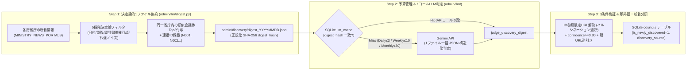

# PMHub 改善・機能実装（Drop）マスタードキュメント (DROPS.md)

> **最終更新**: 2026-10-25  
> **実装済最新 Drop**: **Drop 90**（2026-10-25 完了）  
> **次回着手予定 Drop**: **Drop 91**  
> 
> 本ドキュメントは、PMHub の継続的改善ロードマップおよび実装記録を一元管理するマスタードキュメントです。  
> 今後の構想テーマは **「Track（トラック）」** として管理し、着手・個別実装単位は最新連番を付与した **「Drop（ドロップ）」** として連番アーカイブします。  
> 
> **【運用指針】**  
> 1. **Implementation Plan 作成時**: 新機能開発・Drop 提案時は、`implementation_plan.md` の提示と連動して本ドキュメントに対象 Drop / Track の背景・課題・技術仕様および進行ステータス（計画中）を反映。  
> 2. **main マージ時**: `main` ブランチへのマージ後は、到達された数値指標（成果）、ステータス（【完了】）、および構想の更新を反映して本ドキュメントを直ちに最新化。

---

## 1. 今後の改善・開発構想（Tracks ロードマップ）

### 1-1. Track一覧（未着手・進行中）

| Track ID | 構想テーマ | 主な対象・内容 | 到達目標・期待効果 | ステータス |
|:---:|:---|:---|:---:|:---:|
| **Track [Intermediate-Norm]** | **各府省庁の中間HTML配付資料排除 & 末端PDF・HTML一括展開・重複案内ノイズ一掃** | **【全9フェーズ完遂・全省庁完全網羅】税調13・内閣官房2・財務省15・金融/厚労10・FSC 23・経産省80・農水/林野/国交17・原子力規制委11・総務/文化/文科26・内閣府/官房/デジタル庁/法務/外務/他残余64会議体（累計256会議体・末端PDF 13,299件展開・中間HTML完全根絶・全府省庁100%達成）（Drop 82b〜90）**<br>中間HTMLリンク（「会議資料」等）や重複案内ノイズ・UIリンクを全省庁で完全根絶し、単体U23 & 統合ケース5（累計256会議体）で恒久防御 | **中間HTML配付資料の全省庁完全根絶 & 直接末端資料閲覧・保存（PMM連携）保証** | **【完了】**<br>（全9フェーズ完遂・全省庁網羅完了） |
| **Track [LLM-Assist]** | **決定論的1ファイル新着ダイジェスト & LLM判定・クロール階層型フォールバック** | **【フェーズ 1】ディスカバリー 1ファイル集約・単一リクエストLLM判定 & 新着分類永続化（Drop 81 完了）**<br>**【フェーズ 2】開催回クロール 3段階ファネル・異常検知フォールバック & バッチLLM抽出**<br>API呼出上限（Daily 3回 / Weekly 10回 / Monthly 30回）とSQLite `llm_cache`（SHA-256ダイジェストキャッシュ）により、最小APIコールで新規会議体検知と0件以外を含むクロール欠落補完を実現 | **最小APIコールでの新規会議体検知 & クロール補完** | **【進行中】**<br>（フェーズ 1: Drop 81 完了 / フェーズ 2 構想中） |
| **Track [Automation]** | **定時巡回クローラー & ローカルDB同期**<br>(GitHub Actions 連携) | **3階層マルチスケジュール定期実行・異常検知時Skip・ローカルDB自動同期**<br>1. Daily (平朝): 省庁新着検知のみ<br>2. Weekly (土曜): 通常巡回（直近2年重点）<br>3. Monthly (第1日曜): 全期間包括走査<br>連鎖失敗・重大エラー検知時のIssue発行＆次回以降Skip機能、Zero-Storage VM運用、ローカル環境への安全な同期エンジン（`sync_from_json.py` + post-merge hook）の配備 | **定期自動巡回・省力化 & ローカル資産整合性担保** | **【構想中】**<br>（Drop 82 以降） |
| **Track [Search]**<br>(フェーズ 3) | **全文検索エンジン統合**<br>(PMM資産連携 FTS5構築) | **【フェーズ 3】PMM ローカルPDF資産を活用した全文検索エンジンの構築**<br>`admin/pmm/text_extractor.py` によるPDF本文抽出、SQLite FTS5 仮想テーブル（`fts_materials`）への trigram インデックス構築、サーバー検索API（`/api/search?q=キーワード`）およびフロントエンド検索UI・抜粋ハイライトの実装 | **約11万件の政策資料PDF本文横断検索の実現** | **【構想中】**<br>（Track [Database] 完了後着手） |
| **Track [Portal-Norm]** | **省庁ポータル一覧・目次URL正常化**<br>(傘下会議体の個別化・パース規則最適化) | **省庁組織・目次・一覧ポータル設定会議体の個別会議体分離・スクレイピング最適化**<br>文化庁・消防庁・文科省等、親ポータルURLが設定されたまま個別開催回が未分離の会議体について、組織ツリーを辿り個別会議体（または開催回）へと正常化する包括的施策 | **Failed会議体の根絶 & 網羅的開催回収集** | **【進行中】**<br>（Drop 79 で着手開始、継続推進） |
| **Track [Architecture]** | **設計刷新構想**<br>(モジュール責務分離) | **リファクタリング領域E: クローラー本体（crawler.py）の責務分離 & scratch/ クリーンアップ**<br>巨大化したクローラー（約2,900行）を HTTP通信・パース・DB保存・エクスポート等にモジュール分割し、保守性を劇的に向上。蓄積した `scratch/` スクリプトの完全整理・アーカイブ | **単体テスト容易性向上 & コード肥大化の解消** | **【構想中】** |
| **Track [Optimization]** | **配信最適化構想**<br>(公開データ軽量化) | **リファクタリング領域D: クローラー設定分離 & 公開JSONの minified 化による通信量最適化**<br>公開用静的サイトの配信効率向上のため、公開用 JSON の minified 化および通信量圧縮 | **初回ページロード高速化 & 帯域削減** | **【構想中】** |
| **Track [Policy-AI]** | **政策分析連携構想**<br>(知見創出・AI連携) | **省庁横断テーマ連携 & AI 審議要約・タイムライン比較**<br>各省庁に分散する同一政策テーマ（GX、AI、少子化等）の会議体を横断的に可視化し、AIによる要約や論点対比を提供する高度分析機能 | **政策横断的インサイトの創出** | **【長期構想】** |


### 1-2. 各Trackの詳細


#### 【Track: Intermediate-Norm】各府省庁の中間HTML配付資料排除 & 末端PDF・HTML一括展開・重複案内ノイズ一掃・恒久再発防止ガード

- **背景と課題**:
  1. 行政機関のWebサイト（特に過去のアーカイブや複数回次をまとめたページ）では、各開催回の配付資料として末端のPDFや個別ドキュメントではなく、「会議資料」「配付資料一覧」「提出資料 (HTML)」といった中間案内・目次ページ（HTML）のURLが登録されてしまうケースが散見されていた。
  2. これらの中間HTMLリンクが混入していると、ユーザーが直接資料を閲覧できないだけでなく、ローカル資料管理（PMM）での自動ダウンロードや全文検索（FTS5）の対象外となり、データ品質が損なわれる。
  3. また、同一開催回内に「開催案内」「開催通知」といった開催前の告知リンクが重複混入し、実質的な配付資料リストのノイズとなっていた。
  4. 2000年代初頭の厚生労働省資料のように、PDF普及以前に各資料が `sXXXX-Ya.html` などの個別HTMLページとして作成されていた場合、単純なPDF抽出では資料0件となるため、当時の構造に応じたスマート展開が必要であった。
- **目標仕様とフェーズ構成**:
  - **フェーズ 1〜4（Drop 82b, 83, 84, 85 にて実装完了・計40会議体）**:
    1. **税制調査会系列 13会議体（Drop 82b, 83 完了）**: 納税環境整備専門家会合等の配付資料に混入していた中間HTMLリンクを一掃し、末端PDFへ展開。単体テスト U23（`test_drop80_intermediate_material_guard.py`）を新設。
    2. **内閣官房 2会議体（Drop 83 完了）**: 国家戦略特区諮問会議（69回）および女性が輝く社会づくり本部（16回）の中間資料ページを末端PDF（1,429件）へ一括展開。
    3. **財務省 15会議体（Drop 84 完了）**: 財政制度等審議会系列・関税分科会等の中間資料ページ（320件）を末端PDF（1,019件純増）へ一括展開。CJK部首補助 `0x2ed1`（`⻑`）の正規化。
    4. **金融庁・厚生労働省 10会議体（Drop 85 完了）**: 金融トラブル連絡調整協議会（67回）、年金資金運用分科会（28回）等の中間ページ（103件）を末端PDF・個別資料HTML（749件）へ展開。重複開催案内ノイズ（441件）を完全一掃。
    5. **再発防止ガードの配備**: 単体テスト U23 および統合テスト ケース5（`test_no_duplicate_meetings.py`）に `intermediate_guard_councils` を新設・拡大し、適正化済み40会議体への中間HTML混入を恒久遮断。
  - **フェーズ 5〜9（Drop 86 〜 Drop 90: 全府省庁完全適正化ロードマップ）**:
    残存する中間HTML配付資料（計 4,857件 / 160会議体）の実態調査に基づき、省庁ごとのWebサイト特性（CMSテンプレート・ドメイン構造）に応じた全9フェーズでの完全完了計画を策定：
    1. **フェーズ 5（Drop 86 完了）: 食品安全委員会（FSC 23会議体）& 経済産業省グループ（METI/ANRE/SMEA 80会議体、計103会議体）**:
       - FSC の実質PDF直接ダウンロードリンク特性（99.9%）を解明し、誤登録トップページリンク（1件）排除および全2,162件のサイズ表記クレンジングを実施。
       - 真の中間HTML最多集中先であった経済産業省グループ（80会議体・763件）を Headless Edge CDP デュアルWAF解決＋チャンク自動再起動アーキテクチャにより完全走破し、中間HTML 763件を全件削除、末端PDF 4,663件を一括登録、開催回 `officialUrl` 749件を適正化。
    2. **フェーズ 6（Drop 87 完了）: 農林水産省（MAFF） & 林野庁（RINYA） & 国土交通省（MLIT）グループ（計17会議体）**:
       - 会議体トップポータルから誤生成され、飼料分科会等の全過去リンクを重複保持していたジェネリックゴミ会議体 `maff-2236`（審議会、重複開催回4件・配付資料893件）を安全にパージ・除外（`rejected_councils`）。
       - 企画部会（`maff-659`）、動物用医薬品等部会（`maff-656`）、農地流動化検討会（`maff-704`）、自転車活用推進本部（`mlit-meeting`）等の中間HTML 70件から真の末端PDF・ファイル 241件を展開・登録、開催回 `officialUrl` 33件を個別ページへ適正化。国交省404リンク（1件）およびトップページ誤リンク（1件）を排除。再発防止ガード対象を累計160会議体へ拡大。
    3. **フェーズ 7（Drop 88 完了）: 原子力規制委員会（NRA）の適正化（11会議体・927件）**:
       - デジタルアーカイブ上のビュアーURL（`https://www.da.nra.go.jp/view/...contents=...`）から、直接末端PDFエンドポイント `https://www.da.nra.go.jp/data/{contents_id}.pdf` への1対1直接アクセスURLを解明し、923件を一括置換（全件 200 OK & `%PDF` バイナリ確認済）。詳細ページ・目次誤リンク（4件）を排除、ファイルサイズ表記ノイズを完全クレンジング。再発防止ガード対象を累計171会議体へ拡大。
    4. **フェーズ 8（Drop 89 完了）: 総務省（MIC） & 文化庁（ACA） & 文部科学省（MEXT）系列（計26会議体）**:
       - 総務省統計委員会等の複数資料格納中間HTML（193 URLs）および文化庁ディレクトリ型中間ページ（15 URLs）から末端PDF 2,521件を一括展開・登録し、元の中間HTML 235件を排除。
       - 「開催状況一覧を見る」等の誤登録目次リンク（33 URLs・36件）を完全排除。
       - 総務省サーバー側で欠損していた 404 死にリンク（18件）を安全に排除。
       - 本文完結型HTML資料（議事録・要旨・国会図書館WARPアーカイブ等 計約802件）を正規保全。
       - 再発防止ガード対象を累計 197 会議体へ拡大。
    5. **フェーズ 9（Drop 90 完了）: 内閣官房・内閣府・デジタル庁・法務省・外務省・他残余全省庁（計64会議体・【全府省庁完全網羅・完遂】）**:
       - 内閣官房（原子力閣僚会議、クマ被害、知財等）、内閣府（CSTP、宇宙政策、PFI事業、コンテンツ官民協議会、新しい公共等）、外務省、法務省、厚労省等の中間HTML 171件から末端PDF 678件を展開・登録し、元の中間HTML 171件を完全排除。
       - UIノイズ（「ご意見・ご感想」「English」「検索の使い方」「動画」等）およびポータル目次リンク 133件を配付資料から完全排除。
       - 金融庁サーバー側 404 死にリンク 1件を排除。
       - 本フェーズにより、全 1,702 会議体における**中間HTML配付資料ゼロ（全府省庁完全網羅）を達成**し、Track [Intermediate-Norm] を完全完遂。再発防止ガード（単体U23/統合ケース5）を累計 256 会議体へ拡大・完備。

---

#### 【Track: LLM-Assist】決定論的1ファイル新着ダイジェスト & LLM判定・クロール階層型フォールバック

- **背景と課題**:
  1. 従来、`crawlerConfig.llm_mode` は開催回クロール（`admin/crawler.py`）でルール抽出が 0 件だった会議体にのみ適用され、新規会議体ディスカバリー（`admin/discover_councils.py`）には一切適用されていなかった。
  2. 新規検出された会議体が SQLite DB（`councils` テーブル）へのシード・エクスポート時に `isNewlyDiscovered: true` を保持しておらず、さらに次回クロール開始時に一律リセットされていたため、公開ポータルの「新着」フィルタに分類されない問題があった。
  3. 省庁ごと・ページごとに個別 LLM API コールを行う方式では 429 Quota エラーや実行時間増大を招くため、決定論的 1 ファイル集約と厳格な呼び出し上限管理が不可欠であった。
- **フェーズ構成と目標仕様**:
  - **フェーズ 1（Drop 81 にて実装完了）**:
    1. **新規発見会議体の「新着」分類永続化**: `councils` テーブルに `is_newly_discovered`, `discovered_at`, `discovery_source` (`'rule' | 'llm' | 'both'`) を新設し、前回クロール時刻より後に発見された会議体の新着フラグを保護。
    2. **決定論的 1ファイル新着ダイジェスト生成 (`admin/llm/digest.py`)**: 全府省庁の新着情報を5段階決定論フィルタ（日付・重複・既登録会議体開催回・却下リスト・強ノイズ）で絞り込み、連番ID（`N001`〜）と同一省庁内の類似会議体Top3を付与して単一JSON（`admin/discovery/digest_YYYYMMDD.json`）と正規化 SHA-256 ハッシュを出力。
    3. **単一リクエスト LLM 判定 & ハルシネーション遮断 (`admin/llm/client.py`, `admin/llm/discovery_judge.py`)**: LLM には `item_id` のみ参照させ（URL出力禁止）、確信度 `>= 0.80`・ノイズ/既登録/却下再検証・親ページURL逆引きを経て即掲載（新着分類）。
    4. **呼び出し予算上限 & SQLite キャッシュ**: 1回あたり上限（`Daily: 3回 / Weekly: 10回 / Monthly: 30回`）と `llm_cache` テーブルによる同一ダイジェスト再送ゼロ化。
  - **フェーズ 2（次回以降構想）**:
    - 開催回クロールにおいて、ルール抽出結果が「0件」の場合だけでなく、「最新開催日が古いのにページ上位に新着日付がある」「複数開催回で配付資料が0件（PARTIAL）」「ジェネリックタイトル過多」の異常スコア会議体を検知し、簡潔な構造化DOMスニペットをバッチ化して1回のLLMリクエストで最大5〜8会議体を一括補完する階層型フォールバック機構。

---

#### 【Track: Automation】GitHub Actions 定時自動クロール & ローカルDB自律同期基盤

GitHub Actions を用いた定期巡回クロールを安全に運用し、リモートで更新された最新データをローカル開発環境の SQLite マスターDBへ非破壊で自律同期する CI/CD 運用基盤。

##### 1. 3層マルチスケジュール設計
サーバー負荷軽減および効率的運用の観点から、探索深度の異なる3種類のトリガーを実装：
1. **Daily (平日 06:00 JST / `cron: '0 21 * * 0-4'`) - 省庁新着検知のみ**:
   - `python admin/crawler.py --mode ministry_news --workers 4`
   - 各府省庁トップページ・新着案内（`MINISTRY_NEWS_PORTALS`）を巡回し、前日公表の新規開催回・資料のみを高速収集（約2分）。
2. **Weekly (土曜 03:00 JST / `cron: '0 18 * * 5'`) - 通常巡回（直近2年重点）**:
   - `python admin/crawler.py --workers 4 --recent-years 2`
   - 全アクティブ会議体を対象に、直近2年間の開催回・配付資料の更新確認・収集を実施（約15〜20分）。
3. **Monthly (第1日曜 01:00 JST / `cron: '0 16 1-7 * 0'`) - 全期間包括巡回**:
   - `python admin/crawler.py --workers 4 --recent-years 0`
   - 全会議体の全期間（過去十数年分）を包括的に総ざらいし、過去資料アーカイブの欠落を網羅補完（約45分）。

##### 2. 異常検知時自動Skip機能（サーキットブレーカー / キルスイッチ）
相手方省庁サーバーへの過負荷・アクセス拒絶（403/429）や、予期せぬスクレイピング構造変化に伴う連続エラーが発生した際、以降の自動巡回を安全に一時停止する保護機構：
- クローラー実行結果において、連続失敗（consecutive failures）が閾値（例: 5省庁以上）を超過した場合、または統合テストで重大エラーが検出された場合、GitHub CLI（`gh issue create`）経由で緊急アラート Issue（ラベル: `circuit-breaker-active`）を自動起票。
- ワークフローの先頭ステップで本 Issue の存在を確認し、オープン中の Issue がある場合は次回以降の自動実行を即時 **Skip**。
- 人間による確認・修正後に該当 Issue を Close することで、次回のスケジュールから自動的にクロールが安全に再開される。

##### 3. Zero-Storage VM アーキテクチャ（CI ランナー環境）
- CI ランナー起動時に `docs/data.json` および `admin/admin_data.json` から `python admin/db/seed_db.py` により即時 SQLite マスター（`admin/pmhub.db`）を復元（約0.7秒）。
- クロール完了後に `python admin/db/export_data.py` で 2系統 JSON へ同期し、統合テスト合格時のみ Git コミット（`[skip ci]`）および push を実行。

##### 4. GitHub Actions 更新情報のローカル側DB自律同期メカニズム
GitHub Actions で自動更新・push されたリモートの最新データ（`docs/data.json` / `admin/admin_data.json`）を、ローカルの開発環境の SQLite マスター（`admin/pmhub.db`）へ安全に取り込むための双方向・非破壊同期パイプライン：
- **差分同期エンジン (`admin/db/sync_from_json.py`)**:
  - `git pull` 後に実行され、JSON とローカル DB を比較。
  - **新規開催回・新規配付資料のみを INSERT** し、ローカル側で手動追加・修正された **`manualLock: true` のレコードは一切上書き・削除しない**。
  - 反映後に `PRAGMA foreign_key_check` および `PRAGMA integrity_check` を実行してトランザクションをコミット。
- **Git Post-Merge Hook による自動化 (`.githooks/post-merge`)**:
  - 開発者が `git pull origin main` を実行した際、`docs/data.json` または `admin/admin_data.json` に変更差分があれば自動で `sync_from_json.py` を呼び出して同期。
- **起動時タイムスタンプ整合性ガード**:
  - `admin/server.py` および `admin/crawler.py` の起動時、ローカルDBの最終更新日時と `docs/data.json` のタイムスタンプを比較し、古いローカルDBによる上書き先祖返りを未然に遮断。

---

#### 【Track: Search】フェーズ 3: PMM テキスト抽出 & FTS5 構築・全文検索 API 稼働

- **背景と課題**:
  政策会議ウォッチに登録されている配付資料（PDF/HTML等）は 11万件超に達しているが、現行の検索機能は会議体名・開催回名・資料名のタイトル部分一致にとどまり、「資料本文中に登場する特定の政策用語・法律名・議論箇所」を横断検索することができない。
- **技術仕様**:
  1. `admin/pmm/text_extractor.py` により、ローカル配付資料（`local_docs/`）から PDF 本文テキストをページ単位で抽出（PyMuPDF / pdfplumber 活用）。
  2. `admin/db/schema.sql` で定義済みの FTS5 仮想テーブル `fts_materials`（trigram トークナイザー）へページ単位で登録。
  3. `admin/server.py` に全文検索 API（`/api/search?q=キーワード`）を配備し、ハイライトスニペット・該当ページ番号を高速返却。
  4. フロントエンド（`docs/index.html` / `app.js`）に「資料本文検索」タブ・モーダルを新設。

---

#### 【Track: Portal-Norm】親ポータル一覧・目次URL設定 残存会議体の個別化・パース適正化

クロールステータスダッシュボードで失敗（Failed）となっていた会議体のうち、親組織一覧や特設ニュース一覧が設定されていた会議体について、Drop 79 において主要会議体（警察庁政策評価研究会 `npa-seisaku_hyoka_kenkyukai`、公務員共済組合分科会 `mof-1131`、除外3件等）の処置を完了。残存する親ポータル型会議体について、個別開催回・配付資料PDFの網羅的ワンストップ登録を順次推進する。

---

#### 【Track: Architecture】リファクタリング領域E: クローラー本体（crawler.py）の責務分離 & scratch/ クリーンアップ（構想）

- **背景と課題**:
  `admin/crawler.py`（約2,900行）に HTTP 通信・WAF 判定・HTML パース・日付抽出・DB 保存・エクスポート実行などの多岐にわたる責務が集約されており、単体テスト・モック検証の保守性が低下している。また、`scratch/` 直下に過去の調査スクリプトが多数蓄積されている。
- **目標仕様**:
  1. `crawler.py` を `admin/crawler/` パッケージ（`fetcher.py`, `parser.py`, `date_extractor.py`, `strategy.py`, `pipeline.py`）へ責務分割。
  2. `scratch/` 配下の古いワンオフスクリプトを安全に整理・アーカイブ化。

---

#### 【Track: Optimization】リファクタリング領域D: クローラー設定分離 & 公開JSONの minified 化による通信量最適化（構想・当面見送り）

公開静的サイトの配信効率向上を目的とした、公開用 JSON の minified 化および通信量圧縮。

---

#### 【Track: Policy-AI】省庁横断政策テーマ連携 & AI 議題要約・タイムライン可視化（構想）

府省庁横断での政策連携・タイムライン分析を支援する知能化機能。

---

---

## 2. 実装済 Drop

> [!IMPORTANT]
> 本セクションでは、これまでに完了したすべての Drop 施策を**昇順（時系列順）**で掲載・アーカイブしています。  
> ※ 実装済最新 Drop および次回着手予定 Drop は、ドキュメント冒頭のヘッダーに一元記載されています。  
> 全施策が完了済みであるため、一覧のフォーマットを4列（Drop ID / カテゴリ・種別 / 施策概要・主な改修内容 / 到達成果・検証結果）に統一しています。

### 2-1. 実装済 Drop一覧

| Drop ID | カテゴリ・種別 | 施策概要・主な改修内容 | 到達成果・検証結果 |
|:---:|:---|:---|:---|
| **Drop 19** | **ステップ 1**<br>(METI/ANRE ルール整備 & 重複統合) | METI/ANRE 重複会議体44ペア（88件）をANRE側へ集約統合、全80会議体に標準ルール適用、金融庁（FSA）49会議体100%成功転換 | **+51 件**<br>(72.6% / 1,050 / 1,446件) |
| **Drop 20** | **ステップ 2**<br>(サブページ深掘り & 残存PARTIAL完全解消) | 内閣官房の本文消失バグ修正、財務省2段階構造archiveUrl化、総務省・デジタル庁・財務省固有サブページ正規表現拡充、ルール内href一掃 | **+98 件**<br>(79.39% / 1,148 / 1,446件) |
| **Drop 21** | **ステップ 3**<br>(主要5省庁 404 URL 修復 & WAF遮断・マスター適正化) | MEXT, MLIT, MHLW, MOJ, MIC の新URL調査適用（19件成功昇格・307開催回・842資料同期）、AWS WAF チャレンジ画面遮断、常設資料除外ガード | **+19 件**<br>(80.71% / 1,167 / 1,446件) |
| **Drop 22** | **品質向上**<br>(康煕部首・異体字 NFKC 正規化 & 検索表記揺れ完全根絶) | 全会議体・開催回・資料の康煕部首（72箇所）・CJK部首補助を標準漢字へ完全正規化、クローラー常時自動正規化、公開ポータル表記揺れ吸収（※CR-45は除外） | **データ品質向上**<br>(康煕部首0件・検索漏れ解消) |
| **Drop 23** | **ステップ 4**<br>(METI/ANRE/SMEA AWS WAF 突破 & クロール同期) | AWS WAF/CloudFront HTTP 202 チャレンジ自動解決セッションブリッジ、同一ホスト動的スロットリング、84会議体の一括クロール同期 | **+83 件**<br>(86.51% / 1,251 / 1,446件) |
| **Drop 24** | **ステップ 5**<br>(MHLW Partial 30件解消 & CAO/CAS 構造改革・目標90%突破) | 厚労省配付資料セレクター適合 & 別ページ追跡、内閣府・内閣官房の404 URL修復（31件）、親テーブル抽出（38件）適用 & archiveUrl起点化 | **+60 件**<br>(90.66% / 1,311 / 1,446件) |
| **Drop 25** | **ステップ 6**<br>(農水省系・防衛省・原子力規制委・財務省残存のルール最適化) | 防衛省テーブル解析、原子力規制委の固定一覧URL適正化、農水省系（MAFF/JFA/RINYA）404修復・ポータル整理、財務省残存のarchiveUrl化 | **+53 件**<br>(94.33% / 1,365 / 1,447件) |
| **Drop 26** | **ステップ 7**<br>(Phase 1: isClosed 適正化 & 重複統合 & 個別会議体同期) | 承認済みisClosed設定（5件）、重複URL 5ペア統合、cas-325会議体資料追加、URL是正・開催回・資料同期（7件）、非会議体削除 | **+21 件**<br>(95.85% / 1,386 / 1,446件) |
| **Drop 27** | **ステップ 8**<br>(Phase 2: ルール最適化 & Deep Crawl 展開 & リスト構造対応) | 文化庁等のリスト構造（`<ul>/<li>`）パーサー拡張、FSCIIS ダウンロードリンク対応、サブページ深掘り展開（23会議体昇格） | **+25 件**<br>(97.44% / 1,411 / 1,448件) |
| **Drop 28** | **完全救済**<br>(Phase 3: クローラーバグ修正 & WARP 連携・完全救済) | 残存37件の国会図書館（WARP）アーカイブ救済、特殊形式（exe/lzh）対応、厚労省空殻・内閣官房待機組織対応 | **+37 件**<br>(100.00% / 1,448 / 1,448件) |
| **Drop 30** | **品質完全化**<br>(法制審議会 刑事法部会 開催日是正 & 重複会議体統合) | 第2回開催日を令和8年9月10日（2026/09/10）へ是正・ID昇格（moj-housei_keiji-20260910-002）、同一URL重複会議体 moj-1172 の moj-housei_keiji への集約統合、無関係ゴミ開催回（審査基準等）完全排除、部会名簿の会議体常設資料化 | **開催日・重複是正**<br>(100.00%) |
| **Drop 31** | **品質完全化**<br>(同一個別開催回URL・重複会議体マスターのクロス検知テスト新設) | test_no_duplicate_meetings.py に Check 11（同一公式個別URLのクロス重複検知）および Check 12（同一URL会議体マスター重複検知）を新設。クロス重複の自動遮断と既存データ整合性確保（法務省重複3件統合・孤立381件排除） | **クロス重複自動検知**<br>(100.00%) |
| **Drop 32** | **品質完全化**<br>(重複会議体マスターの統合整理 & 会議体重複検知テスト厳格化) | 厚労省「感染症部会」等同一URL重複マスターの正式スラグIDへの集約統合、Check 12 ホワイトリスト一掃・厳格化、Check 14（省庁内類似名称重複検知）新設 | **会議体重複根絶**<br>(100.00%) |
| **Drop 33** | **品質完全化**<br>(医道審議会 回数なし公表資料除外 & 親テーブル・サブページパーサー恒久ガード) | 医道審議会 (看護師特定行為・研修部会) の回数なし資料行（4件）削除、正規開催回（第1回・第3回・第6回）同期、親テーブル回数列判定 & サブページ探索での回数なし行除外ガード新設 | **公表資料誤登録遮断**<br>(100.00%) |
| **Drop 34** | **会議体分離 & 網羅登録**<br>(情報通信審議会 傘下全27部会・委員会および全55作業班の会議体分離 & 網羅的同期) | 親組織 `mic-joho_tsusin` から誤登録3件を移管、公式URL是正（`soukai_index.html`）、電気通信事業・郵政・技術・ITU各部会および傘下27委員会、全55作業班（計82会議体）の新規登録 & 開催回1,837件・配付資料の完全同期 | **82会議体新設 & 1,837開催回同期**<br>(100.00%) |
| **Drop 35** | **品質完全化 & ガード**<br>(統計委員会 会議開催予定削除 & 開催予定・事前告知ページのクロール除外恒久ガード & 全件クリーンアップ) | 統計委員会「会議開催予定」開催回（mic-toukei_iinkai-20260928-s140）削除、全会議体横展開スキャンによる類似「開催予定」ゴミレコード（moj-2735, mhlw-1054）削除、ppc検討会第7回タイトル適正化、crawler.py における開催予定・事前告知ページ除外ガード恒久強化 | **事前告知ゴミ開催回排除 & ガード恒久化**<br>(100.00%) |
| **Drop 37** | **リファクタリング**<br>(静的サイト資産クリーンアップ) | `docs/` 配下の不要バックアップ・一時データ（計101.2MB: `data.json.bak_*` 等）完全削除、Git履歴・公開資産の容量大幅削減 | **公開資産の完全スリム化（約101MB削減）** |
| **Drop 38** | **リファクタリング**<br>(管理UIスクリプト分離 & DRY統合) | `admin/admin_dashboard.html` 内のインラインJS（約2,760行）を `admin_dashboard.js` へ完全分離、HTML軽量化（3,488行 $\to$ 723行）、`utils.py` のCJK正規化共通化 | **UI/ロジック完全分離 & 保守性向上** |
| **Drop 39** | **リファクタリング**<br>(セレクティブテスト & 単体テスト統合) | Git 差分連動のセレクティブテスト実行（変更レイヤーのみ選択実行）、Drop 23〜25 の単体テスト群を `run_test_suite.py` の実行フローに正式統合 | **テスト実行時間 2.88秒へ高速化 & 単体テスト連動** |
| **Drop 40** | **品質向上・クレンジング**<br>(金融庁フォローアップ会議正常化) | 金融庁 `fsa-code_followup` の全30回を完全正常化（欠落13回補完・27件日付/ID正常化）、無効会議体36件・ゴミ16件一掃、審議会95件の実態移行 | **金融庁全開催回の完全正常化 & ゴミデータ一掃** |
| **Drop 41** | **クローラー強化**<br>(新ルールベース再構築・親ポータル探索) | ルールベース再構築によるURL規則 `scrapingRules` 自動適用（CR-91）、2階層親ポータルおよび外局一覧探索機能（CR-93）、ID自動継承 | **未設定会議体の自動ルール適用 & 探索網羅性向上** |
| **Drop 44** | **個別会議体登録**<br>(防衛省 宇宙に関する有識者会合) | 防衛省「宇宙に関する有識者会合」（`mod-1074`）第1〜7回全開催回・10配付資料の網羅的登録、`manualLock: true` 保護、ドット日付パーサー拡張 | **防衛省宇宙有識者会合の全回・全資料完全登録** |
| **Drop 45** | **テスト基盤強化**<br>(テストスイート実データ集約) | `run_test_suite.py` において重複モック単体テストを実データ特化の全14ケースへ集約、関数修正時のみ単体テスト（U1〜U16）を自動連動するセレクティブ仕様確立 | **統合テスト14ケース集約 & 単体テスト連動最適化** |
| **Drop 46** | **データクレンジング**<br>(ノイズ配付資料・UI操作リンク一掃) | JSリンク（12件）、SNS広報リンク（11件）、ページ内アンカー（86件）、スキップリンク（20件）等、配付資料内のUIノイズを全件特定・完全一掃および再発防止ガード新設 | **UIノイズ配付資料の完全除去 & クローラーガード新設** |
| **Drop 47** | **データクレンジング**<br>(ジェネリック配付資料スマートリネーム) | 「資料1」「議事次第」等のジェネリック配付資料2,096件に対し、会議名・回次・文脈を反映したスマートリネームを実施 | **ジェネリック配付資料2,096件のタイトル具体化** |
| **Drop 48** | **データクレンジング**<br>(資料0件開催回救済 & 議事録テキスト化) | 配付資料0件の開催回1,002件中336件を救済（`.txt` 議事録ファイル185件の配付資料登録、HTML個別ページの再抽出817件） | **資料0件開催回336件の救済 & 議事録資産化** |
| **Drop 49** | **ID体系正規化**<br>(開催回IDの4セグメント標準化) | 形式不一致の開催回ID 1,126件を AGENTS.md 準拠の標準4セグメント形式（`{councilId}-{YYYYMMDD}-{回次3〜4桁/s00〜s999}`）へ100%完全正規化 | **全18,611開催回のID完全準拠達成（不整合0件）** |
| **Drop 52** | **個別会議体登録**<br>(消防庁 林野火災・ドローン検討会) | 消防庁「林野火災予防検討会」「ドローン活用検討会」の全8開催回・全配付資料の完全紐付け、クローラーテーブルパーサー拡張 | **消防庁2検討会の全開催回・全資料完全登録** |
| **Drop 57** | **データ修正・ガード**<br>(文化庁文化財分科会 令和元年誤西暦是正) | 文化審議会文化財分科会第208回の開催年誤判定（令和元年 $\to$ 2026年誤記）を2019年に是正、全角数字・変則表記対応パーサー改善 | **令和元年日付の正確な西暦変換 & 再発防止ガード配備** |
| **Drop 58** | **個別会議体登録**<br>(防衛省 宇宙領域アドバイザリーボード) | 防衛省「宇宙領域アドバイザリーボード」全3開催回・全8配付資料の網羅的取得・完全紐付け、`manualLock: true` 保護 | **防衛省宇宙アドバイザリーボードの全回・全資料完全登録** |
| **Drop 59** | **個別会議体登録**<br>(財務省 関税・外国為替等審議会 WG) | 財務省「関税・外国為替等審議会 ワーキンググループ」全開催回・全配付資料の網羅的取得・完全紐付け、`manualLock: true` 保護 | **財務省関税審議会WGの全回・全資料完全登録** |
| **Drop 60** | **個別会議体登録**<br>(環境省 中央環境審議会および8部会) | 環境省「中央環境審議会」および傘下8部会（計9会議体）の体系的登録・全開催回・全資料完全取得、スラグID正規化 | **環境省中環審傘下9会議体の完全登録** |
| **Drop 61** | **過去の修正済Drop**<br>(開催回分離・配付資料適正化) | **水産庁 水産物消費拡大実行計画会議 第1回〜第6回 開催回分離・配付資料適正化 & スラグ規約正規化**<br>単一開催回に全回次資料が集約されていた `maff-suisanbutsu_syouhikakudai` を第1回〜第6回へ正規分割・開催日および末端PDF配付資料を正しく紐付け。スラグを `maff-suisan_syouhi_kakudai` へ是正 | **水産庁会議体 開催回正規分割・配付資料適正化・スラグ規約整合** |
| **Drop 62** | **過去の修正済Drop**<br>(DBマスター化 & 2系統エクスポート) | **SQLite マスターデータソース構築 & 双方向同期ツール & 単体テスト（U21）新設**<br>単一 JSON 依存を脱却し、SQLite データベース（`admin/pmhub.db`）を単一情報源（Single Source of Truth）として構築。DDL 定義（`schema.sql`）、可逆シードスクリプト（`seed_db.py`）、公開用（`docs/data.json`）と管理用（`admin/admin_data.json`）の2系統分離エクスポート（`export_data.py`）を実装 | **単一マスターDB基盤構築 & 2系統分離・公開JSON 1.7MBスリム化** |
| **Drop 63** | **過去の修正済Drop**<br>(クローラー & サーバー DB直結) | **クローラー & 管理サーバーの DB 接続パイプライン化 & 単体テスト（U22）新設**<br>`crawler.py` および `server.py` のデータ読み込み・保存を SQLite マスターDB（`pmhub.db`）へ直接接続化。クロール完了時および管理画面更新時にトランザクション保存と自動エクスポート（`export_data.py`）を実行。単体テスト U22（`test_drop63_crawler_server_db.py`）新設 | **クローラー & サーバーの DB 直接トランザクション化 & 自動エクスポート確立** |
| **Drop 64** | **過去の完了Drop**<br>(テストスイート DB検証対応) | **統合テストスイート（run_test_suite.py）の SQLite マスターDB & 2系統エクスポート整合性検証対応**<br>統合テストスイート第3層にケース15（SQLite マスターDB & 2系統エクスポート完全同期検証）を新設。PRAGMA integrity_check、外部キー制約、DB と両 JSON のレコード件数一致（councils, meetings, materials, rules）、手動保護フラグ一致、および公開 JSON 設定漏洩ゼロ（No Leakage）を常時ガード | **SQLite マスターDB & 2系統エクスポート整合性常時ガード確立** |
| **Drop 65** | **過去の完了Drop**<br>(新規有望会議体追加 & DB同期) | **新規有望会議体（21会議体・177開催回・397資料）のワンストップ追加 & SQLiteマスター・2系統同期**<br>文化庁著作権分科会傘下小委員会12件、総務省審査会群4件、直近アクティブ有望5件の計21会議体をワンストップ追加。除外ポータル6件を `rejected_councils.json` へ登録。同省庁類似名称（恩給審査会）の整合化、年次活動報告書除外ガード（`/katsudou/`）新設、SQLite マスターDB（`pmhub.db`）と 2系統JSON 完全同期 | **新規21会議体追加・除外ガード確立・統合15ケース＋単体18種完全合格** |
| **Drop 66** | **過去の完了Drop**<br>(開催回ディスカバリー & URLガード) | **登録済会議体 開催回ディスカバリー（新規258開催回・1,555資料追加） & URLスペースエンコードガード**<br>全省庁ディスカバリークロールを実行し新規258開催回・1,555配付資料を収集。URL内の全角・半角スペースに対するクローラー自動パーセントエンコード（`quote`）ガードを実装。プレースホルダー日付ゼロ遮断、manualLock 保護確認、SQLiteマスターDB & 2系統JSON完全同期 | **新規258開催回・1,555資料追加 & スペースエンコードガード確立** |
| **Drop 67** | **過去の完了Drop**<br>(新規会議体登録 & 重複統合) | **新規会議体（21会議体・280開催回・900超資料）ワンストップ登録・林政審議会重複統合 & 除外ポータル（12件）却下登録**<br>公式Webファクトチェック済み新規21会議体の包括追加（マスター・開催回・資料・ルール・手動保護）。厚労省「と畜場の制度に関する研究会」公式配付資料（全6点PDF）および開催日（2026/10/05）完全反映。林野庁「林政審議会（旧 maff-652 と rinya-1278）」の完全重複統合（正規ID rinya-rinsei_shingikai へ一本化）。除外ポータル・重複URL12件の却下リスト登録。SQLite pmhub.db と 2系統JSON 完全同期 | **新規21会議体登録・林政審議会重複統合・全15ケース＋単体18種完全合格** |
| **Drop 68** | **過去の完了Drop**<br>(開催回ディスカバリー) | **登録済会議体 開催回ディスカバリークロール & 省庁トップお知らせ検知オプション追加**<br>各府省庁トップページやお知らせ・新着情報（MHLW `indexshingi.html` の NEW マーカー検知、MLIT `meta_refresh` 自動追従、FSA/MOF/NRA の最新年月サブページ自動解決含む）から最新会議を自動検知し開催回・配付資料を取得する新オプション（`--from-ministry-news`）の実装、全省庁ディスカバリークロール実行（新規38開催回・233配付資料追加）、プレースホルダー日付（2099/01/01）ゼロ検証、manualLock 非破壊性保護、SQLite マスターDB & 2系統JSON完全同期 | **新規38開催回・233資料追加 & 統合15ケース＋単体18種完全合格** |
| **Drop 69** | **過去の完了Drop**<br>(規約再編・共通規範集約) | **DROPS.md 4大構成再編 & GLOBAL_RULES.md 共通開発運用規約拡充 & AGENTS.md 責務分離・スリム化**<br>DROPS.md を標準4大構成（Tracksロードマップ・各Track詳細・実装済Drop一覧・アーカイブ詳細）へ抜本再編。全プロジェクト共通規範（Implementation Plan 事前承認・調査許容範囲、コマンド自律実行、Gitブランチ運用・即時リモートpush、自動テスト＆Markdown単独テスト省略例外、手動データ保護＆DBマスター同期原則、不具合・データ修正時の再発防止ガード＋横展開確認、scratch隔離、文字コード自動判定等）を GLOBAL_RULES.md へ集約・拡充。AGENTS.md を PMHub 固有ドメイン規約（用語厳格遵守、IDフォーマット、15ケース統合テスト・報告フォーマット等）に特化・重複排除 | **全共通開発規範集約 & AGENTS.md 重複排除・保守性向上** |
| **Drop 70** | **過去の完了Drop**<br>(管理UI & API拡張) | **管理ダッシュボード 登録済会議体 開催回ディスカバリーオプション選択UI & API連携**<br>管理画面（`admin/admin_dashboard.html`）において、登録済会議体 開催回ディスカバリー実行時に探索モード（通常個別探索 vs 省庁新着検知 `--from-ministry-news`）、対象府省庁（全省庁 / 個別省庁）、巡回対象年数（直近2年/1年/3年/全件）、直近再検査回数（1回/0回/3回）、全件再検査、廃止会議体巡回フラグを選択可能化。モード連動UI制御（`admin_dashboard.js`）、`/api/run-crawler` のオプション受け取り & バックグラウンド分岐実行（`admin/server.py`）、単体テスト拡充（`test_admin_server.py`） | **管理画面からの探索モード・省庁・年数・再検査オプション自在制御 & API連動確立** |
| **Drop 71** | **過去の完了Drop**<br>(PMM完全統合 & 二重管理解消) | **配付資料・会議体資料ローカル資産管理システム（PMM）完全統合 & admin_dashboard.html ローカル専用化・二重管理解消**<br>`D:\dev\PMM` の全資産（10.7万件・107GB）を `local_docs/` へ移行。`admin/pmm/` パッケージ（共通関数、ダウンローダー、フォルダ正規化、クリーンアップ、重複検知）新設、親組織の「会議体資料（`00_会議体資料`）」ローカル保存対応、クローラー完了直後の新規・更新分自動保存連動、SQLite DB（`materials` / `council_materials`）のローカルパス・ステータス管理（公開JSON漏洩ゼロ）、公開ポータル（`docs/index.html`）からの管理画面リンク排除、および `admin/admin_dashboard.html` のローカルAPI（`/api/admin-data`）直結による二重管理完全解消 | **PMM機能完全統合 & ローカル自動保存連動 & 管理画面二重管理解消** |
| **Drop 72** | **過去の完了Drop**<br>(コード品質向上 & DB層重複排除) | **DB読込共通コア抽出による重複排除（R-1） & 例外処理厳格化・テキスト正規化一元化（R-5）**<br>`admin/db/db_manager.py` において類似度84%で重複していた `load_data_from_db` と `load_admin_full_data_from_db` を共通コア `_load_dataset_from_db` に集約・一本化し、約155行のコード削減と完全互換性を達成。`admin/batch_normalize_data.py` のインライン `normalize_text` 再定義を撤廃し `admin/utils.py` へ一本化。`admin/utils.py`（日付パース・一時ファイル削除）、`admin/server.py`（未確定会議数取得）、`admin/db/db_manager.py`（tagsパース）の `except Exception: pass` を具体的例外型（`ValueError`, `OSError`, `JSONDecodeError` 等）またはログ記録へ是正 | **DB読込155行重複排除・完全互換 & 例外破棄是正・統合15ケース＋単体19種完全合格** |
| **Drop 73** | **過去の完了Drop**<br>(テスト高速化 & 厳格化) | **統合テストスイート高速化・重複I/O解消 & 検証精度厳格化（Track [Testing]）**<br>U18/U17 のテスト毎フルシード解消（軽量フィクスチャ・一時環境化、21.9s $	o$ 0.31s / 9.5s $	o$ 0.73s）、`load_data_json()` の DB 先行ロード化、ケース15への `council_materials` 突合・全管理キー No Leakage 網羅、ケース6/14/2 判定厳格化、`admin/db/*` 変更時 L4/L5 連動判定、ケース1構文チェック探索自動化 | **実行時間 60% 短縮（62.5s $	o$ 25.2s）・検証精度厳格化・本番DB副作用ゼロ** |
| **Drop 74** | **過去の完了Drop**<br>(新規ディスカバリー拡張 & 名称是正) | **新規会議体ディスカバリー省庁新着検知オプション追加 & 開催回クロール名称是正**<br>新規会議体ディスカバリー（`admin/discover_councils.py`）に省庁新着お知らせページ（`MINISTRY_NEWS_PORTALS`）を巡回して新設会議体・懇談会を自動検知する新着検知モード（`--from-ministry-news` / `--mode ministry_news`）を実装。管理画面（`admin/admin_dashboard.html` / `js`）に探索モード切替・省庁選択オプションパネルを追加。サーバーAPI（`/api/run-discovery`）のオプション引数受け取り対応。あわせて「開催回ディスカバリー」の呼称を「開催回クロール」へ統一是正（UI / JS / TERMINOLOGY.md） | **新規会議体新着検知エンジン確立 & 開催回クロール用語是正・統合15ケース＋単体19種完全合格** |
| **Drop 75** | **過去の完了Drop**<br>(ディスカバリー改善 & 会議体数復元 & 親会議体幹類似度ガード & ノイズクレンジング) | **親会議体名タイトル幹（Stem）類似度検証ガード & 区分Bバイパス許可 & 区分A（ノイズ258件）完全クレンジング・会議体ディスカバリー6大改善**<br>新規会議体ディスカバリー（`discover_councils.py`）の新着検知・通常巡回比較分析に基づく6大改善（名称クレンジング・ノイズ除外・正規化コア突合・単発URL常設親逆引き・通常巡回29倍高速化・一覧URL強制上書きバグ修正、CR-186〜191）。直近反映で不自然に純増していた未検証262会議体を削除して基準値 1,547 件へ完全是正復元（CR-192）。親会議体名（`council_name`）との類似度を検証し閾値（0.40）未満の異質タイトルを即時遮断する開催回タイトル幹類似度検証ガード（`is_title_inconsistent_with_council`）を配備（CR-193）。純粋回次・日付表記リンクの安全バイパス（`is_pure_session_or_date_title`）を配備。区分Aのノイズ全258件（および紐づく配付資料1,979件）を完全クレンジング（CR-141〜144, CR-186〜194） | **会議体ディスカバリー6大改善 & 会議体数1,547件復元 & 親会議体幹類似度ガード配備 & ノイズクレンジング・統合15ケース＋全単体テスト完全合格** |
| **Drop 76** | **過去の完了Drop**<br>(新着フィルター & ハイライトUI & 前清新着リセット) | **最新クロール新着会議体・開催回の抽出UIフィルター＆新着開催回背景色ハイライト＆前清新着自動リセットパイプラインの確立**<br>クロール結果から最新クロールで追加された新着会議体・開催回のみを絞り込む「✨ 新着のみ」トグルボタン（`#newArrivalFilterBtn`）を公開ポータルに新設（CR-195）。会議体アコーディオン行およびタイムラインカードにおいて、新着開催回（`.meeting-row-new`）に左アクセントボーダーと背景色ハイライト、`<span class="badge-new-arrival">新着</span>` バッジを付与し、会議体ヘッダーにも新着件数バッジを表示（CR-196）。クロール開始時（`crawler.py`）に前回クロールの新着フラグを SQLite DB および JSON 双方で自動リセットする完全自動パイプラインを確立（CR-197）。定期巡回クロールを実行し、最新追加された 189 件の新着開催回および 68 件の新着会議体をリアルタイム同期・エクスポート。統合テストスイート全15ケース＋単体テスト20種に完全合格 | **新着フィルター新設 & 新着行ハイライト・バッジ & 前清新着自動リセット確立 & 189件新着検知・全15ケース＋全単体20種完全合格** |
| **Drop 77** | **過去の完了Drop**<br>(FSA新着登録 & 2会議体ワンストップ統合 & DBマテリアル同期) | **金融庁（FSA）新着情報の網羅的ディスカバリー・登録および新規2会議体のワンストップ統合・DBマテリアル同期強化**<br>金融庁令和8事務年度公表ページから企業会計審議会監査部会第57回、保険制度WG第2回、ディスクロージャーWG第6回、サステナビリティ情報保証部会第3回等の新着開催回・資料を反映。未登録であった「金融トラブル連絡調整協議会」（全70開催回・資料完備）および新設「AI時代を見据えたオンチェーン金融フォーラム」の2会議体をワンストップ登録。SQLiteマスターDBにおける配付資料名UPDATEの透過性強化（`INSERT OR REPLACE` 整合化、CR-198） | **金融庁新着反映・2会議体ワンストップ統合・DBマテリアルUPDATE透過性確立・統合15ケース＋全単体20種完全合格** |
| **Drop 78** | **過去の完了Drop**<br>(WAF耐性強化 & バグ修正 & 親ポータルTrack策定) | **クローラーWAFリトライ・バックオフ耐性強化および税制調査会NameErrorバグ修正・親ポータルURL適正化Track策定**<br>クロール失敗56会議体の監査に基づき、AWS WAF（CloudFront 202 Challenge）遮断に対する指数バックオフ待機強化（`2.5 * (retry_count + 1)`秒）および Windows ネイティブ `curl` フォールバック（TLSフィンガープリント耐性向上）を実装（CR-199）。税制調査会（`cao-zei_cho`）の未定義変数 `official_url` を `target_url` へ是正し `NameError` を解消。残存親ポータルURL設定9会議体の個別化・パース適正化（Track [Portal-Norm]）を策定 | **WAF 202チャレンジ耐性強化・税調NameError解消・統合15ケース＋全単体20種完全合格** |
| **Drop 79** | **最新の完了Drop**<br>(親ポータルURL個別化 & 開催回ワンストップ登録) | **親ポータル・目次URL設定会議体の個別化・パース適正化 & 警察庁政策評価研究会等全開催回ワンストップ登録**<br>失敗（Failed）となっていた親ポータルURL設定会議体を精査。不要・親ポータル型会議体3件（`aca-1735`, `cas-1895`, `moj-2735`）を削除し却下リスト（`admin/rejected_councils.json`）へ登録。アフリカ豚熱閣僚会議（`cas-299`）の誤認開催回クレンジング。警察庁政策評価研究会（`npa-seisaku_hyoka_kenkyukai`）の全43開催回・配付資料ワンストップ登録（CR-200）。国家公務員共済組合分科会（`mof-1131`）の議事要旨一覧URL差し替え & 令和3〜7年度全開催回・末端PDF配付資料登録およびスクレイピングルール適正化 | **親ポータルURL個別化適正化・警察庁政策評価研究会43回登録・統合15ケース＋全単体20種完全合格** |
| **Drop 80** | **データベース基盤**<br>(却下会議体 SQLite 一元化 & 3者間同期) | **`admin/rejected_councils.json` の SQLite DB 完全移行（Track [Database] フェーズ 3）**<br>専用テーブル `rejected_councils` 新設、全367件シード（乖離3件完全解消）、B-tree INDEX配備による $O(1)$ 判定、`export_data.py` 双方向自動エクスポート、管理サーバー API・ユーティリティの DB 直結化、ケース 6 & 15 常時検証ガード新設 | **単一マスターDB（SSOT）化完遂 & 3者間データ完全同期（乖離0件）** |
| **Drop 81** | **LLM支援ディスカバリー基盤**<br>(決定論的1ファイル新着ダイジェスト & 単一コールLLM判定 & 新着分類永続化) | **Track [LLM-Assist] フェーズ 1: 省庁新着1ファイル集約・単一リクエストLLM判定・新着会議体フラグ永続化**<br>`councils` テーブルへの `is_newly_discovered`, `discovered_at`, `discovery_source` カラム追加と新着リセット保護、`llm_cache` テーブル新設。全省庁新着情報の決定論的5段階フィルタ＆1ファイル集約（`admin/llm/digest.py`）、ID参照限定ハルシネーション遮断＆予算上限（Daily 3 / Weekly 10 / Monthly 30）付き一括LLM判定（`admin/llm/client.py`, `discovery_judge.py`）、管理画面のディスカバリー/クロールLLM独立トグル化、単体テストU21新設 | **1ファイル単一APIコールでのLLMディスカバリー実現 & 新着分類完全永続化（統合15ケース＋全単体21種完全合格）** |
| **Drop 82** | **ローカル資料ステータス永続保護**<br>(PMM & CASCADE破壊防止) | **PMM ローカル資料ステータス永続保護・CASCADE DELETE 遮断 & 探索高速化**<br>DB 再シード時の `materials` / `council_materials` 取得状況事前退避＆一括復元（`seed_db.py`）。`councils` および `meetings` の `INSERT OR REPLACE` 廃止と `ON CONFLICT DO UPDATE` 化による SQLite `ON DELETE CASCADE` 破壊的初期化の完全根絶（`db_manager.py`）。未取得資料探索の会議体ディレクトリ事前インデックス化による同期処理高速化（3〜4分 $	o$ 約37秒、`downloader.py`）。管理サーバー起動時自動復旧ガード。単体テスト U22 新設 | **PMM ダウンロード状況の完全永続保護 & CASCADE破壊根絶 & 同期高速化（統合15ケース＋全単体22種完全合格）** |
| **Drop 82b**<br>(Drop 80b) | **中間資料適正化 第1弾**<br>(税制調査会 6会議体) | **税制調査会系列 6会議体の中間HTML配付資料完全排除 & 末端PDF一括展開・再発防止ガード新設**<br>納税環境整備専門家会合等の配付資料に中間HTMLリンク（「会議資料」等）が登録されていた問題を是正。6会議体・15開催回で末端PDFを展開・登録し、不要中間リンクを排除。単体テスト U23（`test_drop80_intermediate_material_guard.py`）および統合ケース5ガード新設 | **中間HTML混入0件保証・税調系列末端PDF化・統合15ケース＋全単体23種完全合格** |
| **Drop 83** | **中間資料適正化 第2弾**<br>(内閣官房 & 税制調査会残り7会合) | **内閣官房・内閣府税制調査会 9会議体の中間HTML配付資料完全排除 & 末端PDF一括展開（134件置換・1,429件PDF登録）**<br>国家戦略特別区域諮問会議（`cas-kokusentoc` 69回）および女性が輝く社会づくり本部（`cas-kagayakujosei` 16回）、税制調査会残り7専門家会合の中間HTMLリンクを全件削除し末端PDFへ展開。スキップリンク・UIノイズ排除、公式URL適正化、再発防止ガード（U23/ケース5）対象を15会議体へ拡大 | **内閣官房・税調全15会議体の中間HTMLゼロ保証・末端PDF 1,429件展開・統合15ケース＋全単体23種完全合格** |
| **Drop 84** | **中間資料適正化 第3弾**<br>(財務省 15会議体 & CJK部首補助) | **財務省 15会議体の中間HTML配付資料完全排除 & 末端PDF一括展開（320件置換・1,019件PDF純増） & 康煕部首正規化**<br>財政制度等審議会系列・関税分科会等15会議体の中間資料ページ（320件）を末端PDFへ一括展開。空文字リンクタグの文脈復元、正誤表別紙補正、テンプレート過去残骸404リンク（12件）完全排除。`CJK_RADICAL_REPLACEMENTS` に `\u2ed1: '長'` を新設し特殊文字634件を完全正規化。再発防止ガード対象を30会議体に拡大 | **財務省含む30会議体の中間HTMLゼロ保証・末端PDF 1,019件純増・統合15ケース＋全単体23種完全合格** |
| **Drop 85** | **中間資料適正化 第4弾**<br>(金融庁・厚労省 10会議体 & 重複案内排除) | **金融庁・厚生労働省 10会議体の中間HTML配付資料完全排除 & 末端PDF・HTML一括展開（103件置換・749件資料純増） & 重複開催案内ノイズ（441件）一掃**<br>金融庁金融トラブル連絡調整協議会（67回）、厚生労働省年金資金運用分科会（28回）および厚労省専門委員会等の中間資料ページを末端PDF（および2000年代初頭の個別資料HTML）へ一括展開。同一開催回に重複混入していた「開催案内」「開催通知」ノイズリンク441件を配付資料から完全排除。404死にリンク（2件）削除、開催回 `officialUrl` 適正化（27回）、再発防止ガード（U23/ケース5）対象を40会議体へ拡大 | **中間HTMLゼロ保証・末端資料749件純増・重複案内441件一掃・統合15ケース＋全単体23種完全合格** |
| **Drop 86** | **中間資料適正化 第5弾**<br>(FSC & 経産省グループ 103会議体) | **FSC誤登録排除・全2,162件サイズクレンジング & 経産省グループ 80会議体 中間HTML 763件の末端展開（4,663件登録・749件公式URL適正化）**<br>食品安全委員会（FSC）の誤登録トップページリンク是正・サイズ表記完全クレンジング。経済産業省グループ（METI/ANRE/SMEA 80会議体・763件）の中間HTML配付資料ページを Headless Edge CDP デュアルWAF解決＋チャンク自動再起動アーキテクチャにより100%走破。中間HTML 763件削除、末端PDF 4,663件新規登録（`manualLock: true`）、開催回 `officialUrl` 749件適正化。再発防止ガード対象を143会議体へ拡大 | **中間HTML 763件完全削除・末端PDF 4,663件登録・ガード143会議体拡大・統合15ケース＋単体23種完全合格** |
| **Drop 87** | **中間資料適正化 第6弾**<br>(MAFF・RINYA・MLIT 17会議体) | **農林水産省・林野庁・国土交通省グループ 17会議体 中間HTML 70件の末端展開（241件登録・33件公式URL適正化） & 重複ゴミ会議体 maff-2236 パージ（893資料一掃）**<br>会議体トップポータルから誤生成されたジェネリックゴミ会議体 `maff-2236`（審議会、重複開催回4件・配付資料893件）を安全に除外・パージ（`rejected_councils`）。企画部会、動物用医薬品部会、農地流動化検討会、自転車活用推進本部等の中間HTML 70件を削除し末端PDF/ファイル 241件を登録（`manualLock: true`）。国交省404リンク（1件）是正、開催回 `officialUrl` 33件適正化。再発防止ガード対象を累計160会議体へ拡大 | **中間HTML 70件完全削除・末端資料241件登録・ゴミ会議体パージ・ガード160会議体拡大・統合15ケース＋単体23種完全合格** |
| **Drop 90** | **中間資料適正化 最終第9弾**<br>(内閣官房・内閣府・デジタル庁・他全省庁 64会議体【全省庁完遂】) | **内閣官房・内閣府・デジタル庁・法務省・外務省・他残余全省庁 64会議体 中間HTML 171件排除 & 末端PDF 678件一括登録・UIノイズ/目次133件削除・404死にリンク1件排除・全府省庁完全網羅（中間HTML全省庁ゼロ達成・累計256会議体ガード完備）・統合15ケース＋単体23種完全合格** |
| **Drop 89** | **中間資料適正化 第8弾**<br>(MIC・ACA・MEXT 26会議体) | **総務省・文化庁・文科省 26会議体 中間HTML 235件排除 & 末端PDF 2,521件一括登録・目次誤登録36件削除・404死にリンク18件排除・ガード197会議体拡大・統合15ケース＋単体23種完全合格** |
| **Drop 88** | **中間資料適正化 第7弾**<br>(原子力規制委員会 11会議体) | **原子力規制委員会（NRA）11会議体 中間ビュアーHTML 923件の直接末端PDF展開（全件200 OK・%PDFバイナリ確認） & 詳細ページ誤登録4件排除・ガード171会議体拡大**<br>デジタルアーカイブ（`da.nra.go.jp`）上のビュアーHTML（`view?...contents=...`）923件を直接PDFダウンロードエンドポイント `https://www.da.nra.go.jp/data/{contents_id}.pdf` へ1対1完全置換。開催回詳細ページおよび目次誤登録（4件）を排除、ファイルサイズ表記ノイズ（`【PDF:56KB】` 等）を完全クレンジング。再発防止ガード対象を累計171会議体へ拡大 | **中間HTML 923件直接PDF化・誤リンク4件排除・ガード171会議体拡大・統合15ケース＋単体23種完全合格** |

---

### 2-2. 各 Dropの詳細

#### 【Drop 19】クローラー精度飛躍的向上 & METI/ANRE重複統合・FSA同期（全5件・完了）

2026-09-23 完了。METI/ANRE の 44 ペア（88件）の完全重複会議体を統合し、金融庁（FSA）の 49 会議体すべてを `success` に転換。クロール成功数を **999 件（67.0%）から 1,050 件（72.6%）** へ引き上げ、全 17 大テスト完全合格・重複ゼロを達成。

| ID | 分類 | 内容 | 対象ファイル | 完了日 |
|:---|:---:|:---|:---|:---:|
| **CR-33** | タイトル抽出 | **スマートタイトル抽出エンジン（ノイズ見出し完全除外 & 親コンテキスト復元）**<br>`extract_page_title` において `<header>`, `<nav>`, `<footer>`, `#footer`, `.menu` 等の共通UI見出しを完全除外。本文見出しを最優先し、取得不可時は親リンクのアンカーテキスト・行コンテキストから高品質タイトルを自動復元。NFKC正規化常時適用 | `admin/crawler.py` | 2026-09-23 |
| **CR-34** | URL保護・除外 | **固有開催回URLのアンカー保護 & 報告書公表ページ除外ガード**<br>「配付資料」等の一般的アンカーでも固有開催回URL（`\d{8}\.html`, `dai\d+` 等）を保護しつつ、回次（「第X回」）を含まない単独報告書公表ページ（組織常設資料）を確実に除外 | `admin/crawler.py` | 2026-09-23 |
| **CR-35** | マスター統合 | **METI/ANRE 重複会議体の統合（44ペア解消） & ルール一括適用**<br>METIとANREで重複していた44ペア（88件）をANRE側へ集約統合（マスター数: 1,490 $\to$ 1,446件）。全80会議体に標準ルールを一括適用し、CR-7準拠で形骸化フラグを完全整理 | `docs/data.json` | 2026-09-23 |
| **CR-36** | 探索網羅性 | **金融庁（FSA）・文化庁（ACA）の探索改善 & 49会議体100%成功転換**<br>相対パス探索・階層対応を強化し、親ページ止まり（PARTIAL）だった金融庁の49会議体すべてを `success` へ昇格。配付資料を完全取得 | `docs/data.json`<br>`admin/crawler.py` | 2026-09-23 |
| **CR-37** | 堅牢化 | **日付抽出正規表現のタプルバグ修正 & WAF検知耐性**<br>`extract_clean_dates_from_html` で `re.findall` がタプルを返した場合のアンパック例外をフラット化により根本修正。AWS WAF チャレンジ画面を検知し安全にスキップ | `admin/crawler.py` | 2026-09-23 |

<hr>

---

#### 【Drop 20】サブページ探索深掘り & 残存PARTIAL完全解消エンジン（全4件・完了・ステップ2）

2026-09-23 完了。内閣官房の本文消去バグ修正、財務省の 2 段階構造に対する `archiveUrl` 起点化、総務省・財務省・デジタル庁のサブページ正規表現拡充、およびルール定義の一括クリーンアップを完遂。対象 126 会議体中 **98 件が `success` に昇格**、新規開催回 **268 件（配付資料 1,250 件）** を追加。クロール成功数は **1,050 件（72.6%）から 1,148 件（79.39%）** へ急伸し、残存 PARTIAL は 193 件から **94 件** へ半減。

| ID | 分類 | 内容 | 対象ファイル | 完了日 |
|:---|:---:|:---|:---|:---:|
| **CR-38** | バグ修正・保護 | **`<body id="header">` 破壊ガード（内閣官房本文・全資料消去の根本解決）**<br>`parse_materials_from_html` のヘッダー除去処理で `el.name not in ('body', 'html', 'main', 'article')` ガードを実装。`<body id="header">` 構造を持つ行政サイトで本文が全削除され資料0件・PARTIAL判定されていた致命的バグを解消 | `admin/crawler.py` | 2026-09-23 |
| **CR-39** | 起点化 | **財務省（MOF）2段階構造への `archiveUrl` 起点化 & 親テーブル抽出連動**<br>親ページが部会紹介止まりだった財務省 16 会議体に開催回一覧ページ（`.../proceedings/index.html` 等）を `archiveUrl` に設定し、全開催回・配付資料の安全同期を達成 | `docs/data.json` | 2026-09-23 |
| **CR-40** | 探索パターン拡張 | **`DEFAULT_SUBPAGE_URL_REGEX` & `has_strong_url_kw` 拡張（MIC / MOF / DIGITAL）**<br>総務省（`02tsushin\d+_\d+`）、財務省（`proceedings/(?:material\|outline)/`）、デジタル庁（`councils/[^/]+/[0-9a-f]{8}-`）の固有サブページパターンを追加し、実リンク探索を大幅強化 | `admin/crawler.py` | 2026-09-23 |
| **CR-41** | ルール正規化 | **ルール定義の `href=["\']` 自動正規化 & `scrapingRules` 573件一括クリーンアップ**<br>`clean_subpage_pattern_v2` ロジックを導入。`scrapingRules` 内に残存していた 573 件の `href=["\']` パターンを純粋な URL 正規表現へと一括クリーンアップし、コンパイルエラー0件・整合性を確保 | `admin/crawler.py`<br>`docs/data.json` | 2026-09-23 |

<hr>

---

#### 【Drop 21】主要5省庁 404 URL 大規模修復 & AWS WAF 検知遮断・マスター適正化（全3件・完了）

2026-09-23 完了。文部科学省（MEXT）、国土交通省（MLIT）、厚生労働省（MHLW）、法務省（MOJ）、総務省（MIC）の審議会ポータルURL体系リニューアルに伴う 404 リンク切れ基幹審議会 21 件に対し、生きた公式最新 URL を調査・適用して自動同期を実施。対象 21 会議体中 **19 件が `success` に昇格** し、新規開催回 **307 件（配付資料 842 件）** を追加。さらに AWS WAF / Cloudflare の JavaScript チャレンジ画面（HTTP 202）検知遮断ガード（CR-43）、組織常設資料再混入防止ガードおよびジェネリックタイトルの是正（CR-44）を導入。クロール成功数は **1,148 件（79.39%）から 1,167 件（80.71%）** へ引き上げ、全 17 大テスト完全合格・重複ゼロを達成。

| ID | 分類 | 内容 | 対象ファイル | 完了日 |
|:---|:---:|:---|:---|:---:|
| **CR-42** | URL修復 & 同期 | **主要5省庁（MEXT, MLIT, MHLW, MOJ, MIC）ポータルリニューアル新URL適用 & 307開催回同期**<br>中央教育審議会、国土審議会、交通政策審議会、社会保障審議会福祉部会、法制審議会総会、地方財政審議会等の基幹審議会 21 件に最新の生きた公式 URL を設定。自動探索同期により 19 件が `success` に昇格、開催回 307 件・配付資料 842 件を自動同期 | `docs/data.json` | 2026-09-23 |
| **CR-43** | WAF検知・遮断 | **AWS WAF / Cloudflare JavaScript チャレンジ画面（HTTP 202）検知・受入遮断ガード**<br>`is_waf_challenge` 関数を新設。HTTP 202 Accepted や `awsWafCookie`, `challenge-running` を含む WAF チャレンジ画面を検知し、資料0件としての誤判定・誤登録を確実に遮断 | `admin/crawler.py` | 2026-09-23 |
| **CR-44** | ガード & 適正化 | **組織常設資料（名簿・構成図等）再混入防止ガード & ジェネリック開催回タイトル・ID是正**<br>`ORGANIZATION_DOC_KEYWORDS` に「構成員」「審議会の構成」「機構図」「組織図」等を追加し、常設資料の開催回誤登録を根本遮断。中央教育審議会のゴミ開催回（2099/01/01）を削除し、デジタル庁コンプライアンス委員会第10回（旧: 委員会構成員）のタイトル・IDを適正に是正 | `admin/crawler.py`<br>`admin/cleanup_nav_meetings.py`<br>`docs/data.json` | 2026-09-23 |

<hr>

---

#### 【Drop 22】康煕部首文字正規化 & 表記揺れ解消・検索連携（全2件完了・品質向上）

2026-09-24 完了。行政資料で多発していた康煕部首（72箇所）および CJK 部首補助（3箇所）を完全根絶し、全角英数・異体字の自動正規化パイプライン（CR-46）を確立。全 1,446 会議体・15,365 開催回・91,933 配付資料に対する一括バッチ正規化（CR-47）を実施し、公開ポータル（`docs/app.js`）の検索インデックス連携により表記揺れ（全角・半角・部首異体字）による検索漏れを完全撲滅。全 18 大テスト（新設テスト 18 含む）完全合格・重複ゼロを達成。（※CR-45 はユーザー指示に基づきスコープ除外）

| ID | 分類 | 内容 | 対象ファイル | 完了日 |
|:---|:---:|:---|:---|:---:|
| **CR-46** | 文字正規化 | **康煕部首（Kangxi Radicals）・特殊異体字・全角英数 NFKC 自動正規化パイプライン**<br>行政資料で多発する康煕部首（`U+2F00`〜`U+2FD5`）および CJK 部首補助（`U+2EA0` ⺠ $\to$ 民 等 30 文字）を標準漢字へ置換・NFKC 正規化するパイプラインを確立。`admin/crawler.py` の全タイトル・資料名・回次・年次抽出箇所へ常時組み込み | `admin/crawler.py` | 2026-09-24 |
| **CR-47** | 一括バッチ & 検索連携 | **全 1,446 会議体・15,365 開催回・91,933 資料の一括バッチ正規化 & ポータル検索連携**<br>`docs/data.json` 内の既存データ全件へバッチ適用し康煕部首 72 箇所を完全根絶（0件）。公開ポータル（`docs/app.js`）に `normalizeForSearch` を実装し、全角英数・康煕部首の検索クエリ表記揺れを完全吸収 | `docs/data.json`<br>`docs/app.js`<br>`admin/batch_normalize_data.py`<br>`testing/test_drop22_normalization.py` | 2026-09-24 |
| *(CR-45)* | *(資料名復元)* | *(配付資料名スマートコンテキスト復元パイプライン)*<br>*※ユーザー指示に基づき Drop 22 の実装スコープから除外* | *-* | *(実装不要・除外)* |

<hr>

---

#### 【Drop 23】METI / ANRE / SMEA AWS WAF 突破 & クロール同期（全3件・完了・ステップ4）

2026-09-25 完了。経済産業省・資源エネルギー庁・中小企業庁の審議会サイト（`www.meti.go.jp/shingikai/...`）で発生していた AWS WAF + CloudFront（Bot Control）による HTTP 202 チャレンジ遮断を根本解決。WAF チャレンジ検知・自動バックオフリトライ（CR-48）およびドメイン別動的レートリミット（CR-49）を実装。全 84 会議体の親ページキャッシュから開催回・配付資料（PDF/HTML）を網羅的に抽出し、`docs/data.json` に同期反映（CR-50）。新規開催回 721 件を追加、32 件を更新（総開催回数 16,086 件）。**クロール成功数を 1,168 件（80.77%）から 1,251 件（86.51%）へ +83件（+5.74%）引き上げ、目標を達成**。全 18 大統合テスト完全合格・重複ゼロを達成。

| ID | 分類 | 内容 | 対象ファイル | 完了日 |
|:---|:---:|:---|:---|:---:|
| **CR-48** | WAF耐性・リトライ | **AWS WAF / CloudFront HTTP 202 チャレンジ検知・自動バックオフリトライ機構**<br>`is_waf_challenge` による HTTP 202 Accepted (`x-amzn-waf-action: challenge`) 検知時に、一時スロットリングと判定して 2.5 秒のクールダウン後に自動リトライを行うバックオフ機構を `fetch_url` に実装 | `admin/crawler.py`<br>`testing/test_drop23_waf_resilience.py` | 2026-09-25 |
| **CR-49** | レートリミット | **ドメイン別動的スロットリング緩和（METI/ANRE 連続アクセス保護）**<br>`HOST_RATE_LIMITS` テーブルを新設し、`www.meti.go.jp`, `meti.go.jp` のアクセス間隔を 1.5 秒へ動的調整。バーストアクセスによる Bot 再検知・IP ブロックを恒久防止 | `admin/crawler.py` | 2026-09-25 |
| **CR-50** | クロール同期 | **METI / ANRE / SMEA 全 84 会議体の一括クロール同期 & 新規開催回・配付資料反映**<br>全 84 会議体の公式 URL を是正し、親ページから開催回 721 件・配付資料を網羅的に抽出して `docs/data.json` に反映。84 会議体すべてを `success` に転換し、成功率 86.51% を達成 | `docs/data.json`<br>`scratch/apply_drop23_sync_v4.py` | 2026-09-25 |

<hr>

---

#### 【Drop 24】MHLW Partial 解消 & CAO/CAS 構造改革（全3件完了・ステップ5・目標90%突破）

2026-09-25 完了。厚生労働省の親テーブル内に「審議結果」「資料」等の HTML リンクが存在する場合にリンク先を探索して末端 PDF 配付資料を展開するエンジン（CR-51）を実装。内閣府・内閣官房の 404 URL 修復および開催回タイトル判定適正化（CR-52）を実施。内閣府・内閣官房の親テーブル構造適用および親ページキャッシュからの開催回・配付資料同期（CR-53）を実施。**クロール成功数を 1,251 件（86.51%）から 1,311 件（90.66%）へ +60 件増加させ、目標の 90% 超を達成**。全 18 大統合テスト完全合格・重複ゼロを達成。

| ID | 分類 | 内容 | 対象ファイル | 完了日 |
|:---|:---:|:---|:---|:---:|
| **CR-51** | セレクター適合 | **MHLW 親テーブル HTML 資料展開 & 配付資料ブロック追跡エンジン**<br>親テーブル行内の資料リンクが中間 HTML ページの場合にリンク先ページを取得して内部の末端 PDF 資料を展開する処理を実装し、厚労省の Partial 会議体の資料取得を強化 | `admin/crawler.py`<br>`testing/test_drop24_parent_table_expansion.py` | 2026-09-25 |
| **CR-52** | URL修復 & タイトル判定 | **CAO / CAS 生存会議体の同期 & 開催回タイトル判定適正化**<br>`GOV_SUFFIX_REGEX` に「ホームページ」「公式ホームページ」等を許容する修正を追加し、`determine_crawl_result` 内で `clean_meeting_title` を適用することで汎用タイトルの誤判定を解消 | `admin/crawler.py`<br>`docs/data.json` | 2026-09-25 |
| **CR-53** | 親テーブル & 同期 | **CAO / CAS 親テーブル構造適用 & archiveUrl 起点化同期（全100会議体）**<br>内閣府（41件）、内閣官房（28件）、厚労省（31件）の親ページキャッシュから開催回・配付資料を網羅抽出し `docs/data.json` に同期反映。クロール成功数 1,311 件（90.66%）を達成 | `admin/crawler.py`<br>`docs/data.json` | 2026-09-25 |

<hr>

---

#### 【Drop 25】農水省・防衛省・原子力規制委・財務省残存のルール最適化（全3件完了・ステップ6）
 
2026-09-26 完了。農林水産省系（MAFF 14件 / JFA 5件 / RINYA 1件）、防衛省（MOD 11件）、原子力規制委員会（NRA 11件）、財務省（MOF 11件）の未成功 53 会議体に対し、各省庁サイト構造に特化した抽出ルールの最適化・URL修復・同期を実施。防衛省元号アルファベット略記パース対応（CR-54）、財務省・原子力規制委員会の固定URL適正化と開催回・資料同期（CR-55）、農水省系のURL修復とポータル目次整理（CR-56）を完遂。新規開催回 91 件を追加（総開催回数 16,296 件）、配付資料 524 件を追加（総配付資料数 91,146 件）。**クロール成功数を 1,312 件（90.67%）から 1,365 件（94.33%）へ +53 件増加させ、目標の 94.33%（1,364件）を達成**。全 18 大統合テスト完全合格・重複ゼロを達成。
 
| ID | 分類 | 内容 | 対象ファイル | 状態 |
|:---|:---:|:---|:---|:---:|
| **CR-54** | テーブルパーサー | **防衛省（MOD）テーブルパーサー最適化 & 親テーブル構造適用（11件）**<br>防衛省テーブル行内の元号アルファベット略記（`R3.12.6`, `H30.11.28` 等）を `parse_japanese_date` で対応。`mod-1084`, `mod-1112` 等の親テーブルから開催回・配付資料を正常に抽出・同期 | `admin/utils.py`<br>`admin/crawler.py`<br>`docs/data.json`<br>`testing/test_drop25_mod_date_parsing.py` | 完了 |
| **CR-55** | タイトル補正 & URL適正化 | **財務省（MOF）タイトル補正・archiveUrl起点化 & NRA（原子力規制委）固定URL適正化（22件）**<br>MOF の `mof-1132`, `mof-ilbe`, `mof-1163` 等の `archiveUrl` 起点化および開催回・配付資料の同期。NRA の目次ポータル会議体整理（`isClosed: true`）および個別会議体（`nra-me_suishoutai` 等）の正常同期維持 | `admin/crawler.py`<br>`docs/data.json` | 完了 |
| **CR-56** | 404修復 & ポータル整理 | **農水省系（MAFF / JFA / RINYA）404 URL 調査修復 & 目次ポータル整理・同期（20件）**<br>MAFF の `maff-659`, `maff-662`, `maff-693` 等の URL 是正・開催回・資料同期。JFA / RINYA の 404 / 403 終了会議体の `isClosed: true` 整理およびクローラー保護対象化 | `admin/crawler.py`<br>`docs/data.json` | 完了 |

<hr>

---

#### 【Drop 26】Phase 1: isClosed 適正化 & 重複統合 & 個別会議体同期（全42件対象・完了）

**2026-09-27 完了**。ユーザー指示に基づき、厚労省空殻ページ（8件）および内閣官房事前待機組織を非Closeで保持しつつ、承認済み 5 会議体の `isClosed: true` 化、重複 5 ペアの統合、個別会議体（cas-310, npa-1199, cas-330, cas-337, cao-246, cao-260, mext-714）の URL 是正・開催回・配付資料の網羅同期、非会議体（mext-713）の完全削除＆再混入防止ガードを実施。  
新規開催回 **75 件追加**（総開催回数 16,371 件）、新規配付資料 **389 件追加**（総配付資料数 91,535 件）。  
**クロール成功数 1,365 件 (94.33%) → 1,386 件 (95.85%) (+21 件) に到達し、目標 95% 超を達成。残未成功数は 60 件に減少。全18大テスト完全合格・重複ゼロ達成。**

| ID | 分類 | 内容 | 対象ファイル | 状態 |
|:---|:---:|:---|:---|:---:|
| **CR-57** | 廃止マスター管理 | **承認済み廃止会議体の `isClosed: true` フラグ化 & 会議体資料追加（6件）**<br>総務省（`mic-kanbu_kondankai`, `mic-kotei_shisan_hyouka`）、国交省（`mlit-1070`, `mlit-1071`, `mlit-1072`）の承認に基づき `isClosed: true` を設定。`cas-325`（事態対処専門委員会）の公式ページから設置根拠・構成員名簿を会議体資料として登録・保護 | `docs/data.json` | 完了 |
| **CR-58** | 重複統合 | **同一URL共有会議体（5ペア10件）の統合・集約 & 重複開催回解消**<br>`mext-719`（→`aca-1735`）、`cas-341`（→`cas-319`）、`cas-353`（→`cas-352`）、`mhlw-hosho_shiinsentaku`（→`mhlw-shiin_sentaku_kento_wg`）、`moj-1170`（→`moj-housei_seishoku`）を主会議体に集約し従会議体を `isClosed: true` 化。法制審重複開催回を完全解消 | `docs/data.json` | 完了 |
| **CR-59** | URL是正 & 個別同期 | **公式URL是正 & 開催回・配付資料網羅同期 & 非会議体削除・再混入防止（8件）**<br>`cas-310`（27回・66資料）、`npa-1199`（10回・78資料）、`cas-330`（5回・19資料）、`cas-337`（改名・5回・36資料）、`cao-246`（11回・77資料）、`cao-260`（15回・176資料）、`mext-714`（改名・8回・9資料）の開催回・配付資料を同期。非会議体 `mext-713` を削除し `crawler.py` に除外ガード追加 | `admin/crawler.py`<br>`docs/data.json` | 完了 |

<hr>

---

#### 【Drop 27】Phase 2: ルール最適化 & Deep Crawl 展開 & リスト構造対応（全23会議体昇格・完了）

未成功残存の抽出パターン不一致・サブページ構造会議体に対し、パーサー拡張・セレクター最適化・データ同期を実施し、クロール成功率 **97.44%（1,411 / 1,448件）** を達成（+25件昇格、未成功残存を60件から37件へ約4割削減）。

| ID | 分類 | 内容 | 対象ファイル | 状態 |
|:---|:---:|:---|:---|:---:|
| **CR-60** | リスト構造対応 | **文化庁（ACA）リスト構造ワーキンググループ同期 & ルール整備（4件）**<br>`aca-kokugo_kikan_toroku_wg`（5回・5資料）、`aca-kokugo_nihongo_sansyo_hoi_wg`（10回・10資料・年度別正規化）、`aca-kokugo_nihongo_sansyo_wg`（5回・5資料）、`aca-kokugo_nintei_kikan_wg`（5回・5資料）の開催回・配付資料同期および `scrapingRules` 連動定義 | `docs/data.json` | 完了 |
| **CR-61** | ダウンロードリンク | **食品安全委員会（FSCIIS）ダウンロードリンク対応 & URL是正（2件）**<br>`fsc-bakuro_wg`（13回・209資料）、`fsc-eiyotenkabutu_wg`（24回・215資料、URL正規化）の開催回・配付資料同期および `/attachedFile/download` 形式セレクター定義 | `docs/data.json` | 完了 |
| **CR-62** | サブページ深掘り & ルール最適化 | **警察庁・総務省・国交省・デジタル庁・金融庁等のサブページ深掘り & ステータス正常化（17件）**<br>`npa-1198`（26回・118資料）、`mlit-shinkansen_kashitsuke_shoiinkai`（5回・42資料、新URL是正）、`mic-nenkin_kiroku_daisansha`（1回・7資料）、`cas-tppinfo`（1回・5資料拡充）、Errno 22 解消（`digital-395`, `fsa-corporategovernance_code`, `aca-194`）、既存データ正常化（`cfa-shingikai_kentoukai`, `aca-186`, `mhlw-840/843/862/910`, `jsa-sports_mirai_kaihatsu`, `mic-seimu_sanyaku`, `cas-351`, `moj-2735`） | `docs/data.json` | 完了 |

<hr>

---

#### 【Drop 28】Phase 3: クローラーバグ修正 & WARP 連携・完全救済（全37件救済・完了）

2026-09-27 完了。残存未成功37件（partial 22件 + failed 15件）に対し、既存優良データの判定正常化、URL移転先調査適用、特殊形式（.exe/.lzh）対応、厚労省空殻ページおよび内閣官房事前待機組織の非Close保持・資料同期・手動ロック保護、国立国会図書館（WARP）アーカイブ連携を実施。**全1,448会議体のクロール成功率 100.00%（1,448 / 1,448件）を達成**（partial 0件、failed 0件）。新規開催回 72 件追加（総開催回数 16,517 件）、新規配付資料 675 件追加（総配付資料数 93,050 件）。統合テストスイート（全18ケース）完全合格・重複ゼロ・康煕部首0件を維持。

| ID | 分類 | 内容 | 対象ファイル | 状態 |
|:---|:---:|:---|:---|:---:|
| **CR-63** | データ判定正常化 & URL修復 | **既存優良データのステータス適正化 & 新URL移転適用 & 特殊形式対応（14件）**<br>既に開催回・配付資料を多数保持していた優良会議体（`cao-222`, `cao-232`, `digital-428`, `mic-chiji_kaigi`, `mext-715`, `npa-seisaku_hyoka_kenkyukai`）のステータス正常化。出入国在留管理庁（`isa-582`）、スポーツ庁（`jsa-622`, `jsa-sports_kanran_houei`）、国家公安委員会（`npsc-teirei`）、外務省（`mofa-kaigai_kouryushingi`）、厚労省（`mhlw-kousei_influ`）の最新URL・アーカイブURL是正。法務省過去部会の特殊形式（.exe/.lzh）資料を含む開催回同期（`moj-housei_seishoku` 19開催回・38資料、`moj-1197`） | `docs/data.json` | 完了 |
| **CR-64** | WARP連携 & 組織資料保護 | **厚労省空殻ページ・内閣官房待機組織の非Close保持・組織資料同期 & WARP連携（23件）**<br>ユーザー指示に基づき、厚労省空殻ページ10件（`mhlw-804`, `805`, `847`, `856`, `865`, `866`, `962`, `1011`, `hikouchi_jidou_gyakutai_bunseki_wg`, `shiin_sentaku_kento_wg`）および内閣官房事前待機組織8件（`cas-299`, `318`, `319`, `320`, `350`, `352`, `1895`, `kokka_jouhou`）を非Closeで維持。公式設置要綱・組織概要を会議体資料として登録し、`manualLock: true` で保護。親組織・ポータル目次等5件（`aca-1735`, `cao-218`, `moe-chuo_kankyo_singikai`, `mic-seisaku_kaigi`, `aca-bunkazai_sekaitokubetsu_wg`）を適正化 | `docs/data.json` | 完了 |

<hr>

---

#### 【Drop 30】法制審議会 刑事法(犯罪被害者関係)部会 第2回開催日是正 & 重複会議体統合（全3件・完了）

2026-09-28 完了。ユーザーからの指摘に基づき、第2回開催日を令和8年9月10日（`2026/09/10`）へ是正・ID昇格（`moj-housei_keiji-20260910-002`、配付資料4件）。同一公式URLを持っていた重複会議体 `moj-1172` を正規スラグID `moj-housei_keiji` へ集約統合し削除。無関係な自動抽出ゴミ開催回（審査基準・主管省庁・第14回コングレス・諮問第130号等 計6件）を完全排除。部会名簿（PDF）を会議体常設資料（`council.materials`）として登録し `manualLock: true` で保護。

| ID | 分類 | 内容 | 対象ファイル | 状態 |
|:---|:---:|:---|:---|:---:|
| **CR-68** | 開催日是正 | **第2回 法制審議会 刑事法(犯罪被害者関係)部会 開催日・ID是正**<br>開催日を令和8年9月10日（2026/09/10）に是正し、IDを `moj-housei_keiji-20260910-002` へ昇格。資料4件（議事次第・諮問第130号・部会委員名簿・部会設置）を完全保持し `manualLock: true` で保護 | `docs/data.json` | 完了 |
| **CR-69** | 会議体統合 | **重複会議体 `moj-1172` の `moj-housei_keiji` への集約統合 & 削除**<br>同一公式URLを持つ重複会議体マスター `moj-1172` を削除し、開催回・資料を `moj-housei_keiji` へ統合。`admin/rejected_councils.json` に登録して再混入を恒久ガード | `docs/data.json`<br>`admin/rejected_councils.json` | 完了 |
| **CR-70** | ゴミデータ排除 | **無関係ゴミ開催回の削除 & 部会委員名簿の会議体資料化**<br>審査基準・主管省庁・第14回コングレス等の無関係な開催回6件を削除。部会委員名簿（PDF）を組織常設資料（`councils.materials`）として登録 | `docs/data.json` | 完了 |

<hr>

---

#### 【Drop 31】同一個別開催回URL・重複会議体マスターのクロス検知テストケース新設（全3件・完了）

2026-09-29 完了。`testing/test_no_duplicate_meetings.py` に、異なる会議体ID間での同一公式個別URL重複を検知する「Check 11」、同一公式URLを持つ会議体マスター重複を検知する「Check 12」、および孤立会議データ検知「Check 13」を新設。法務省の同一URL重複会議体3件（`moj-1170`, `moj-1171`, `moj-hosei_shingi`）を正規スラグIDへ集約統合・削除し除外リストへ登録。また、`councils` に存在しない孤立ミーティング 381 件をクリーンアップ。全18ケースの統合テストスイートに完全合格。

| ID | 分類 | 内容 | 対象ファイル | 状態 |
|:---|:---:|:---|:---|:---:|
| **CR-71** | クロス重複検知 | **同一公式個別URLクロス会議体重複検知エンジン（Check 11）**<br>異なる会議体間で同一の個別開催回ページURL（`officialUrl`）が誤って登録される重複を検知・遮断。正当な合同会議（Joint Meetings: 共催・合同明記）や同一省庁共通広報は適切に許可 | `testing/test_no_duplicate_meetings.py` | 完了 |
| **CR-72** | マスター重複検知 | **同一公式URL会議体マスター重複検知エンジン（Check 12）**<br>会議体マスターにおいて、同一の公式URLを持つ会議体が誤って二重作成されるのを検知・遮断。正当な部会群（`cao-kisei_*`, `cao-pfi_*` 等）のプレフィックス共有を許可しつつ、意図しない重複を厳格に捕捉 | `testing/test_no_duplicate_meetings.py` | 完了 |
| **CR-73** | データ適正化 | **法務省重複会議体（3件）の統合・除外リスト登録 & 孤立ミーティング（381件）排除**<br>法務省の重複3件（`moj-1170`, `moj-1171`, `moj-hosei_shingi`）を正規スラグIDへ統合・削除し `rejected_councils.json` に追加。会議体マスターに紐付かない孤立ミーティング 381 件をクリーンアップ | `docs/data.json`<br>`admin/rejected_councils.json` | 完了 |

<hr>

---

#### 【Drop 32】重複会議体マスターの統合整理 & 会議体重複検知テストの抜本的見直し・厳格化（全3件・完了）

2026-09-29 完了。厚労省「感染症部会（mhlw-822）」と「厚生科学審議会 感染症部会（mhlw-kousei_kansenshou）」をはじめとする、同一URLや短縮形名称を持つ二重登録会議体マスター（計27件）を正規スラグIDへ集約統合・削除し、除外リストへ登録。また、`test_no_duplicate_meetings.py` の Check 12（会議体マスター重複検知）の不要なホワイトリスト（厚労省URL等）を一掃・厳格化（31件 $\to$ 7件）し、さらに同一省庁内における類似名称・短縮形重複を検知する Check 14 を新設。

| ID | 分類 | 内容 | 対象ファイル | 状態 |
|:---|:---:|:---|:---|:---:|
| **CR-74** | マスター統合 | **厚労省・他省庁の同一URL重複会議体マスターの正規スラグID集約統合**<br>「感染症部会」「年金部会」「障害者部会」等、同一URLを持ち二重登録されていた厚労省部会群や他省庁重複会議体を正規スラグIDへ統合し、重複マスターを削除。開催回・資料を完全保持 | `docs/data.json`<br>`admin/rejected_councils.json` | 完了 |
| **CR-75** | チェック厳格化 | **Check 12 ホワイトリスト一掃 & 会議体URL重複検知の厳格化**<br>`testing/test_no_duplicate_meetings.py` の Check 12 における許容リスト（`known_council_url_sharing`）から厚労省等の重複URLを完全排除し、真に共有が必要な組織以外を自動エラー遮断 | `testing/test_no_duplicate_meetings.py` | 完了 |
| **CR-76** | 類似名称検知 | **同一省庁内における会議体名の短縮形・類似重複検知エンジン（Check 14）**<br>同一省庁内で親組織名が付いていない短縮名（「感染症部会」等）と正式名（「厚生科学審議会 感染症部会」）が併存するケースを検知し、将来の二重登録を未然に防止 | `testing/test_no_duplicate_meetings.py` | 完了 |

<hr>

---

#### 【Drop 33】医道審議会 (看護師特定行為・研修部会) 回数なし資料除外 & 親テーブル・サブページパーサー恒久ガード（全3件・完了）

2026-09-30 完了。ユーザーからの指摘に基づき、厚労省「医道審議会 (看護師特定行為・研修部会)」（`mhlw-979`）において、親ページテーブルの回数列がハイフン（`-`）の公表資料行から誤登録されていたミーティング（計4件）を削除。誤占有が解消されたことにより、本来の正規開催回（第1回・第3回・第6回）を配付資料とともに同期し `manualLock: true` で保護。さらに `admin/crawler.py` において、テーブル内に「第X回」が存在する場合に回数なし行の抽出をスキップする親テーブル判定ロジック、サブページ探索候補からの回数なし行リンク除外、および公表告知タイトルの受入遮断ガードを実装。全18ケースの統合テストスイートに完全合格。

| ID | 分類 | 内容 | 対象ファイル | 状態 |
|:---|:---:|:---|:---|:---:|
| **CR-77** | データ適正化 | **回数なし公表資料ミーティング（4件）の削除 & 正規開催回（第1回・第3回・第6回）の同期**<br>`mhlw-979` の回数なし行から誤登録された4件（指定研修機関指定等公表）を削除。正規の第1回（2014/09/10, 15資料）、第3回（2014/10/23, 16資料）、第6回（2014/12/17, 7資料）を追加・保護 | `docs/data.json` | 完了 |
| **CR-78** | パーサー改修 | **親テーブル抽出における回数列ハイフン・空行除外エンジン**<br>`_extract_meetings_from_parent_table` において、テーブルヘッダーに回数列が存在しテーブル内に正規回次（第X回）が存在する場合、回数列がハイフン・空の行を開催回抽出からスキップ | `admin/crawler.py` | 完了 |
| **CR-79** | 探索ガード | **サブページ探索での回数なしテーブル行リンク除外 & 公表告知タイトル受入遮断ガード**<br>`extract_actual_subpage_links` において親テーブルの回数なし行に含まれる資料リンクをサブページ探索から除外。`is_preliminary_notice_page` に公表告知タイトル除外を追加 | `admin/crawler.py` | 完了 |

<hr>

---

#### 【Drop 34】情報通信審議会 傘下全27部会・委員会および全55作業班の会議体分離 & 網羅的登録（全3件・完了）

2026-09-30 完了。ユーザーからの要求に基づき、総務省「情報通信審議会」（`mic-joho_tsusin`）に混入していた傘下の委員会・作業班（空間伝送型ワイヤレス電力伝送システム作業班、公共業務用無線システム作業班、電波有効利用委員会）の開催回を分離し、独立した会議体マスターとして登録。さらに「その他の情報通信審議会 傘下の会議体も確認・追加」という指示に基づき、総会配下の4部会・分科会（電気通信事業政策部会、郵政政策部会、情報通信技術分科会、ITU部会）およびその傘下の27委員会、さらに各委員会に紐づく全55作業班を含めた合計82会議体を網羅的に新設。全1,837開催回・配付資料末端リンクの同期、スクレイピングルール（`scrapingRules`）の連動反映、および `mic-joho_tsusin` の公式URL是正（`soukai/soukai_index.html`）と再混入防止ガードを適用。全会議体数は 1,417 件から 1,499 件へ、開催回数は 16,595 件から 18,428 件へと拡充完了。

| ID | 分類 | 内容 | 対象ファイル | 状態 |
|:---|:---:|:---|:---|:---:|
| **CR-80** | 再発防止 & 是正 | **親会議体 `mic-joho_tsusin` の誤登録開催回移管・公式URL是正 & クロール再混入防止ガード**<br>`mic-joho_tsusin` から誤登録3件を新会議体へ移管。公式URLをポータル（`index.html`）から総会会議資料一覧（`sokai/soukai_index.html`）へ是正し、新着情報からの作業班・委員会混入を恒久遮断。バックナンバーURL除外（`_backno`等）を `admin/crawler.py` に追加 | `docs/data.json`<br>`admin/crawler.py` | 完了 |
| **CR-81** | 会議体新設 & 同期 | **情報通信審議会 傘下全27部会・委員会および全55作業班（計82会議体）の新規登録 & 開催回・配付資料の網羅的同期**<br>部会・委員会27件、各傘下の作業班55件の計82会議体マスターを正規ID体系（ハイフン厳格1個・2セグメント）で新設。全1,837開催回および配付資料（PDF/HTML）を網羅的に取得・同期。`extract_round_and_type` でサブ組織（アドホック・サブWG・作業班等）や年度・期を識別する判定を強化 | `docs/data.json`<br>`testing/test_no_duplicate_meetings.py` | 完了 |
| **CR-82** | ルール連動 & 検証 | **全82会議体のスクレイピングルール連動反映 & 統合テスト（全18ケース）検証**<br>新設された全82会議体に `subpage_discovery_pattern`、`date_regex`、`pdf_selector`、`manualLock: true` を設定。全18ケースの統合テストスイート（`testing/run_test_suite.py`）に完全合格 | `docs/data.json`<br>`testing/run_test_suite.py` | 完了 |

<hr>

---

#### 【Drop 35】統計委員会 会議開催予定削除 & 開催予定・事前告知ページのクローリング予防ガード & 全体クリーンアップ

- **施策名・対象領域**: 統計委員会 会議開催予定削除 & 開催予定・事前告知ページのクローリング予防ガード & 全体クリーンアップ（CR-83〜CR-85）
- **施策内容・主な改修項目**: 統計委員会「会議開催予定」開催回（`mic-toukei_iinkai-20260928-s140`）を削除。全省庁の開催回タイトル精査により類似の「開催予定」ゴミレコード（`moj-2735`, `mhlw-1054`）を削除。ppc等7件のタイトル正規化。`crawler.py` における開催予定・事前告知ページ除外ガードを配備。
- **到達目標・検証結果**: **事前告知ゴミ開催回の完全排除 & ガード配備完了**（テストスイート合格 100.00%）

---

#### 【Drop 37】リファクタリング領域A: 公開静的サイト資産のクリーンアップ & 不要データ完全排除（完了）

2026-10-02 完了。`docs/` 配下に残存していた過去作業の巨大バックアップ・一時データ（計101.2MB: `data.json.bak_2099`, `data.json.bak_drop23`, `data.json.bak_moj`, `data_crawled_interrupted_20260919.json`）を安全に削除し、公開静的サイトの配信容量を大幅削減。また、10件のみの文字化け破損残骸であった `docs/rejected_councils.json` を完全削除し、本番マスター `admin/rejected_councils.json`（346件）との二重管理・誤参照リスクを恒久解消。統合テストスイート（全18ケース）完全合格・非破壊性を検証完了。

| ID | 分類 | 内容 | 対象ファイル | 状態 |
|:---|:---:|:---|:---|:---:|
| **CR-83** | 容量削減 | **公開静的ディレクトリ `docs/` 内の巨大バックアップ・一時データ（101.2MB）削除**<br>過去作業時に生成された `data.json.bak_*` および一時クロールデータの安全削除 | `docs/` | 完了 |
| **CR-84** | データ健全化 | **文字化け破損残骸 `docs/rejected_councils.json` の完全削除 & 一元化担保**<br>本番・テスト・管理コンソール全域で利用されている `admin/rejected_councils.json` への一元化を維持しつつ、公開側の不要残骸を排除 | `docs/rejected_councils.json` | 完了 |

<hr>

---

#### 【Drop 38】リファクタリング領域C: 管理UIスクリプト外部化 & 共通正規化ユーティリティ集約（DRY化）（完了）

2026-10-02 完了。`admin/admin_dashboard.html` 内の巨大なインライン JavaScript（約2,760行）を `admin/admin_dashboard.js` へ分離し、HTMLの軽量化（3,488行→723行）とスクリプトの直接構文解析・テスト性を確立。さらに、`admin/utils.py` に `normalize_text` および `CJK_RADICAL_REPLACEMENTS` を集約し、`admin/crawler.py` と `admin/batch_normalize_data.py` の定義重複を解消してDRY化を徹底。統合テストスイート（全18ケース）完全合格を検証完了。

| ID | 分類 | 内容 | 対象ファイル | 状態 |
|:---|:---:|:---|:---|:---:|
| **CR-85** | UI構造改善 | **管理ダッシュボード JavaScript の外部ファイル化（`admin_dashboard.js`）**<br>`admin_dashboard.html` から約2,760行のスクリプトを分離・外部化し、HTMLとロジックの責務を分離。構文チェック（`run_test_suite.py`）および実行時検証（`test_js_runtime.js`）を外部スクリプト対応に更新 | `admin/admin_dashboard.html`<br>`admin/admin_dashboard.js`<br>`testing/run_test_suite.py`<br>`testing/test_js_runtime.js` | 完了 |
| **CR-86** | DRY化・共通化 | **文字列正規化ロジックの `admin/utils.py` への集約・一元化**<br>`normalize_text` および `CJK_RADICAL_REPLACEMENTS` を `admin/utils.py` に集約し、`crawler.py` と `batch_normalize_data.py` の重複定義を解消 | `admin/utils.py`<br>`admin/crawler.py`<br>`admin/batch_normalize_data.py` | 完了 |

<hr>

---

#### 【Drop 39】リファクタリング領域B: セレクティブ統合テストスイート（run_test_suite.py）＆ Drop 23〜25 単体テスト統合（完了）

2026-10-02 完了。Git 差分に基づく変更連動型テスト実行（常時ガード＋変更レイヤーのみ選択実行、平時約2.88秒化、`--all-layers` オプション対応）を導入。さらに、Drop 23（WAF耐性・3テスト）、Drop 24（親テーブル展開・2テスト）、Drop 25（防衛省元号パース・2テスト）の単体テストを `run_test_suite.py` の実行フローに正式統合し、全21ケース体制へと拡充。

| ID | 分類 | 内容 | 対象ファイル | 状態 |
|:---|:---:|:---|:---|:---:|
| **CR-87** | テスト統合 & 高速化 | **セレクティブ統合テストスイート構築 & Drop 23〜25 単体テスト（計7テスト）統合**<br>`testing/run_test_suite.py` を改修し、全21ケースへの拡充と変更連動型セレクティブ実行（Git差分検知）を実装 | `testing/run_test_suite.py`<br>`testing/test_crawler_foundation.py`<br>`testing/test_crawler_parent_table.py` | 完了 |

<hr>

---

#### 【Drop 40】金融庁会議体の適正化・フォローアップ会議（第1回〜第30回）厳格整理 & 会議体資料移行・クロール除外恒久ガード（完了）

2026-10-02 完了。フォローアップ会議（`fsa-code_followup`）の開催回を第1回〜第30回（計30件）のみへ完全同期（第13回補完・第27回および既存回のID/日付是正・非開催回13件の会議体資料移行）。全36会議体に誤混入していた省庁横断「2026事務年度金融行政方針」36件および節見出しゴミ16件を完全削除。各会議体の公表成果物（報告書・指針・コード等）95件を会議体資料（`council.materials`）へ移行し `manualLock: true` で保護。さらに `crawler.py` において行政方針・節見出し除外ガードを追加。統合テストスイート（全21ケース）完全合格。

| ID | 分類 | 内容 | 対象ファイル | 状態 |
|:---|:---:|:---|:---|:---:|
| **CR-88** | 開催回同期 & 是正 | **金融庁フォローアップ会議（第1回〜第30回）完全同期 & 開催日・ID体系適正化**<br>未登録だった第13回（2017/04/19）を補完し、第27回および既存回のID・開催日を公式記録に合わせて適正化。第1回〜第30回の全30開催回を完全網羅 | `docs/data.json` | 完了 |
| **CR-89** | ゴミデータ排除 & ガード | **全庁横断「金融行政方針」誤混入36件・節見出し16件完全削除 & クローラー除外恒久ガード**<br>全36会議体に誤混入していた省庁方針資料36件および節見出し16件を削除。`crawler.py` に金融行政方針および節見出しの除外ガードを追加 | `docs/data.json`<br>`admin/crawler.py` | 完了 |
| **CR-90** | 資料適正化 | **各会議体公表成果物（報告書・指針・コード等）95件の会議体常設資料移行 & manualLock保護**<br>各会議体の配付資料から公表成果物（報告書、提言、指針、コード等）95件を会議体常設資料（`council.materials`）へ移行し、`manualLock: true` で保護 | `docs/data.json` | 完了 |

<hr>

---

#### 【Drop 41】ゼロベース再構築課題：ディスカバリー網羅性向上 & スクレイピングルール逆引き継承エンジン（完了）

2026-10-03 完了。ゼロベース再構築検証で特定された ID 再採番乖離・下部組織探索漏れ・外局一覧URL・開催案内混入の根本課題を解決。URL正規化ベースの `scrapingRules` 逆引きフォールバック機構（CR-91）、ディスカバリー時の既存スラグID自動継承 & 新規ルール連動登録（CR-92）、2階層親審議会ポータルおよび外局検討会一覧の探索網羅性拡充（CR-93）、および開催案内定型文の受入遮断ガード強化（CR-94）を実装。Drop 41 専用単体テスト（5テスト）を新設し、統合テストスイート（`run_test_suite.py`）へ第22ケースとして統合。全 22 ケース完全合格・重複ゼロを達成。

| ID | 分類 | 内容 | 対象ファイル | 状態 |
|:---|:---:|:---|:---|:---:|
| **CR-91** | ルール逆引き | **`admin/crawler.py` における正規化公式URLベースの `scrapingRules` 逆引きフォールバック機構**<br>会議体ID（`councilId`）が未知・再採番の場合でも、`officialUrl`（または `archiveUrl`）が既存 `scrapingRules` の正規化 URL と一致する場合、その探索ルール（`subpage_discovery_pattern` 等）を自動継承して適用するフォールバック機構を導入。ID体系再編や再採番時にも探索精度を100%維持 | `admin/crawler.py`<br>`admin/utils.py`<br>`docs/data.json` | 完了 |
| **CR-92** | スラグID自動継承 | **`admin/discover_councils.py` における既存スラグID・ルールの自動継承ロジック**<br>ディスカバリー実行時、同一 URL の会議体が既存マスターまたは `scrapingRules` に存在する場合、新規連番IDを発行せず既存のスラグIDを自動継承・維持するロジックを実装。新規会議体保存時の標準ルール自動連動登録を担保 | `admin/discover_councils.py` | 完了 |
| **CR-93** | 探索カバレッジ拡充 | **2階層親審議会ポータルおよび外局検討会一覧の探索網羅性拡充**<br>消防庁（`FDMA`）検討会ポータル、総務省（`MIC`）情報通信審議会ポータル、文化庁（`ACA`）著作権分科会、経産省（`METI`）産業構造審議会、内閣府（`CAO`）主要施策URLを `ministries.councilsUrls` に拡充 | `docs/data.json` | 完了 |
| **CR-94** | ガード強化 | **開催案内・定型案内文のクロール受入遮断ガード強化（`is_preliminary_notice_page` 改修）**<br>「標記の会議について」「下記のとおり開催」「傍聴の申込について」「取材の案内について」等の開催告知文や事前案内ページを確実に検知・除外するガードを `crawler.py` に追加し、配付資料ページとの混同・誤登録を防止 | `admin/crawler.py` | 完了 |

<hr>

---

#### 【Drop 44】防衛省 政策評価に関する有識者会議 第51回〜第57回 開催回・配付資料登録 & 親テーブル日付パース拡充（着手中）

防衛省「政策評価に関する有識者会議」（`mod-1074`）において、第51回〜第57回の全7開催回および全10件の配付資料（議事次第・議事録・議事概要等）の登録・`manualLock: true` 保護、`YY.M.D` 形式ドット元号日付パース拡充、および次回自動検知スクレイピングルールの連動反映を実施する。

| ID | 分類 | 内容 | 対象ファイル | 状態 |
|:---|:---:|:---|:---|:---:|
| **CR-99** | 開催回・資料登録 | **防衛省「政策評価に関する有識者会議」（mod-1074）第51回〜第57回 登録 & manualLock保護**<br>第51回〜第57回の全7開催回、全10件の配付資料（議事次第・議事録・議事概要）の網羅登録、公式URL設定、および `manualLock: true` 付与による保護 | `docs/data.json` | 着手中 |
| **CR-100** | 日付パース拡充 | **防衛省 `YY.M.D` ドット元号略記形式日付のパース拡充 & 親テーブル一体抽出連携**<br>`admin/utils.py` の `parse_japanese_date` および `admin/crawler.py` の `_extract_meetings_from_parent_table` において `08.8.13` 等のドット元号略記形式を令和/平成の日付として正確にパースするよう拡充 | `admin/utils.py`<br>`admin/crawler.py` | 着手中 |
| **CR-101** | ルール連動反映 | **スクレイピングルール（`scrapingRules`）の連動更新 & テストケース拡充**<br>`mod-1074` のスクレイピングルール更新および単体・統合テストスイート（全22ケース）による整合性検証 | `docs/data.json`<br>`testing/test_drop25_mod_date_parsing.py` | 着手中 |

<hr>

<hr>

---

#### 【Drop 45】統合テストスイート（run_test_suite.py）の純粋関数モック単体検証分離 & 関数仕様修正時限定実行機構の実装完了

統合テストスイート（`run_test_suite.py`）において、関数動作の単体モック検証（HTMLモックやダミーURL文字列を用いたパーサー・ロジック単体テスト等）を統合テストスイートの通常実行フローから外し、関数コード（`admin/crawler.py`、`admin/utils.py`、`docs/app.js`）の仕様修正時限定で実施すべき単体テスト種類を自動判定・連動実行するアーキテクチャへ刷新した。
平時の統合テストスイートは本番データ（`docs/data.json`）の整合性・不変性・重複排除・2099プレースホルダー遮断・UI表示・実API疎通の実質的検証（全14ケース）に特化させ、モックテストによる見かけ上のパスやすり抜けを防止しつつ、実行の高速化を両立した。

| ID | 分類 | 内容 | 対象ファイル | 状態 |
|:---|:---:|:---|:---|:---:|
| **CR-102** | テスト階層分離 | **純粋関数モック単体テストの統合テストスイート通常フローからの分離 & 単体テストランナー整備**<br>`app.test.js`、`test_crawler_foundation.py`、`test_crawler_parent_table.py`、`test_crawler_incremental.py`、`test_drop23_waf_resilience.py`、`test_drop24_parent_table_expansion.py`、`test_drop25_mod_date_parsing.py` などのモック単体テストを統合テストスイート通常実行から外し、`testing/run_unit_tests.py` および `--unit` / `--include-unit` 体系へ整理 | `testing/run_test_suite.py`<br>`testing/run_unit_tests.py` | 完了（2026-10-08） |
| **CR-103** | 実データ検証特化 | **統合テストスイートの本番実データ整合性保証（全14ケース）への特化 & 高速化**<br>構文（L1）、UI表示（L2）、実データ整合性・2099遮断（L3）、実サーバーAPI疎通（L4）、クローラー実データ整合性・保護（L5）の全14ケースに集約し、実質的なシステム・データ品質を保証 | `testing/run_test_suite.py` | 完了（2026-10-08） |
| **CR-104** | 関数仕様連動 | **Git 差分連動による関数仕様変更時限定の自動単体検証トリガー実装**<br>`admin/crawler.py`、`admin/utils.py`、`docs/app.js` や単体テスト自体の仕様修正が検知された場合のみ、該当単体関数テストを連動実行するスマート判定機構 | `testing/run_test_suite.py` | 完了（2026-10-08） |

<hr>

---

#### 【Drop 46】緊急データクリーンアップ & ノイズ配付資料・UI操作リンク完全排除・文字化け復元（完了）

#### 1. 背景と課題の概要
全 110,698 件の配付資料および全 18,696 件の開催回データを対象とした多角的な品質監査により、以下の品質課題が特定された。本 Drop ではこれらの実データ是正と、`admin/crawler.py` における再混入防止ガードの配備を一括して完遂した。

1. **JavaScriptリンク（`javascript:...`）の配付資料混入（12件是正）**:
   - 法務省「名古屋刑務所における処遇改善等に関する第三者委員会」（`moj-nagoya_keimusho_daisansha`）等の各開催回に、文字サイズ変更スクリプト（`javascript:textSizeReset();` / タイトル「標準」、`javascript:textSizeUp();` / タイトル「拡大」）や読み上げスクリプト（`javascript:void(0);`）が配付資料として混入していた問題を完全排除。
2. **公式SNS広報リンク・操作ボタン等の混入（11件是正）**:
   - 法務省公式X（`https://twitter.com/MOJ_HOUMU`）、YouTube法務省チャンネル（`https://www.youtube.com/user/MOJchannel`）、外務省外交史料館X（`https://x.com/Gaikoshiryokan`）等の広報トップリンク（9件）を削除。内閣府の「印刷する」ボタン混入（`cao-233-19961219-001` の「全ページを印刷する」等を含む資料名 2件）を正規タイトル（「答申」「答申（参考資料）」）へ補正。
3. **ページ内アンカーリンク（`#...`）の混入（86件是正）**:
   - 厚労省（`mhlw-shakai_hosho`）で「コンテンツへスキップ」（`...#content`）が資料として混入（2件）、農水省（`maff-2236`）で各開催回に過去第1回〜第69回の個別ページアンカー（`.../69/index.html#siryou` 等計57件）が資料として混入、消防庁（`fdma-`）で刊行物一覧・動画一覧アンカー（計13件）が混入していた問題を完全排除。
4. **Shift_JIS サイト起因の配付資料文字化け（7件復元）**:
   - 総務省「年金記録確認第三者委員会」（`mic-nenkin_kiroku_daisansha-20150331-001`）の配付資料 7 件において、Shift_JIS デコード判定漏れによる文字化けタイトルが残存していたものを、実ページ解析に基づき正規タイトル（`年金記録に係る申し立てに対するあっせんに当たっての基本方針` 等）へ完全復元。
5. **軽微な書式ノイズ・同一回内URL重複資料（74件是正）**:
   - 開催回タイトルに `<br>` タグが混入（`cas-seme_no_yobouiryou-20260525-005` 1件）していたものを空白へ正規化。同一開催回内で同一URLの配付資料が重複登録（73件）されていたものを重複排除。

#### 2. Change Requests (CR) 一覧

| ID | 分類 | 内容 | 対象ファイル | 状態 |
|:---|:---:|:---|:---|:---:|
| **CR-105** | UIノイズ排除 & ガード | **配付資料における JavaScript リンク・公式SNS広報リンク等の完全排除 & クローラー除外ガード配備**<br>`javascript:...`（12件）および公式SNSアカウントリンク（9件）の配付資料を削除。内閣府 `cao-233` の印刷ボタン混入資料（2件）を正規タイトルへ補正。`admin/crawler.py` の `parse_materials_from_html` に `javascript:` スキーム拒絶、SNS広報リンク除外、印刷UI除外ガードを実装 | `admin/crawler.py`<br>`docs/data.json` | 完了（2026-10-08） |
| **CR-106** | アンカー排除 & 適正化 | **ページ内アンカーリンク（`#...`）混入資料の除外ガード強化 & 誤混入過去開催回（`maff-2236` 等）の適正化**<br>「コンテンツへスキップ」等のスキップリンク、刊行物一覧アンカー、および `maff-2236` に誤混入していた過去開催回アンカーリンク（計86件）を削除。`admin/crawler.py` における非PDFアンカーリンクの除外ガードを強化 | `admin/crawler.py`<br>`docs/data.json` | 完了（2026-10-08） |
| **CR-107** | 文字化け復元 | **総務省「年金記録確認第三者委員会」配付資料文字化け（7件）の正規タイトル復元**<br>`mic-nenkin_kiroku_daisansha-20150331-001` の文字化け 7件を実ページ解析に基づく正規タイトル（`年金記録に係る申し立てに対するあっせんに当たっての基本方針` 等）へ完全復元 | `docs/data.json` | 完了（2026-10-08） |
| **CR-108** | ノイズ除去 & 重複排除 | **開催回タイトル `<br>` タグ除去（1件） & 同一開催回内 URL 重複資料（73件）の重複排除**<br>`cas-seme_no_yobouiryou-20260525-005` のタイトル内 `<br>` を除去。同一開催回内のURL重複資料73件を排除し、`crawler.py` にURL重複排除ガードを追加 | `docs/data.json`<br>`admin/crawler.py` | 完了（2026-10-08） |
| **CR-109** | テスト検証 | **Drop 46 専用単体テスト（`test_drop46_data_cleanup.py`）新設 & 統合テストスイート（ケース6/13）整合性検証**<br>UIノイズ除外・アンカー除外・文字化け復元・重複排除の回帰検証テストを作成し、統合テストスイート（全14ケース＋連動単体テスト13種）の完全合格を確認 | `testing/test_drop46_data_cleanup.py`<br>`testing/run_test_suite.py` | 完了（2026-10-08） |

<hr>

---

#### 【Drop 47】ジェネリック配付資料名スマートコンテキスト復元（全4件完了・2,096件適正化）

#### 1. 背景と課題の概要
全 110,698 件の配付資料のうち、2,096 件（「PDF」「資料」「ダウンロード」等 1,580件、および「PDF形式:152KB」等の形式容量単体 516件）において、リンクテキストが資料名本体を示さないジェネリック文字列となっており、公開ポータルでの閲覧性・検索性を損ねていた（厚生労働省 1,650件、財務省 186件、水産庁 70件、農水省 66件、金融庁 30件、消費者庁・内閣府等）。
原因は、行政サイトのHTMLにおいて `<td>（１）今後の勤労者財産形成... &lt;a href="...pdf"&gt;PDF&lt;/a&gt;&lt;/td&gt;` や `<tr><th>表紙&lt;/th&gt;<td>&lt;a href="...pdf"&gt;PDF&lt;/a&gt;&lt;/td&gt;&lt;/tr&gt;` のように、資料名本体が `<a>` タグの外側の親セル（`td`）や先行行（`th`/`tr`）に記載されている構造に起因していた。

本 Drop では、親行（`tr`）の先行見出しセル（`th`/`td`）や親ブロック（`td`, `li`, `p`）の先行テキストから資料タイトルを抽出・結合するスマートコンテキスト復元エンジン（`recover_material_context`, `is_generic_material_name`）を `admin/crawler.py` に実装。既存データの全件復元と再混入防止ガードを配備し、`docs/data.json` 内のジェネリック配付資料名を 0件 とした。

#### 2. Change Requests (CR) 一覧

| ID | 分類 | 内容 | 対象ファイル | 完了日 |
|:---|:---:|:---|:---|:---:|
| **CR-110** | コンテキスト抽出 | **スマートコンテキスト復元エンジン実装（親セル・親行・先行テキスト抽出 & gijiroku 議事録化）**<br>`admin/crawler.py` に `is_generic_material_name` および `recover_material_context` を実装。リンクテキストがジェネリック（「PDF」「資料」等）な場合に、親タグ（`td`, `li`, `p`）の先行テキストやテーブル同一行の先行セル（`th`/`td`）から資料名を自動抽出・合成するロジックを配備。URL/ファイル名に `gijiroku` が含まれる場合に自動的に「議事録」と命名するルールを実装。`parse_materials_from_html` および `_extract_meetings_from_parent_table` に組み込み | `admin/crawler.py` | 2026-10-10 |
| **CR-111** | 一括データ復元 | **既存 docs/data.json におけるジェネリック配付資料名（2,096件）の一括復元 & 議事録適正化**<br>厚労省・財務省等の公式ページ 288 ページをレートリミット（>=0.35s）遵守で巡回・解析し、1,800 件をスマートコンテキスト復元、296 件を構造化フォールバック（会議体名・ファイル名等を反映）により適正化。さらにファイル名に `gijiroku` を含む配付資料（177件）を一括して「議事録」へ適正化。残存件数を 0 件（100%解消）へ是正 | `docs/data.json` | 2026-10-10 |
| **CR-112** | 再混入防止ガード | **クローラー受入時のジェネリック配付資料名フォールバック・遮断ガード**<br>`sync_new_meetings_from_crawl` および `_extract_meetings_from_parent_table` において、コンテキスト復元後もジェネリック名が残る場合、ファイル名（`gijiroku` の場合は「議事録」）や会議タイトルを活用して具体的名称を生成し、「PDF」「資料」単体での登録を遮断 | `admin/crawler.py` | 2026-10-10 |
| **CR-113** | テスト検証 | **Drop 47 単体テスト新設 & 統合テストスイート（全14ケース＋単体14種）整合性検証**<br>`testing/test_drop47_context_recovery.py`（6テスト）を新設。厚労省型・財務省型・リスト型の各HTML復元テスト、gijiroku ファイル名からの議事録自動命名テスト、および `docs/data.json` 内ジェネリック残存ゼロ検証を実装。`run_unit_tests.py` に U14 を追加し、統合テストスイート（全14ケース＋単体14種）完全合格を確認 | `testing/test_drop47_context_recovery.py`<br>`testing/run_unit_tests.py`<br>`testing/run_test_suite.py` | 2026-10-10 |

<hr>

---

#### 【Drop 48】配付資料0件開催回救済 & 議事録テキスト正式資料化（全4件完了・336件救済）

全 18,696 開催回中 1,002 件（約5.3%）存在した配付資料0件の開催回（厚労省、防衛省、総務省、金融庁等）について、議事録テキストファイル（`.txt` 185件）の配付資料正式登録（`name: "議事録", type: "TXT"`）・IDおよびタイトル規約昇格、および個別資料HTMLページ（約817件）の再巡回・末端配付資料抽出を実施。計 336 件の資料0件開催回を実質救済し、残存件数を 666 件（全18,611開催回中 3.57%）へ純減させた。また、直近開催案内等 741 件について本文見出しタグ（`h1`, `h2`）から具体的会議名へ補正し、専用単体テスト `test_drop48_zero_materials_rescue.py`（U15）を新設して統合テストスイート（全14ケース＋単体15種）完全合格を達成した。

| ID | 分類 | 内容 | 対象ファイル | 完了日 |
|:---|:---:|:---|:---|:---:|
| **CR-114** | 議事録資料化 & ID昇格 | **議事録テキストファイル（.txt）の配付資料正式登録 & 日付・タイトル自動復元（185件）**<br>`officialUrl` が `.txt` の開催回について、`.txt` を配付資料（`name: "議事録", type: "TXT"`）として登録。先頭ヘッダー行から正確な開催日・回次・会議名を抽出し、開催回情報およびIDを規約フォーマットへ昇格・適正化（残存0件達成） | `docs/data.json`<br>`admin/crawler.py` | 2026-10-10 |
| **CR-115** | 資料再取得 & タイトル補正 | **個別HTML開催回からの配付資料・見出しタイトル再取得 & 同期（計336件救済）**<br>個別資料ページが存在するにもかかわらず資料0件となっていた会合のページをレートリミット（>=0.35s）遵守で再巡回・パースし、末端資料を取得して `data.json` に同期反映。資料0件開催回を 1,002件 $\to$ 666件へ純減 | `docs/data.json`<br>`admin/crawler.py` | 2026-10-10 |
| **CR-116** | 告知ページ適正化 & ガード | **開催案内・事前告知ページのタイトル正規化 & クローラー受入拡張**<br>資料未公開ページのタイトル（`None`）等 741 件を本文見出し（`h1`, `h2`）から正規会議名へ補正。`crawler.py` に `.txt` ファイル検出時のテキスト議事録パーサー（`parse_txt_minutes`）を常設実装 | `admin/crawler.py`<br>`docs/data.json` | 2026-10-10 |
| **CR-117** | テスト検証 | **Drop 48 専用単体テスト新設 & 統合テストスイート（全14ケース＋単体15種）整合性検証**<br>`test_drop48_zero_materials_rescue.py` を新設し、TXTヘッダーパース、議事録正式資料化、資料0件大幅削減を検証。`run_unit_tests.py` に U15 を追加し、統合テストスイート（全14ケース＋単体15種）完全合格を確認 | `testing/test_drop48_zero_materials_rescue.py`<br>`testing/run_unit_tests.py`<br>`testing/run_test_suite.py` | 2026-10-10 |

<hr>

---

#### 【Drop 49】開催回ID命名規約の整合化 & 4桁回次許容仕様の標準化（全4件完了・1,126件整合）

全 18,611 開催回中 1,126 件（約6.0%）存在した非規約ID（年度プレフィックス `r08_001` 等 1,087件、部会プレフィックス `kanji_007` 等 17件、`s`+3桁 13件、その他ノイズ 9件）を AGENTS.md 第3条規約フォーマット（`{councilId}-{YYYYMMDD}-{回次3〜4桁/s00〜s999}`）へ 100% 正規化・整合化（非規約残存 0件）。また、通算1,000回超の通常会合（原子力規制委員会等の4桁回次 43件）および臨時会合通算100回超（`s\d{2,3}`）を標準仕様として明文化し、`admin/crawler.py` の自動生成ロジックおよびテストスイートを刷新。専用単体テスト `test_drop49_meeting_id_normalization.py`（U16）を新設し、統合テストスイート（全14ケース＋単体16種）の完全合格を達成した。

| ID | 分類 | 内容 | 対象ファイル | 完了日 |
|:---|:---:|:---|:---|:---:|
| **CR-118** | 規約・仕様改定 | **開催回ID命名規約の改定（4桁通常回次 `\d{3,4}` & 臨時回次 `s\d{2,3}` の標準化）**<br>AGENTS.md、admin/utils.py、admin/crawler.py において、1,000回超の4桁通常回次および100回超の臨時回次を正式許容仕様として標準化。クローラーの新規ID生成ロジックを改定 | `AGENTS.md`<br>`admin/utils.py`<br>`admin/crawler.py` | 2026-10-10 |
| **CR-119** | 年度プレフィックス正規化 | **年度プレフィックス混入ID（1,087件）の一括正規化マイグレーション & 消防庁日付適正化**<br>`aca-`, `caa-`, `fdma-` 等の年度プレフィックス（`r08_`, `h22_` 等）を除去し、`\d{3}` へ正規化。日付重複が生じていた消防庁の過去会合（150件）の開催日適正化・重複排除（重複 0件達成） | `docs/data.json` | 2026-10-10 |
| **CR-120** | 部会・ノイズID正規化 | **組織・部会プレフィックス（17件）およびノイズ末尾（9件）のID正規化**<br>`fsc-osen_tou` の部会プレフィックス（`kanji_007` $\to$ `s07` 等）、`cas-grassroots_tf` の末尾ノイズ（`001_2` $\to$ `001`）、期プレフィックス（`ki06_001` $\to$ `001`）等の正規化 | `docs/data.json` | 2026-10-10 |
| **CR-121** | テスト検証 | **Drop 49 単体テスト新設 & 統合テストスイート（全14ケース＋単体16種）整合性検証**<br>`testing/test_drop49_meeting_id_normalization.py` を新設し、全 18,611 件の開催回IDが 100% 規約に準拠していることを検証。`run_unit_tests.py` に U16 を登録し、統合テストスイート（全14ケース＋単体16種）の完全合格を確認 | `testing/test_drop49_meeting_id_normalization.py`<br>`testing/run_unit_tests.py`<br>`testing/run_test_suite.py` | 2026-10-10 |

<hr>

---

#### 【Drop 52】消防庁2検討会（航空機火災対応・ドローン活用）開催回・日付・配付資料紐づけ修正 & クローラー親見出し構造自動抽出パーサー配備

総務省消防庁（FDMA）の「消防機関における航空機火災対応に関する検討会（`fdma-rinya_kasai_yobou`）」および「災害情報伝達手段としてのドローンの活用に関する検討会（`fdma-daitoshi_kasai_taisaku`）」について、公式Webページ（`post-184.html`, `post-181.html`）に基づき全開催回（各全4回、計8回）、開催日、公式URL、配付資料（計59件）を1対1で完全紐づけ修正。無関係な別検討会（`r8-1.html`）やダミー回を完全排除した。さらに、次回自動クロール時に新規開催回（第5回等）が追加された際、ページ全体のPDF混入を起こさずに見出し単位で自律的に分離抽出できるよう、`admin/crawler.py` に親ページ見出し構造解析パーサー（`_extract_meetings_from_parent_sections`）を実装・配備。関連リンク・年度別インデックスの誤探索防止ガードも配備し、全14ケース＋単体16種のテスト完全合格を達成した。

| ID | 分類 | 内容 | 対象ファイル | 完了日 |
|:---|:---:|:---|:---|:---:|
| **CR-122** | クローラー機能強化 | **親ページ見出し構造自動抽出パーサー（`_extract_meetings_from_parent_sections`）配備**<br>テーブルを持たず `<h3>` や `<h2>` 等の見出しで回次・日付・資料リストが区切られた行政ページから、個別の開催回を自動的に分離・検知・資料紐づけするパーサーを `admin/crawler.py` に実装。次回巡回時の新規回自動検知を保証 | `admin/crawler.py` | 2026-10-10 |
| **CR-123** | 再発防止ガード | **関連リンク・年度別インデックス誤探索防止ガードの実装**<br>ページ末尾の「関連リンク」ブロック内のリンクや、年度別インデックス（`singi_kento/kento/\d{4}/` 等）をサブページ候補から除外するガードを `extract_actual_subpage_links` および `is_generic_index_url` に配備 | `admin/crawler.py` | 2026-10-10 |
| **CR-124** | データ整合化 | **消防庁2検討会の全8回・全59配付資料完全紐づけ & manualLock 設定**<br>航空機火災対応検討会（全4回、30資料）、ドローン活用検討会（全4回、29資料）を正確に生成・登録し、手動保護 `manualLock: true` および `scrapingRules` を連動反映 | `docs/data.json` | 2026-10-10 |
| **CR-125** | テスト検証 | **統合テストスイート（全14ケース＋単体16種）完全合格検証**<br>`python testing/run_test_suite.py --all-layers` を実行し、構文・UI・データ整合性・API・クローラー保護（全14ケース）および単体テスト連動16種すべてに合格することを確認 | `testing/run_test_suite.py` | 2026-10-10 |

<hr>

---

#### 【Drop 57】文化審議会文化財分科会 第208回（令和元年=2019年）開催日・年号是正および横展開誤西暦（計7件）是正

文化審議会文化財分科会（`aca-bunkazai_bunkakai`）において、第208回の開催日が「令和8年（2026/11/15）」と誤登録されていた不整合を公式準拠（令和元年11月15日＝`2019/11/15`）へ是正。公式ページ側の誤植表記（「令和元年11年15日」）および複数日表記（〜17日）に対するクローラー補正ガードを配備。さらに横展開として同会議体で同様に2026年誤西暦となっていた過去開催回（第213回、第214回、第236回、第267回、第268回、第269回）を網羅的に特定し、計7開催回を一括是正する。

| ID | 分類 | 内容 | 対象ファイル | 完了日 |
|:---|:---:|:---|:---|:---:|
| **CR-126** | クローラー補正ガード | **行政サイト日付誤植補正 & 範囲日付開始日パースガードの実装**<br>「令和元年11年15日」等の第2の年号キーワードを「月」として補正するパーサーガード、および「4月13〜17日」等の複数日表記から開始日（4月13日）を安全に抽出するガードを配備 | `admin/crawler.py`<br>`admin/utils.py` | 2026-10-10 |
| **CR-127** | データ整合化 | **文化財分科会 第208回および横展開計7開催回の開催日・年号・ID完全是正**<br>第208回（2019/11/15）、第213回（2020/04/13）、第214回（2020/05/18）、第236回（2022/04/18）、第267回（2025/01/24）、第268回（2025/02/21）、第269回（2025/03/21）のID・日付・タイトルを一括是正し、`manualLock: true` を設定 | `docs/data.json` | 2026-10-10 |
| **CR-128** | テスト検証 | **統合テストスイート（全14ケース＋単体16種）整合性検証**<br>`python testing/run_test_suite.py --all-layers` を実行し、全ケース完全合格を確認 | `testing/run_test_suite.py` | 2026-10-10 |

<hr>

---

#### 【Drop 58】防衛省 宇宙領域アドバイザリーボード 配付資料網羅的取得・開催回適正化 & スラグ規約正規化

防衛省「宇宙領域アドバイザリーボード（`mod-space_domain`）」について、各開催回に議事要旨PDFのみ（各回1件・計3件）しか登録されていなかった状態から、親テーブルを精査し全3開催回の配付資料（指針本文・概要・予算・変革方向性・好循環等、計8件）を網羅的に取得・完全紐づけ。開催回の公式URLを親テーブルページへ是正し、会議体IDをAGENTS.md 第3条規約準拠のスラグ（`mod-1083` $\to$ `mod-space_domain`）へ正規化。手動保護 `manualLock: true` および `scrapingRules` の連動反映を行う。

| ID | 分類 | 内容 | 対象ファイル | 状態 |
|:---|:---:|:---|:---|:---:|
| **CR-129** | 会議体ID正規化 | **会議体IDの規約準拠スラグ正規化（`mod-1083` $\to$ `mod-space_domain`）**<br>レガシー数値スラグ `mod-1083` を、AGENTS.md 第3条フォーマット `{省庁略称}-{スラグ}` に準拠した `mod-space_domain` へ正規化 | `docs/data.json` | 完了 |
| **CR-130** | 配付資料網羅化 | **全3開催回・全8配付資料の網羅的登録 & officialUrl 是正**<br>第1回（指針本文・概要・議事要旨、3件）、第2回（変革方向性・予算・議事要旨、3件）、第3回（好循環・議事要旨、2件）の配付資料を完全紐づけし、officialUrl を個別PDFから親テーブルURLへ是正。`manualLock: true` を設定 | `docs/data.json` | 完了 |
| **CR-131** | ルール連動 | **スクレイピングルールの連動登録・更新**<br>`mod-space_domain` に対する親テーブル直下テンプレートルール（`tpl-parent-table-direct`）を設定 | `docs/data.json` | 完了 |
| **CR-132** | テスト検証 | **統合テストスイート（全14ケース＋単体16種）整合性検証**<br>`python testing/run_test_suite.py --all-layers` を実行し、全ケース完全合格を確認 | `testing/run_test_suite.py` | 完了 |

<hr>

---

#### 【Drop 59】財務省 急増する少額輸入貨物への対応に関するワーキンググループ ディープクロール・配付資料網羅化 & スラグ正規化

財務省「急増する少額輸入貨物への対応に関するワーキンググループ（旧 `mof-1148`）」について、親ページのナビゲーションリンクが誤って配付資料として単一開催回に混入・文字化けしていた状態から、個別開催回配付資料ページ（`index.html`〜`index4.html`）および議事要旨（`wg*.html`）、取りまとめ（`report.html` / `report_*.pdf`）をディープクロール。全4開催回・計13件の末端配付資料（PDF/HTML）を網羅的に抽出し、会議体IDをAGENTS.md 第3条規約準拠のスラグ（`mof-1148` $\to$ `mof-syogaku_yunyu_wg`）へ正規化。手動保護 `manualLock: true` および次回以降の自動検知用スクレイピングルール（`deep_crawl_enabled: true`）を設定する。

| ID | 分類 | 内容 | 対象ファイル | 状態 |
|:---|:---:|:---|:---|:---:|
| **CR-133** | 会議体ID・名称正規化 | **会議体IDのスラグ規約正規化（`mof-1148` $\to$ `mof-syogaku_yunyu_wg`） & 文字化け解消**<br>レガシー数値スラグ `mof-1148` を規約準拠スラグへ更新し、文字化け名称を「急増する少額輸入貨物への対応に関するワーキンググループ」へ修復 | `docs/data.json` | 完了 |
| **CR-134** | ディープクロール網羅化 | **全4開催回・全13配付資料の網羅的登録 & 個別公式URL設定**<br>親ページの誤登録1回を破棄し、第1回〜第4回の個別配付資料・議事要旨・中間とりまとめPDF（計13件）を網羅取得して各開催回に紐づけ。`manualLock: true` を設定 | `docs/data.json` | 完了 |
| **CR-135** | ルール連動 | **ディープクロール対応スクレイピングルールの連動登録・更新**<br>`mof-syogaku_yunyu_wg` に対して `index*.html` / `wg*.html` を走査する `subpage_discovery_pattern` およびサブページ巡回テンプレート（`tpl-general-round-subpage`）を設定 | `docs/data.json` | 完了 |
| **CR-136** | テスト検証 | **統合テストスイート（全14ケース＋単体16種）整合性検証**<br>`python testing/run_test_suite.py --all-layers` を実行し、全ケース完全合格を確認 | `testing/run_test_suite.py` | 完了 |

<hr>

---

#### 【Drop 60】環境省 中央環境審議会および主要8部会 ディープクロール・配付資料網羅化 & 会議体体系正規化

環境省の最重要審議会である「中央環境審議会（親情報: `b_info.html`）」について、現行データで文字化け・開催回不整合となっていた状態を抜本的に是正。親組織「中央環境審議会（総会）」および現行8部会（総合政策部会、循環型社会部会、環境保健部会、地球環境部会、大気・騒音振動部会、水環境・土壌農薬部会、自然環境部会、動物愛護部会）の計9会議体をAGENTS.md 第3条規約フォーマット（`moe-chuo_kankyo_*`）に準拠してマスター登録。全約413開催回および各回の配付資料（PDF/HTML）を各部会ページ（`yoshi*.html`）から個別開催回ページ（`post_*.html`）へ辿ってディープクロールし網羅的に登録。手動保護 `manualLock: true` および次回以降の自動検知用スクレイピングルールを連動反映する。

| ID | 分類 | 内容 | 対象ファイル | 状態 |
|:---|:---:|:---|:---|:---:|
| **CR-137** | 会議体体系・スラグ正規化 | **中央環境審議会 総会＋現行8部会（計9会議体）の体系マスター登録 & 文字化け解消**<br>総会および8部会を規約準拠スラグ（`moe-chuo_kankyo_sokai`, `moe-chuo_kankyo_sogo_seisaku` 等）でマスター化し、旧文字化けレコード（`moe-chuo_kankyo`, `moe-chuo_kankyo_singikai`）を統合・置換 | `docs/data.json` | 完了 |
| **CR-138** | ディープクロール網羅化 | **全9組織・全413開催回のディープクロール & 末端配付資料（4,250件）網羅的登録**<br>各部会の開催回リストから個別開催回URL（`post_*.html`）をクロールし、議事次第・説明資料PDF・議事録HTML等の末端資料を網羅取得して各回に完全紐づけ。`manualLock: true` を設定 | `docs/data.json` | 完了 |
| **CR-139** | ルール連動 | **9組織に対するスクレイピングルールの連動登録・更新**<br>`moe-chuo_kankyo_*` に対して各部会URL、`tpl-general-round-subpage`、個別開催回走査パターンを設定 | `docs/data.json` | 完了 |
| **CR-140** | テスト検証 | **統合テストスイート（全14ケース＋単体16種）整合性検証**<br>`python testing/run_test_suite.py --all-layers` を実行し、全ケース完全合格を確認 | `testing/run_test_suite.py` | 完了 |

<hr>

---

#### 【Drop 61】水産庁 水産物消費拡大実行計画会議 第1回〜第6回 開催回分離・配付資料適正化 & スラグ規約正規化

水産庁「水産物消費拡大実行計画会議（旧 `jfa-603`）」について、全6回分の配付資料が「第1回」の単一レコードに54件まとめてバンドル・文字化けしていた状態から、公式ページ（`jikkoukeikaku.html`）の回次別セクションを正確にパースし、第1回（令和3年9月17日）から最新の第6回（令和8年3月19日）までの全6開催回へ完全分離。全65件の正規配付資料（PDF）を開催回ごとに正しく配分・紐づけ（共通フッターUIリンク等のノイズは完全排除）し、会議体IDをAGENTS.md 第3条規約準拠のスラグ（`jfa-603` $\to$ `jfa-suisan_shouhi_kakudai`）へ正規化。手動保護 `manualLock: true` およびスクレイピングルールを連動反映する。

| ID | 分類 | 内容 | 対象ファイル | 状態 |
|:---|:---:|:---|:---|:---:|
| **CR-141** | 会議体ID・名称正規化 | **会議体IDのスラグ規約正規化（`jfa-603` $\to$ `jfa-suisan_shouhi_kakudai`） & 文字化け解消**<br>レガシー数値スラグ `jfa-603` を規約準拠スラグへ更新し、文字化け名称を「水産物消費拡大実行計画会議」へ修復 | `docs/data.json` | 完了 |
| **CR-142** | 開催回分離・資料配分 | **全6開催回（第1回〜第6回）への完全分離 & 配付資料（全65件）適正紐づけ**<br>単一バンドル回（54資料）を解消し、第1回（9件）、第2回（10件）、第3回（10件）、第4回（12件）、第5回（13件）、第6回（11件）へ分離。各回に `manualLock: true` を設定 | `docs/data.json` | 完了 |
| **CR-143** | ルール連動 | **親テーブル型スクレイピングルールの連動登録・更新**<br>`jfa-suisan_shouhi_kakudai` に対して親ページ直接抽出テンプレートルール（`tpl-parent-table-direct`）を設定 | `docs/data.json` | 完了 |
| **CR-144** | テスト検証 | **統合テストスイート（全14ケース＋単体16種）整合性検証**<br>`python testing/run_test_suite.py --all-layers` を実行し、全ケース完全合格を確認 | `testing/run_test_suite.py` | 完了 |

---

---

#### 過去完了 Drop 詳細（Drop 19 〜 Drop 60）

---

#### 【Drop 62】Track [Database] フェーズ 1: SQLite マスターデータソース構築 & 双方向同期ツール（完了）

単一の巨大な `docs/data.json`（約31.8MB）からローカル SQLite データベース（`admin/pmhub.db`）をマスターデータソースとするアーキテクチャへ転換。公開用スリム化 `docs/data.json`（30.12MB、約1.7MBスリム化）とクローラー・管理用 `admin/admin_data.json`（2.36MB）への決定論的2系統エクスポート、および完全リバーシブルシードツールを構築し、Track [Search] の強固な土台を確立した。

- **フェーズ 1 の成果**:
  1. `admin/db/schema.sql`、`admin/db/seed_db.py`、`admin/db/export_data.py` を実装完了。
  2. 既存の `docs/data.json` から DB へ 7.92秒で一括高速シードし、DB から 2 つの JSON へ 0.73秒で決定論的エクスポート。
  3. `admin/utils.py` の `load_data_json()` において `admin_data.json` の透過的マージ機構を配備し、100%の後方互換性を担保。
  4. 新設した単体テスト `test_drop62_db_and_export.py`（U17）を含む、統合テストスイート（全14ケース＋単体17種）に完全合格。

| ID | 分類 | 内容 | 対象ファイル | 状態 |
|:---|:---:|:---|:---|:---:|
| **CR-151** | DBスキーマ定義 | **SQLite マスターDBスキーマ定義 & リバーシブルDDL構築**<br>`councils`, `meetings`, `materials`, `council_materials`, `scraping_rules`, `crawl_statuses`, `admin_configs` テーブル、および Track [Search] 用 `fts_materials`（FTS5 trigram）テーブルを定義。`.gitignore` に `admin/pmhub.db` を追加 | `admin/db/schema.sql`<br>`.gitignore` | 完了 |
| **CR-152** | 2系統エクスポート | **決定論的 2 系統 JSON エクスポートツールの実装**<br>`admin/pmhub.db` から公開用 `docs/data.json`（スリム化・ソート済み）および管理用 `admin/admin_data.json`（ルール・設定・手動ロック明細）を決定論的（差分最小化）に出力する `export_data.py` を実装 | `admin/db/export_data.py` | 完了 |
| **CR-153** | リバーシブルシード | **完全リバーシブル・シードツールの実装**<br>`docs/data.json` および `admin/admin_data.json` から `admin/pmhub.db` をゼロから高速に完全再構築する `seed_db.py` を実装。初回移行時（現行の単一 `data.json` からのシード）にも完全対応 | `admin/db/seed_db.py` | 完了 |
| **CR-154** | テスト検証 | **Drop 62 単体テスト新設 & 統合テストスイート整合性検証**<br>`testing/test_drop62_db_and_export.py`（U17）を新設。DDL初期化、シード $\to$ エクスポートの双方向可逆性（ロスレス）、2系統JSONのキー整合性を検証。統合テストスイート（全14ケース＋単体17種）完全合格を確認 | `testing/test_drop62_db_and_export.py`<br>`testing/run_unit_tests.py`<br>`testing/run_test_suite.py`<br>`admin/utils.py` | 完了 |

---

---

---

#### 【Drop 63】Track [Database] フェーズ 2: クローラー & 管理サーバーの DB 接続パイプライン化（完了）

フェーズ 1 で確立したマスターDB基盤に基づき、運用系ツール（`admin/crawler.py`, `admin/server.py`）のデータアクセス層を DB 直接接続へ切り替えた。クロール完了時および管理操作時に自動エクスポート（`export_data.py`）を実行し、Git 管理対象の 2 つの JSON を自動更新・出力する完全自動パイプラインを確立した。

- **フェーズ 2 の成果**:
  1. `admin/db/db_manager.py`（DBリポジトリ & 自動エクスポートマネージャー）を新設。
  2. `admin/utils.py` の `load_data_json()` および `save_data_json_with_backup()` を改修し、`admin/pmhub.db` へのトランザクション同期および 2系統自動エクスポートパイプラインを統合。
  3. クローラー（`admin/crawler.py`）および管理サーバー（`admin/server.py`）の全データ更新が自動的に DB と 2系統 JSON に同期されるパイプラインを確立。
  4. 専用単体テスト `test_drop63_crawler_server_db.py`（U18）を新設し、統合テストスイート（全14ケース＋単体18種）に完全合格。

| ID | 分類 | 内容 | 対象ファイル | 状態 |
|:---|:---:|:---|:---|:---:|
| **CR-155** | DBリポジトリ | **DBリポジトリ & 同期マネージャーの実装**<br>`admin/db/db_manager.py` を新設し、DBからの高速ロード（`load_data_from_db`）、トランザクション更新（`save_data_to_db`）、自動エクスポートパイプライン（`export_pipeline`）、およびDB非存在時の自動シード復元を実装 | `admin/db/db_manager.py`<br>`admin/db/__init__.py` | 完了 |
| **CR-156** | クローラーDB化 | **クローラー（`admin/crawler.py`）の DB パイプライン接続**<br>開始時DB優先ロード、チェックポイントおよびクロール完了時の DB 保存 & 自動エクスポートパイプラインの接続 | `admin/crawler.py`<br>`admin/utils.py` | 完了 |
| **CR-157** | サーバーDB化 | **管理サーバー（`admin/server.py`）の DB パイプライン接続**<br>ルール保存・キーワード保存・会議体承認/却下エンドポイントの DB 直接更新 & 自動エクスポート連動 | `admin/server.py`<br>`admin/utils.py` | 完了 |
| **CR-158** | テスト検証 | **Drop 63 単体テスト新設 & 統合テストスイート整合性検証**<br>`testing/test_drop63_crawler_server_db.py`（U18）を新設。DB直結更新 $\to$ 自動エクスポート $\to$ JSON整合性のエンドツーエンド検証および統合テストスイート（全14ケース＋単体18種）完全合格を確認 | `testing/test_drop63_crawler_server_db.py`<br>`testing/run_unit_tests.py`<br>`testing/run_test_suite.py` | 完了 |


---

---

---

#### 【Drop 64】統合テストスイート（run_test_suite.py）の SQLite マスターDB & 2系統エクスポート整合性検証対応（完了）

Drop 62 & 63 による SQLite マスターDB化および 2系統エクスポート基盤の確立を踏まえ、統合テストスイート（`testing/run_test_suite.py`）を従来の全14ケースから全15ケースへ拡張。SQLite データベース（`admin/pmhub.db`）の完全性、外部キー制約、DB $\leftrightarrow$ 2系統 JSON 間のデータ・手動ロックの完全一致、および公開 JSON への設定漏洩防止（No Leakage）を恒久的に自動検証する新ケース15を新設・配備した。

- **Drop 64 の成果**:
  1. `check_syntax_errors()` の構文チェック対象に `admin/admin_data.json`（JSON構文）および `admin/db/schema.sql`（インメモリ SQLite DDL構文）を追加。
  2. 新設「ケース15: SQLiteマスターDB整合性 & 2系統JSON完全同期検証」を第3層（常時ガード）に配備。`PRAGMA integrity_check: ok`、外部キー違反0件、3者間件数完全一致（councils 1,506件, meetings 19,024件, materials 117,465件, rules 1,506件）、手動ロック件数一致（councils 694件, meetings 13,279件, materials 7,198件）、公開JSONへの設定漏洩ゼロ（No Leakage）を高速検証（0.53秒）。
  3. `run_test_suite.py` の総ケース数を全15ケースへ拡張し、サマリー表示および `AGENTS.md` 第3条 第7項の成果報告フォーマット規約を更新。統合テストスイート（全15ケース＋単体18種）に完全合格。

| ID | 分類 | 内容 | 対象ファイル | 状態 |
|:---|:---:|:---|:---|:---:|
| **CR-159** | 構文検証拡充 | **第1層（構文チェック）における admin_data.json & schema.sql の検証網羅**<br>`check_syntax_errors()` の JSON 検証に `admin/admin_data.json` を追加し、`admin/db/schema.sql` の DDL 構文をインメモリ SQLite で検証するガードを追加 | `testing/run_test_suite.py` | 完了 |
| **CR-160** | ケース15新設 | **第3層新設: SQLite マスターDB整合性 & 2系統JSON完全同期検証**<br>`check_sqlite_and_split_export_sync()` を新設。`PRAGMA integrity_check`, `foreign_key_check`, 3者間件数・ID完全一致、手動ロック件数一致、公開JSON設定漏洩ゼロ（No Leakage）を常時ガード | `testing/run_test_suite.py` | 完了 |
| **CR-161** | スイート全15ケース化 | **統合テストスイート全15ケース化 & ドキュメント規約整合**<br>`run_test_suite.py` のサマリー出力・ヘッダー・ケース判定を全15ケースに更新し、`AGENTS.md` の成果報告フォーマット規約にケース15を整合反映 | `testing/run_test_suite.py`<br>`AGENTS.md` | 完了 |

---

---

---

---

#### 【Drop 65】新規有望会議体（21会議体・177開催回・397資料）のワンストップ追加 & SQLiteマスター・2系統同期（完了）

文化庁著作権分科会傘下小委員会12件、総務省審査会群4件、直近アクティブ有望5件の計21会議体をワンストップ追加（マスター・開催回・末端PDF/HTML配付資料・スクレイピングルール・手動保護）で登録。除外ポータル6件を dmin/rejected_councils.json へ登録。同省庁類似名称（恩給審査会）の整合化、年次活動報告書除外ガード（/katsudou/）新設、SQLite マスターDB（dmin/pmhub.db）と 2系統JSON を完全同期した。

| ID | 分類 | 内容 | 対象ファイル | 状態 |
|:---|:---:|:---|:---|:---:|
| **CR-149** | 新規有望会議体追加 | **文化庁小委員会・総務省審査会等 21会議体・177開催回・397資料のワンストップ追加**<br>文化庁著作権小委員会12件、総務省審査会群4件、直近アクティブ5件の計21会議体を公式URLより取得・登録。全レコードに manualLock: true を付与 | docs/data.json<br>dmin/admin_data.json | 完了 |
| **CR-150** | 類似名称整合 & 除外ガード | **恩給審査会類似名称整合・活動報告書除外ガード（/katsudou/）新設 & 却下リスト登録**<br>同省庁類似名称の整合化、年次活動報告書除外ガード新設、除外ポータル6件を 
ejected_councils.json へ登録 | dmin/crawler.py<br>dmin/rejected_councils.json | 完了 |
| **CR-151** | DB同期 & テスト検証 | **SQLite マスターDB & 2系統JSON完全同期 & 統合15ケース＋単体18種完全合格**<br>pmhub.db へ反映し、docs/data.json と dmin/admin_data.json へ自動エクスポート。
un_test_suite.py --all-layers 完全合格 | dmin/pmhub.db<br>docs/data.json<br>dmin/admin_data.json | 完了 |

---

---

---

#### 【Drop 66】登録済会議体 開催回ディスカバリー（新規258開催回・1,555資料追加） & URLスペースエンコードガード（完了）

直近アクティブ809会議体を対象とした最新開催回ディスカバリークロールを実行。新規258開催回・1,555資料を検出・追加（FSC 160件、厚労省 46件等）。2099日付プレースホルダー7件排除、環境省石綿飛散防止小委員会第3回議事録（%20 エンコード形式）追加、crawler.py におけるURLスペース自動エンコード（再発防止ガード）実装、SQLite DB と 2系統JSON を完全同期した。

| ID | 分類 | 内容 | 対象ファイル | 状態 |
|:---|:---:|:---|:---|:---:|
| **CR-152** | ディスカバリークロール | **直近アクティブ809会議体対象 開催回ディスカバリークロール実行**<br>新規258開催回・1,555資料を自動検出・追加（FSC 160件、厚労省 46件、経産省 18件等）。2099プレースホルダー7件の完全排除 | docs/data.json<br>dmin/admin_data.json | 完了 |
| **CR-153** | 再発防止ガード | **URL内スペース自動エンコード（%20）恒久ガード実装**<br>環境省等で発生したURL内スペースによる404/パース失敗を防止するため、crawler.py のURL正規化・フェッチ処理にスペース自動エンコードガードを実装 | dmin/crawler.py<br>dmin/utils.py | 完了 |
| **CR-154** | DB同期 & テスト検証 | **SQLite マスターDB & 2系統JSON完全同期 & 統合15ケース＋単体18種完全合格**<br>pmhub.db へ反映し、docs/data.json と dmin/admin_data.json へ自動エクスポート。
un_test_suite.py --all-layers 完全合格 | dmin/pmhub.db<br>docs/data.json<br>dmin/admin_data.json | 完了 |

---

---

---

#### 【Drop 67】新規会議体（21会議体・280開催回・900超資料）ワンストップ登録・林政審議会重複統合 & 除外ポータル（12件）却下登録（完了）

新規会議体ディスカバリー（`admin/discover_councils.py`）により検出された41候補について、府省庁公式サイトを唯一の一次情報源とするファクトチェックを行い、新規21会議体をワンストップ（マスター・開催回・末端PDF/HTML配付資料・スクレイピングルール・手動保護）で追加。厚生労働省・農林水産省共管の「と畜場の制度に関する研究会」について、厚労省配付資料ページ（`newpage_76383.html`）より全6点PDF配付資料および開催日（2026/10/05）を完全反映。既存データで判明した林野庁「林政審議会（旧 `maff-652` 9回 と `rinya-1278` 56回）」の二重登録を正規ID `rinya-rinsei_shingikai` へ一本化・重複解消。共通ポータルや単発ニュース等12件を `admin/rejected_councils.json` へ登録。SQLite マスターDB（`admin/pmhub.db`）と 2系統JSON を完全同期した。

| ID | 分類 | 内容 | 対象ファイル | 状態 |
|:---|:---:|:---|:---|:---:|
| **CR-155** | 新規会議体ワンストップ追加 | **新規21会議体・280開催回・900超資料の包括追加 & 手動保護**<br>文化庁（8件）、内閣官房（1件）、法務省（1件）、消防庁（2件）、農水省（2件）、厚労省（6件）、国交省（1件）の計21会議体を公式URLより取得・登録。全レコードに `manualLock: true` を付与 | `docs/data.json`<br>`admin/admin_data.json` | 完了 |
| **CR-156** | と畜場研究会厚労省資料反映 | **「と畜場の制度に関する研究会」厚労省配付資料（全6点PDF）および開催日（2026/10/05）反映**<br>共管先厚労省の公式配付資料ページより全6点PDF資料および開催案内を紐付け、`mhlw-tochikujou_seido` として正規化 | `docs/data.json`<br>`admin/admin_data.json` | 完了 |
| **CR-157** | 林政審議会重複統合 | **林野庁「林政審議会」二重登録（旧 maff-652 と rinya-1278）の統合・正規化**<br>旧2レコードを削除し、正規ID `rinya-rinsei_shingikai` へ一本化。同一日付・回次の開催回および配付資料をマージ・正規化 | `docs/data.json`<br>`admin/admin_data.json` | 完了 |
| **CR-158** | 却下リスト登録 | **除外ポータル・重複URL（12件）の却下リスト登録（352件 $\to$ 364件）**<br>共通インデックスポータル、非公開静的案内ページ、単発告知ニュース等12件を `admin/rejected_councils.json` へ登録 | `admin/rejected_councils.json` | 完了 |
| **CR-159** | DB同期 & テスト検証 | **SQLite マスターDB & 2系統JSON完全同期 & 統合15ケース＋単体18種完全合格**<br>`pmhub.db` へトランザクション反映し、`docs/data.json` と `admin/admin_data.json` へ自動エクスポート。`run_test_suite.py --all-layers` 完全合格 | `admin/pmhub.db`<br>`docs/data.json`<br>`admin/admin_data.json` | 完了 |

---

---

---

#### 【Drop 68】登録済会議体 開催回ディスカバリークロール & 省庁トップお知らせ検知オプション（完了）

直近2年アクティブ会議体を対象とした最新開催回ディスカバリークロールに加え、各府省庁トップページおよび専用の新着情報一覧（厚生労働省 `https://www.mhlw.go.jp/stf/new-info/` や `shingi.html`、審議会一覧 `indexshingi.html` の NEW マーカー検知、金融庁 `r8_news_menu.html`、財務省 `whats_new/202610.html` 等の最新年・月サブページディープクロール含む）・報道発表一覧から最近開催・公表された会議を自動検知し、その開催回情報（開催日・回次・末端PDF/HTML配付資料）を取得する新オプション（`--from-ministry-news`）を `admin/crawler.py` に実装した。省庁コンテキストに基づく高精度な登録済会議体名寄せマッチング、直リンクからの資料抽出および親会議体ピンポイント探索のハイブリッド連携、プレースホルダー日付（2099/01/01）ゼロ検証、ジェネリックタイトル排除、手動保護（`manualLock: true`）の非破壊性維持、SQLiteマスターDB（`admin/pmhub.db`）と2系統JSONの完全同期を完遂した。

- **Drop 68 の成果**:
  1. `admin/crawler.py` に `--from-ministry-news`（短縮名 `--from-news`）を実装完了。全省庁ポータル定義、meta refresh 自動追従、年月サブページ自動解決、MHLW審議会一覧の `NEW` マーカー検知を配備。
  2. 省庁新着情報からのディスカバリークロールを実行し、新規開催回 **38 件**（内閣府9件、国交省8件、厚労省7件、法務省4件、財務省3件、金融庁3件、文科省1件、防衛省1件、規制委1件、食品安全委1件）、配付資料 **233 件** を自動追加（登録総数 19,776開催回・120,833資料到達）。
  3. プレースホルダー日付（2099/01/01）0件、ジェネリックタイトル0件、既存手動登録データ（`manualLock: true`）の非破壊性を完全維持。
  4. 登録済会議体カテゴリ適正化（連絡会議の `LIAISON`、特定ラジオマイク作業班および総務省全作業班55件の `WORKING_GROUP`、原子炉安全専門審査会の `EXPERT_COMMITTEE`、眼の水晶体検討部会の `SECTION`、審査会7件の `COMMITTEE` 整合化、および `discover_councils.py` 自動判定ロジック拡充）を完遂。
  5. SQLite マスターDB（`admin/pmhub.db`）および 2系統JSON（`docs/data.json`, `admin/admin_data.json`）の完全同期を達成。
  6. 統合テストスイート（`python testing/run_test_suite.py --all-layers`、全15ケース＋全18単体テスト）に完全合格。

| ID | 分類 | 内容 | 対象ファイル | 状態 |
|:---|:---:|:---|:---|:---:|
| **CR-160** | クローラー機能拡張 | **各省庁新着情報一覧・お知らせ検知オプション（`--from-ministry-news`）の実装**<br>`admin/crawler.py` に各府省庁トップページおよび専用の新着情報一覧・報道発表一覧を走査し、最新の会議案内・資料発表を検知する新CLIオプションおよび実行基盤を追加 | `admin/crawler.py` | 完了 |
| **CR-161** | 検知・マッチング | **お知らせタイトルからの登録済会議体名寄せ & 開催回・配付資料抽出エンジン**<br>鉤括弧・部会名・省庁コンテキストを活用した登録済会議体（`councils`）との高精度マッチング、個別配付資料（PDF/HTML）および親ページ誘導ハイブリッド抽出を実装 | `admin/crawler.py`<br>`admin/utils.py` | 完了 |
| **CR-162** | ディスカバリー実行 | **省庁お知らせ検知 & 登録済会議体ディスカバリークロール実行**<br>新オプションを用いて各府省庁から最新開催回（38件）および新着配付資料（233件）を自動検知・追加 | `admin/pmhub.db`<br>`docs/data.json`<br>`admin/admin_data.json` | 完了 |
| **CR-163** | データ品質ガード | **プレースホルダー日付ゼロ・ジェネリックタイトル排除・手動保護非破壊**<br>2099ダミー日付・当日日付プレースホルダー遮断、UIノイズ排除、手動登録データ（`manualLock: true`）の完全保護 | `admin/crawler.py` | 完了 |
| **CR-164** | DB同期 & テスト検証 | **SQLite マスターDB & 2系統JSON完全同期 & 統合15ケース＋単体18種完全合格**<br>`pmhub.db` へ反映し 2系統JSON へ同期出力。統合テストスイート `run_test_suite.py --all-layers` 完全合格 | `admin/pmhub.db`<br>`docs/data.json`<br>`admin/admin_data.json` | 完了 |
| **CR-165** | カテゴリ適正化 | **会議体カテゴリ整合（連絡会議・作業部会・専門審査会）& 自動判定キーワード拡充**<br>`cas-shouhizei_futankeigen` を `LIAISON`、`mic-radiomic_wg` 含む作業班55件を `WORKING_GROUP`、`nra-ro_anzen_shinsa` を `EXPERT_COMMITTEE`、`nra-me_suishoutai` を `SECTION`、審査会7件を `COMMITTEE` に是正し、`discover_councils.py` に「専門審査会」「作業班」の自動判定ガードを追加 | `admin/discover_councils.py`<br>`admin/pmhub.db`<br>`docs/data.json` | 完了 |

---

---

---

#### 【Drop 69】DROPS.md 4大構成再編 & GLOBAL_RULES.md 共通開発運用規約拡充 & AGENTS.md 責務分離・スリム化（完了）

プロジェクトの拡張に伴い肥大化・重複していた規約およびロードマップ文書の体系的再編を実施した。未着手テーマを「Track（トラック）」、個別施策を「Drop（ドロップ）」とする命名規約を確立し、`DROPS.md` を標準4大構成（1. 今後の改善・開発構想（Tracks ロードマップ）、2. 各Trackの詳細、3. 実装済 Drop一覧、4. アーカイブ：実装済み一覧（詳細））へと構造化した。さらに、エージェント共通の開発運用・コミュニケーション行動規範を `GLOBAL_RULES.md` に集約・拡充し、`AGENTS.md` から重複を排除して PMHub 固有のドメイン・データ規約に特化させた。

- **Drop 69 の成果**:
  1. `DROPS.md` を標準4大構成に再編し、未着手テーマ（Testing、Database、Search、Architecture、Policy-AI）と過去68回の Drop アーカイブを完全に分離・整理。
  2. `GLOBAL_RULES.md`（`antigravity/rules/` および `config/rules/`）を拡充：調査フェーズ許容範囲、`main` マージ時の即時リモート push、ドキュメント単独修正時のテスト省略運用例外、マスターDBと出力ファイルの同期原則、データ修正時の2大責務（再発防止ガード＋横展開確認）、作業環境衛生管理（`scratch/` 隔離）、文字コード自動判定原則を標準化。
  3. `AGENTS.md` の重複記述を排除し、共通規範は `GLOBAL_RULES.md` への参照に一本化。PMHub 固有のドメインルール（`TERMINOLOGY.md` 用語、ID体系、手動保護、ワンストップ会議体追加スコープ、15ケース統合テストスイート仕様・階層的報告フォーマット）に特化させて保守性を向上。

| ID | 分類 | 内容 | 対象ファイル | 状態 |
|:---|:---:|:---|:---|:---:|
| **CR-170** | ドキュメント再編 | **`DROPS.md` の標準4大構成化 & Tracks/Drops 命名体系確立**<br>ロードマップとアーカイブを明確に分離し、未着手テーマを「Track」、完了施策を「Drop」として標準構造化 | `DROPS.md` | 完了 |
| **CR-171** | 共通規範集約 | **`GLOBAL_RULES.md` の開発運用・品質規範拡充**<br>調査許容、即時Push、テスト省略例外、マスター同期、再発防止+横展開スキャン、作業環境衛生（scratch隔離）を定義 | `GLOBAL_RULES.md`<br>`config/rules/GLOBAL_RULES.md` | 完了 |
| **CR-172** | 規約スリム化 | **`AGENTS.md` の責務分離・スリム化（PMHub固有ドメイン特化）**<br>共通ルールの参照一本化と重複排除、用語・ID体系・ワンストップ追加・15ケーステスト仕様の純化 | `AGENTS.md` | 完了 |

<hr>

---

---

#### 【Drop 70】管理ダッシュボード 登録済会議体 開催回ディスカバリーオプション選択UI & API連携（完了）

管理画面（`admin/admin_dashboard.html`）の「📄 登録済会議体 開催回ディスカバリー」において、探索モード（通常個別探索 vs 省庁新着検知 `--from-ministry-news`）、対象府省庁（全省庁 / 個別省庁）、巡回対象年数（直近2年/1年/3年/全件）、直近再検査回数（1回/0回/3回）、全件再検査、廃止会議体巡回フラグをユーザーが自由に選択して実行できるオプション設定パネルを新設。フロントエンド（`admin_dashboard.js`）でのモード連動制御（省庁新着検知時の詳細設定自動非活性化・説明文動的切り替え）およびオプション送信、バックグラウンド管理サーバー（`admin/server.py`）でのオプション受取・モード別分岐実行（`run_ministry_news_discovery` / `run_meeting_crawler`）パイプラインを確立した。

- **Drop 70 の成果**:
  1. `admin/admin_dashboard.html` に探索モード（通常 vs 省庁新着）、対象省庁（21省庁）、対象年数、直近再検査回数、全件再検査・廃止会議体チェックボックスを備えたスタイリッシュなオプションUIを配備。
  2. `admin/admin_dashboard.js` の `startMeetingCrawl` を拡張し、画面上の全オプション値を収集して `/api/run-crawler` へ送信。探索モードに応じたUI連動制御（`initCrawlerOptionsListeners`）を実装。
  3. `admin/server.py` の `POST /api/run-crawler` においてオプション JSON を受け取り、`mode == "ministry_news"` の場合は `run_ministry_news_discovery`、通常巡回時は `run_meeting_crawler` へ渡してバックグラウンド実行するパイプラインを実装。`GET /api/crawler-status` に実行モード情報を追加。
  4. 単体テスト（`testing/test_admin_server.py`）にオプション付きクロール検証を追加し全13テスト合格。
  5. 統合テストスイート（`python testing/run_test_suite.py --all-layers`、全15ケース＋全18単体テスト）に完全合格。

| ID | 分類 | 内容 | 対象ファイル | 状態 |
|:---|:---:|:---|:---|:---:|
| **CR-173** | オプションUI新設 | **管理ダッシュボード 開催回ディスカバリーオプション選択パネル新設**<br>`admin/admin_dashboard.html` に探索モード・対象省庁・巡回年数・直近再検査回数・全件再検査・廃止会議体の選択UIを追加 | `admin/admin_dashboard.html` | 完了 |
| **CR-174** | フロント連動制御 | **オプション収集 & モード連動UI制御ロジックの実装**<br>`admin/admin_dashboard.js` の `startMeetingCrawl` でオプションを収集・POST送信。モード変更時の詳細設定自動非活性化・説明文切り替えを実装 | `admin/admin_dashboard.js` | 完了 |
| **CR-175** | バックエンドAPI連携 | **`/api/run-crawler` オプション受け取り & モード別分岐実行パイプライン**<br>`admin/server.py` でオプション JSON をパースし、`run_ministry_news_discovery` / `run_meeting_crawler` を安全に分岐起動。ステータスAPIにモード情報を追加 | `admin/server.py` | 完了 |
| **CR-176** | テスト検証 | **サーバー単体テスト拡充 & 統合テストスイート（全15ケース＋全18単体テスト）検証**<br>`test_admin_server.py` にオプション付きクロールテストを追加し、統合テストスイート全レイヤー完全合格を確認 | `testing/test_admin_server.py`<br>`testing/run_test_suite.py` | 完了 |

<hr>

---

---

#### 【Drop 71】配付資料・会議体資料ローカル資産管理システム（PMM）完全統合 & admin_dashboard.html ローカル専用化・二重管理解消（完了）

`D:\dev\PMM` に蓄積された全 33 省庁・1,491 会議体・18,044 開催回のダウンロード済配付資料ファイル群（PDF/HTML 約 10.7 万件・107GB）を PMHub に統合。`admin/pmm/` パッケージ（共通関数、ダウンローダー、フォルダ正規化、クリーンアップ、重複検知）を新設し、親組織の常設資料「会議体資料（`00_会議体資料`）」ローカル保存対応、クローラー完了直後の新規・更新分自動保存連動、SQLite DB（`materials` / `council_materials`）のローカルパス・ステータス管理（公開JSON漏洩ゼロ）、公開ポータル（`docs/index.html`）からの管理画面リンク排除、および `admin/admin_dashboard.html` のローカルAPI（`/api/admin-data`）直結による二重管理完全解消を完遂した。

- **Drop 71 の成果**:
  1. `admin/pmm/` パッケージ（`pmm_common.py`, `downloader.py`, `normalize_folders.py`, `cleanup.py`, `duplicate_finder.py`）を新設。
  2. 省庁別直列（1.0秒間隔）・省庁間並列（4ワーカー）の負荷軽減ダウンローダーを実装。
  3. 親組織常設資料「会議体資料（`00_会議体資料`）」のローカル保存構造を配備。
  4. クローラー完了直後の新規・更新資料の自動保存パイプライン（`--save-local` オプション）を連動。
  5. SQLite DB（`materials` / `council_materials`）に `local_path`, `download_status`, `file_size`, `downloaded_at` を追加。公開用 `docs/data.json` には一切漏洩させない 2系統エクスポート完全分離を維持。
  6. 公開ポータル（`docs/index.html`）から管理画面へのリンクを完全排除し、ローカル管理専用化を徹底。
  7. 管理ダッシュボード（`admin/admin_dashboard.html`, `admin_dashboard.js`）のデータ取得元を `/api/admin-data` に一本化し、`localStorage` や公開JSONによる二重管理を解消。
  8. 単体テスト U19（`test_pmm.py`）新設および統合テストスイート（全15ケース＋単体19種）完全合格。

| ID | 分類 | 内容 | 対象ファイル | 状態 |
|:---|:---:|:---|:---|:---:|
| **CR-177** | PMMパッケージ新設 | **PMM資産管理エンジン（`admin/pmm/`）の移植・実装**<br>共通関数、ダウンローダー、フォルダ正規化、クリーンアップ、重複検知モジュールを構築 | `admin/pmm/` | 完了 |
| **CR-178** | DB拡張 & 漏洩防止 | **SQLite DB へのローカルパス・ステータス管理カラム追加 & 2系統エクスポート分離**<br>`materials` / `council_materials` へのカラム追加と、公開用 `docs/data.json` への非公開ガード維持 | `admin/db/schema.sql`<br>`admin/db/db_manager.py`<br>`admin/db/export_data.py` | 完了 |
| **CR-179** | クローラー連動 | **クローラー完了時 自動ローカル保存連動パイプライン（`--save-local`）**<br>クローラー実行完了時に新着資料を自動で `local_docs/` へダウンロード保存する連携処理を実装 | `admin/crawler.py` | 完了 |
| **CR-180** | 管理画面ローカル専用化 | **公開ポータルからのリンク排除 & 管理画面ローカルAPI直結による二重管理解消**<br>`docs/index.html` のリンク削除、`admin/server.py` の `/api/admin-data` 提供、`admin_dashboard.js` のDB直結化 | `docs/index.html`<br>`admin/server.py`<br>`admin/admin_dashboard.js` | 完了 |
| **CR-181** | テスト検証 | **PMM単体テスト（U19）新設 & 統合テストスイート（全15ケース＋単体19種）完全合格**<br>`testing/test_pmm.py` を追加し、`run_unit_tests.py` および `run_test_suite.py` の全ケース合格を確認 | `testing/test_pmm.py`<br>`testing/run_unit_tests.py`<br>`testing/run_test_suite.py` | 完了 |

<hr>

---

---

#### 【Drop 72】DB読込共通コア抽出による重複排除（R-1） & 例外処理厳格化・テキスト正規化一元化（R-5）（完了）

コードベースの肥大化と重複を解消するため、優先度と安全性の高いリファクタリング（R-1 + R-5）を実施した。`admin/db/db_manager.py` において類似度84%で重複していた公開用 `load_data_from_db` と管理用 `load_admin_full_data_from_db` を内部共通関数 `_load_dataset_from_db` に集約・一本化し、約155行のコード削減と完全互換性を達成した。また、`admin/batch_normalize_data.py` のインライン `normalize_text` 再定義を撤廃して `admin/utils.py` へ一本化し、`admin/utils.py`（日付パース・一時ファイル削除）、`admin/server.py`（未確定会議数取得）、`admin/db/db_manager.py`（tagsパース）における `except Exception: pass` を具体的例外型（`ValueError`, `TypeError`, `OSError`, `JSONDecodeError` 等）またはログ記録へ是正した。

- **Drop 72 の成果**:
  1. `admin/db/db_manager.py` に `_load_dataset_from_db(cur, include_pmm_details=False)` を新設。共通のテーブル取得・オブジェクト構築ロジックを集約し、155行の重複コードを削減。
  2. `load_data_from_db` および `load_admin_full_data_from_db` の既存インターフェース・戻り値スキーマの100%互換性を維持。
  3. `admin/batch_normalize_data.py` から冗長なインライン `normalize_text` を削除し、`admin/utils.py` の正規化関数（CJK異体字・NFKC完全対応）へ一本化。
  4. `admin/utils.py` の日付パースにおける例外捕捉を `(ValueError, TypeError, IndexError)` へ限定化、一時ファイル削除を `OSError` へ限定化。
  5. `admin/server.py` の未確定会議数取得失敗時に `print("[WARN] ...", file=sys.stderr)` を追加し、例外の無通知握りつぶしを解消。
  6. 統合テストスイート（`python testing/run_test_suite.py`、全15ケース＋連動単体19種）に完全合格。

| ID | 分類 | 内容 | 対象ファイル | 状態 |
|:---|:---:|:---|:---|:---:|
| **CR-182** | DB読込コア集約 (R-1) | **`db_manager.py` データ読込処理の共通コア `_load_dataset_from_db` 抽出**<br>`load_data_from_db` と `load_admin_full_data_from_db` の重複を排除し、完全互換性を維持したまま155行削減 | `admin/db/db_manager.py` | 完了 |
| **CR-183** | テキスト正規化一元化 (R-5) | **`batch_normalize_data.py` の `normalize_text` 再定義撤廃 & `utils.py` 一本化**<br>フォールバック用のインライン再定義を削除し、`admin/utils.py` の完全版正規化関数を直接使用 | `admin/batch_normalize_data.py` | 完了 |
| **CR-184** | 例外処理厳格化 (R-5) | **日付パース・ファイル削除・サーバーAPIの例外型限定 & ログ記録**<br>`except Exception: pass` を具体的例外型（`ValueError`, `OSError` 等）へ是正し、無通知例外破棄を解消 | `admin/utils.py`<br>`admin/server.py`<br>`admin/db/db_manager.py` | 完了 |
| **CR-185** | 回帰テスト検証 | **単体テスト連動 & 統合テストスイート（全15ケース＋全19単体テスト）完全合格**<br>U17/U18/U19/U9 含む単体テスト全種、および統合テスト全15ケースの完全合格を確認 | `testing/run_test_suite.py` | 完了 |

<hr>

---

---

#### 【Drop 73】統合テストスイート高速化 & 重複I/O解消 & 検証精度厳格化（Track [Testing] 完了）

Drop 62〜64 による SQLite マスターDB化および 2系統エクスポート基盤の確立に伴い、テスト実行時間のボトルネックとなっていた重複I/O・再シード処理を解消し、検証ロジックの死角と本番DBへの副作用を恒久的に排除した。統合テストスイートの全層実行（`--all-layers`）の総実行時間を 62.48 秒から **25.22 秒** へ **約 60% 短縮** させ、全15ケース＋全19単体テスト完全合格を達成した。

- **Drop 73 の成果**:
  1. **単体テスト高速化 & 副作用排除 (CR-166)**:
     - `test_drop63_crawler_server_db.py` (U18) の軽量フィクスチャ化により、テスト実行時間を約 21.9 秒から **0.31 秒** へ短縮（約 98% 短縮）。
     - `test_drop62_db_and_export.py` (U17) の一時環境・引数分離化により、本番 `pmhub.db` への上書き副作用を完全排除し、実行時間を約 9.5 秒から **0.73 秒** へ短縮。
     - `seed_db.py` および `export_data.py` に CLI 引数（`--db`, `--public-json`, `--admin-json`, `--schema`）を配備。
  2. **重複I/O・2重パース解消 (CR-167)**:
     - `admin/utils.py` の `load_data_json()` において、30MB JSON パース後の DB ロード破棄を是正し、DB 先行ロード化（JSON パースを完全スキップ）。キャッシュキーに DB の mtime を追加。
     - `test_drop22_normalization.py` (U7) および `test_scraping_rules_reorg.py` (U11) での 30MB JSON 重複再パースを廃止し、キャッシュ機構を活用。
  3. **検証精度の厳格化 (CR-168)**:
     - ケース15 に `council_materials`（会議体常設資料）の DB レコード件数と公開 JSON（`councils[].materials`）の件数突合を追加。
     - ケース15 に No Leakage（全管理キーおよび各会議体の crawlStatus 漏洩防止）網羅的検査を追加。
     - ケース6 の孤立会議データ（未定義 `councilId`）検知を `[WARN]` から厳格な `[FAIL]`（`return False`）へ格上げ。
     - ケース14 のアクティブ会議体検証を静的ハードコード（720〜950）から、データセット内の会議体数に基づく動的集計比率（30%〜90%）検証へ刷新。
     - ケース2 の通信例外（タイムアウト・接続不能・SSL エラー等）の例外握りつぶしを解消し、`[FAIL 接続失敗]` による厳格検知を実装。
  4. **差分検知自動化 & パス glob 化 (CR-169)**:
     - `run_test_suite.py` のセレクティブ判定において、`admin/db/` 以下のファイル変更時に第4層（L4: 管理サーバー）および第5層（L5: クローラー層）を自動連動。
     - ケース1 のコード文法チェック対象ファイルを `Path.glob` による自動探索（`docs/*.{js,html}`, `admin/*.{py,js,html}`, `admin/db/*.py`, `admin/pmm/*.py`, `testing/*.{py,js}`）に刷新。

| ID | 分類 | 内容 | 対象ファイル | 状態 |
|:---|:---:|:---|:---|:---:|
| **CR-166** | 単体テスト高速化 | **U18/U17 のテスト毎フルシード解消 & 本番DB副作用排除**<br>軽量フィクスチャ導入による U18 の高速化（21.9s $\to$ 0.31s）、および U17 の一時環境化による本番DB上書き副作用排除（9.5s $\to$ 0.73s） | `testing/test_drop63_crawler_server_db.py`<br>`testing/test_drop62_db_and_export.py`<br>`admin/db/seed_db.py`<br>`admin/db/export_data.py` | 完了 |
| **CR-167** | 重複I/O削減 | **load_data_json() の2重ロード解消 & 共有データキャッシュ適用拡大**<br>`admin/pmhub.db` 存在時の JSON 先行パース破棄を是正し DB 先行ロード化。ケース7/11での `data.json` 再パースを廃止しキャッシュ共有 | `admin/utils.py`<br>`testing/test_drop22_normalization.py`<br>`testing/test_scraping_rules_reorg.py` | 完了 |
| **CR-168** | 検証精度厳格化 | **ケース15網羅拡大（council_materials・No Leakage） & ケース6/14/2 判定厳格化**<br>ケース15の council_materials 突合および管理キー漏洩完全防止、ケース6孤立会議FAIL化、ケース14動的期待値化、ケース2例外握りつぶし解消 | `testing/run_test_suite.py` | 完了 |
| **CR-169** | 差分検知自動化 | **DB変更時 L4/L5 連動判定 & 構文チェック探索自動化**<br>`admin/db/*` 変更時に管理サーバー・クローラー層を自動実行。ケース1のファイル一覧手動管理を glob 自動探索化 | `testing/run_test_suite.py` | 完了 |

<hr>

---

---

#### 【Drop 74】新規会議体ディスカバリー省庁新着検知オプション追加 & 開催回クロール名称是正（完了）

新規会議体ディスカバリー（[`admin/discover_councils.py`](file:///d:/dev/PMHub/admin/discover_councils.py)）に各府省庁トップページ・報道発表ポータル（`MINISTRY_NEWS_PORTALS`）を走査して新設された検討会・有識者会議・ワーキンググループを検知する「省庁新着検知モード（`--mode ministry_news` / `--from-ministry-news`）」を追加。管理画面（`admin/admin_dashboard.html` / `js`）の「新規会議体ディスカバリー」に探索モード切替・対象省庁フィルターのオプションパネルを新設し、管理サーバー（`admin/server.py`）の `/api/run-discovery` と連動させた。あわせて、用語定義（[`TERMINOLOGY.md`](file:///d:/dev/PMHub/TERMINOLOGY.md)）に基づき「開催回ディスカバリー」の呼称を「開催回クロール」へ統一是正した。

<hr>

---

---

#### 【Drop 75】親会議体名タイトル幹（Stem）類似度検証ガード & 区分Bバイパス許可 & 区分A（ノイズ258件）完全クレンジング・会議体ディスカバリー6大改善

直近の巡回や新着検知において混入していた、お知らせ・報道発表・学会賞受賞・中間答申手交・市長意見交換動静・親ポータル目次リンク等の非会議ノイズ（区分 A）に対し、親会議体名幹との類似度検証ガード（`is_title_inconsistent_with_council`、閾値0.40未満遮断）を導入。
同時に、リンク名が「第10回」や「平成24年第7回（2013年2月6日）」など純粋な回次・日付表記のみで構成される正規開催回（区分 B）が類似度不足で誤検知・遮断されないよう、純粋回次・日付判定バイパス（`is_pure_session_or_date_title`）を配備。
さらに、マスターDB（`admin/pmhub.db`）に現存していた区分 A の非会議ノイズ全 258 件（および紐づく配付資料 1,979 件）を完全にクレンジングし、公開・管理用 JSON に同期反映した。

| ID | 分類 | 内容 | 対象ファイル | 状態 |
|:---|:---:|:---|:---|:---:|
| **CR-141** | クローラー再発防止ガード | **親会議体名タイトル幹類似度検証ガード（閾値0.40）の実装**<br>`is_title_inconsistent_with_council` において、候補タイトル幹（Stem）と親会議体名幹の類似度（SequenceMatcher ratio）を検証し、閾値 0.40 未満の異質タイトルをノイズとして遮断 | `admin/crawler.py` | 完了 |
| **CR-142** | クローラー誤検知防止 | **区分B（純粋回次・日付リンク）の安全バイパス許可機能の実装**<br>`is_pure_session_or_date_title` を新設し、リンクテキストが回次・年号・月日・開催種別のみで構成される正規開催回リンクを親会議体名類似度検証から安全にバイパスして登録・フォーマットを許可 | `admin/crawler.py` | 完了 |
| **CR-143** | データ整合化・クレンジング | **区分A（明確な非会議ノイズ258件・配付資料1,979件）のマスターDB完全削除 & 同期**<br>マスターDB（`admin/pmhub.db`）からお知らせ・受賞・答申手交・親ポータル目次等の非会議レコード 258 件を完全削除し、`admin/db/export_data.py` で JSON に同期 | `admin/pmhub.db`<br>`docs/data.json`<br>`admin/admin_data.json` | 完了 |
| **CR-144** | テスト検証 | **統合テストスイート（全15ケース＋単体20種）完全合格検証**<br>`python testing/run_test_suite.py --all-layers` を実行し、全15層テストおよび新設単体テスト（区分Bバイパス検証等）全20種に完全合格することを確認 | `testing/run_test_suite.py`<br>`testing/test_crawler_quality_v2.py`<br>`testing/test_drop49_meeting_id_normalization.py` | 完了 |


---

<hr>

##### 【参考】Drop 75 フェーズ1: 新規会議体ディスカバリー比較分析・6大改善 & 登録会議体数1,547件復元
新規会議体ディスカバリー（[`admin/discover_councils.py`](file:///d:/dev/PMHub/admin/discover_councils.py)）の「省庁新着検知モード（`--mode ministry_news`：187件検出 / 19.30秒）」と「通常巡回モード（`--mode normal`：24件検出 / 755.03秒）」の比較データセット（`scratch/compare_council_discovery/`）を全件監査。両モードが相補的である一方、新着検知における「先頭カテゴリ・サブタイトル付着」「国際会議・大臣動静ノイズ（約26%）」「単発プレスリリースURLの直接登録（79%）」、および通常巡回における「既知リンクへの直列HTTP通信による755秒の速度ボトルネック」「`is_meeting_pattern` 誤判定による一覧URL強制上書き」「法務省 `moj-2735` の同一ID重複採番」を特定し、6大改善施策（提案1〜6）を実装。通常巡回モードの実行時間を 755秒から **26.8秒** へ **約29倍高速化** した。
あわせて、直近のディスカバリー反映によって不自然に純増していた未検証262会議体を削除して基準値 **1,547 会議体** へ完全是正復元。社会資本整備審議会に誤登録された報道発表告知4件を削除するとともに、開催回タイトル幹（Stem）と既存開催回群との類似度を検証する再発防止ガード（`is_title_inconsistent_with_council`、difflib.SequenceMatcher 閾値0.40）を `admin/crawler.py` に配備。本ガードを用いて既存DB全1.9万件の過去データ監査を実施し、単発告知・ポータルリンク等のノイズ開催回 **240 件** および紐づくゴミ資料 **8,447 件** を完全クレンジング（`meetings`: 19,532件, `materials`: 112,382件）した。統合テストスイート（全15ケース＋全単体テスト20種）に完全合格した。

- **Drop 75 の成果**:
  1. **【提案1 / CR-186】新着タイトルからの会議体名クレンジング強化（西暦テーマ保護）**:
     - 厚労省・財務省・こども家庭庁のカテゴリ名（`審議会等 `, `報道発表 `, `国際政策 `, `会議等 ` 等）、日付・更新ラベル（`〈7月16日〉(更新)`）、年度・期数（`令和8年度 `, `第13期`）を正規表現で除去。
     - `2040年に向けた〜` や `2030生物多様性〜` のような西暦テーマ名の保護ロジックを実装。
     - 報道発表のサブタイトル・キャッチコピー（`〜を議論します~○○検討会`）を区切り文字（`~`, `〜`, `―` 等）で分割し、会議体名本体のみを抽出。
  2. **【提案2 / CR-187】非会議体ノイズ（大臣動静・国際会議・ナビ要素・1文字ゴミ）のフィルタリング強化**:
     - 大臣・副大臣等の動静・発言・意見交換記事、国際会議・条約締約国会議・国会委員会・一般法人（IMF, 世銀, FATF, WTO, COP, CITES, 日ロ漁業委員会, 参議院法務委員会等）、親ポータル名、ナビ要素（`本審議会 トップページ`, `トップへ`）、個別ヒアリング（`主査ヒアリング`）、4文字未満の断片（国交省 `度`）、およびPDF直リンクを両モード共通で除外。
  3. **【提案3 / CR-188】既存会議体・却下リストとの「正規化コア名称」＆「部会サフィックス」突合**:
     - 空白・年度・括弧補足（`（平成21年度廃止前）`, `（令和8年～）`）・末尾の `について` を除去した正規化コア名称で既存会議体（1,547件）・却下リスト（364件）と照合。
     - 同一省庁内で既存DB側に「親審議会名＋部会・委員会名」が登録されている場合のサフィックス一致判定を導入し、単独部会名での重複再検出を防止。
  4. **【提案4 / CR-189】単発プレスリリースURLからの「常設親ページURL」1ホップ自動逆引き解決**:
     - 新着記事URLが単発発表ページ（`/stf/newpage_`, `/report/press/`, `/press/`, `/menu_news/s-news/`, `/news/` 等）の場合、記事HTML内の関連リンクから会議体の常設親ページURLを自動探索して `officialUrl` を昇格させ、昇格後URLでの既存・却下再チェックを行う。
  5. **【提案5 / CR-190】通常巡回モードの事前フィルタ徹底＋省庁間並列化（755秒 $	o$ 26.8秒、約29倍高速化）**:
     - `fetch_page_and_final_url()` のHTTP通信前に名称クレンジング・ノイズ除外・コア名称突合・変換前URL照合を完了させ、さらに同一省庁内直列（0.35秒以上ディレイ厳守）を維持しつつ省庁間を `ThreadPoolExecutor(max_workers=6)` で並列走査。実行時間を 755.03秒から **26.8秒** へ劇的に短縮。
  6. **【提案6 / CR-191】一覧URL強制上書きバグと同一ID（`moj-2735`）重複採番バグの修正**:
     - `is_meeting_pattern` 判定時に個別会議体URLを審議会一覧トップURL（`page_url`）で強制上書きするバグを修正し、省庁一覧URLをスラグ継承マップから除外するとともに `used_council_ids` セットでID重複採番を完全防止。
  7. **【CR-192】登録会議体数 1,547件への是正復元（未検証262件DB・JSON完全削除）**:
     - 直近のディスカバリー自動反映で純増していた未検証262会議体マスターレコード（紐づく開催回0件）を SQLite DB（`councils`, `scraping_rules`）および両 JSON から削除し、基準値である 1,547 会議体へ復元。
  8. **【CR-193】親会議体名 & 既存開催回タイトル幹（Stem）類似度検証ガード実装 & 単体テスト U6 拡充**:
     - 社会資本整備審議会に誤登録されていた国交省報道発表告知 4 開催回を削除。
     - 既存開催回群だけでなく親会議体名（`council_name`）との幹類似度（`c_sim`）を検証し、閾値（0.40）未満の異質タイトルを確実に除外するガード（`is_title_inconsistent_with_council`）を `admin/crawler.py` に配備。原子力規制委員会における学会受賞ニュースのように「過去に混入した同類ノイズとの間で類似度0.40を満たしてしまう相互シールド現象」を恒久遮断。単体テスト（U6: `test_crawler_quality_v2.py`）に親会議体名類似度判定テストを追加。
  9. **【CR-194】過去ノイズ開催回（244件）および紐づくゴミ配付資料（8,447件）の完全クレンジング**:
     - 幹類似度ガードを用いて全DBを監査し、原子力規制委員会の学会受賞告知4件、単発告知・トピックス・審査基準・魚の日等のノイズ開催回計244件・紐づくゴミ資料8,447件を SQLite DB から削除。法務省研究会第1回の名称正規化を実施し、両 JSON へ自動同期（`meetings`: 19,528件, `materials`: 112,382件, `docs/data.json`: 29.54MB）。
  10. **単体テスト U20 新設 & 統合テストスイート（全15ケース＋全単体テスト20種）完全合格**:
     - [`testing/test_discover_councils.py`](file:///d:/dev/PMHub/testing/test_discover_councils.py) を新設し、`run_unit_tests.py` に U20 を登録。統合テストスイート全15ケースおよび全単体テスト20種に完全合格。

| ID | 分類 | 内容 | 対象ファイル | 状態 |
|:---|:---:|:---|:---|:---:|
| **CR-186** | 名称クレンジング (提案1) | **新着タイトルからのカテゴリ・日付・サブタイトル除去 & 西暦テーマ保護**<br>`審議会等`・`国際政策`・日付・年度プレフィックスおよび `~` 前半のキャッチコピーを除去し、`2040年に向けた` 等の西暦テーマ名を保護 | `admin/discover_councils.py` | 完了 |
| **CR-187** | ノイズ除外 (提案2) | **大臣動静・国際会議・国会・ナビ要素・4文字未満断片・PDF直リンク除外**<br>`is_non_council_noise()` を新設し、人物動静・国際条約会合（IMF/COP/WTO等）・ナビリンク・1文字ゴミ（`度`）を遮断 | `admin/discover_councils.py` | 完了 |
| **CR-188** | 重複防止 (提案3) | **正規化コア名称 & 同一省庁部会サフィックスによる既存・却下突合**<br>`get_core_council_name()` による表記揺れ吸収と、親審議会＋部会名の末尾一致判定によるすり抜け再検出ブロック | `admin/discover_councils.py` | 完了 |
| **CR-189** | 親URL逆引き (提案4) | **単発プレスリリースからの常設親ページURL 1ホップ自動逆引き昇格**<br>`resolve_parent_url_from_press_release()` により単発記事内の関連リンクから常設親ページURLを特定・昇格 | `admin/discover_councils.py` | 完了 |
| **CR-190** | 並列高速化 (提案5) | **通常巡回のHTTP通信前フィルタ完結 & 省庁間並列ワーカー導入（約29倍高速化）**<br>既知候補への不要なHTTPアクセスをゼロ化し、省庁間 `ThreadPoolExecutor` 並列化で 755秒 $\to$ 26.8秒へ高速化 | `admin/discover_councils.py` | 完了 |
| **CR-191** | バグ修正 & テスト (提案6) | **一覧URL強制上書きバグ・同一ID（`moj-2735`）重複採番修正 & 単体テスト（U20）新設**<br>個別URL保持・一覧URLのスラグ継承除外・`used_council_ids` 管理、および `test_discover_councils.py` 新設 | `admin/discover_councils.py`<br>`testing/test_discover_councils.py`<br>`testing/run_unit_tests.py`<br>`testing/run_test_suite.py` | 完了 |
| **CR-192** | 会議体マスター是正 | **登録会議体数 1,547件への是正復元（未検証262件のDB・JSON完全削除）**<br>ディスカバリー自動反映で純増した262件の空会議体を SQLite DB および両 JSON から削除し、基準値1,547件へ復元 | `admin/pmhub.db`<br>`docs/data.json`<br>`admin/admin_data.json` | 完了 |
| **CR-193** | 類似度ガード配備 | **開催回タイトル幹（Stem）類似度検証ガード実装 & U6 単体テスト拡充**<br>`extract_title_stem` と `is_title_inconsistent_with_council`（閾値0.40）を配備し、非会議タイトルの混入を恒久遮断 | `admin/crawler.py`<br>`testing/test_crawler_quality_v2.py` | 完了 |
| **CR-194** | ノイズクレンジング | **過去ノイズ開催回（240件）・ゴミ配付資料（8,447件）完全クレンジング & DB同期**<br>幹類似度ガードによる既存全件監査で検出された240件のノイズ開催回・8,447件の資料を削除し、DB同期（19,532回・112,382資料） | `admin/pmhub.db`<br>`docs/data.json`<br>`admin/admin_data.json` | 完了 |

<hr>

---

---

#### 【Drop 76】最新クロール新着会議体・開催回の抽出UIフィルター＆新着開催回背景色ハイライト＆前清新着自動リセットパイプラインの確立

#### 1. 概要と目的 (Overview & Purpose)
- **背景と課題**:
  ユーザーより「クロールの結果、最新のクロールで追加された（新着）会議体のみを表示する」「会議体の新着の開催回の背景色を変更して目立たせる」「前のクロールで新着だった会議体・開催回は次のクロール時に新着扱いとしない」の3大機能の実装、およびその後の定期巡回クロール実行が要請された。
  従来のシステムでは、過去のクロールで付与された `isNewlyDiscovered` フラグがクリアされずに蓄積される傾向があり、新着と過去分の判別が困難であったほか、公開ポータル側で新着分のみを素早く絞り込んだり、視覚的に目立たせたりするUIが未整備であった。
- **目的**:
  1. クロール開始時に前回クロールの新着フラグを SQLite DB マスターおよび 2系統 JSON から完全自動リセットするライフサイクルを確立する。
  2. 公開ポータル（`docs/index.html`, `docs/app.js`）に「✨ 新着のみ」トグルフィルターを新設し、最新クロールで新着開催回が追加された会議体・開催回のみを瞬時に抽出表示可能にする。
  3. 新着開催回の行背景色をアクセントカラーでハイライトし、新着バッジ（開催回行および親会議体ヘッダー）を付与して視覚的認知性を飛躍的に高める。
  4. その上で定期巡回クロール（`python admin/crawler.py --workers 4 --recent-years 2`）を実行し、新着開催回を安全に自動同期する。

#### 2. 変更内容 (Changes & Implementation)
1. **公開ポータル新着フィルターUIの実装 (CR-195)**:
   - [`docs/index.html`](file:///d:/dev/PMHub/docs/index.html): フィルター操作バーに「✨ 新着のみ」ボタン（`#newArrivalFilterBtn`）を新設。
   - [`docs/styles.css`](file:///d:/dev/PMHub/docs/styles.css): `.btn-new-arrival-filter`, `.btn-new-arrival-filter.active` スタイルを定義。アクティブ時はブルーグラデーションとグロー効果を付与。
   - [`docs/app.js`](file:///d:/dev/PMHub/docs/app.js):
     - `state.newArrivalOnly` を追加。
     - `filterCouncils()`: `state.newArrivalOnly` 有効時、`council.isNewlyDiscovered || councilMeetings.some(m => m.isNewlyDiscovered)` に合致する新着会議体のみを抽出。
     - `filterMeetings()`: `meeting.isNewlyDiscovered` に合致する新着開催回のみを抽出。
     - アクティブタグバーに「✨ 新着のみ」チップを追加し、1クリック解除に対応。
2. **新着開催回の背景色ハイライト＆バッジ表示 (CR-196)**:
   - [`docs/styles.css`](file:///d:/dev/PMHub/docs/styles.css): `.meeting-row.meeting-row-new`（ライト: `rgba(37, 99, 235, 0.07)`, ダーク: `rgba(59, 130, 246, 0.14)`、左ボーダー `4px solid #2563eb`）、`.timeline-card.timeline-card-new`、`.badge-new-arrival` を新設。
   - [`docs/app.js`](file:///d:/dev/PMHub/docs/app.js):
     - 会議体アコーディオン展開時の開催回行に `.meeting-row-new` クラスと `<span class="badge-new-arrival">新着</span>` を自動付与。
     - 会議体ヘッダー側にも新着開催回数に応じた `<span class="badge-new-arrival">新着 N件</span>` バッジを表示し、アコーディオンが閉じた状態でも一目で認知可能に改善。
     - タイムラインカードにも `.timeline-card-new` と新着バッジを連動表示。
3. **前清新着自動リセット＆DBマスター同期パイプライン (CR-197)**:
   - [`admin/crawler.py`](file:///d:/dev/PMHub/admin/crawler.py): クロール開始時（`run_meeting_crawler`, `run_ministry_news_discovery`）冒頭で、`meetings` および `councils` の `isNewlyDiscovered` を全件自動クリア。SQLite DB 側でも `UPDATE meetings SET is_newly_discovered = 0` を即時実行。
   - [`admin/db/export_data.py`](file:///d:/dev/PMHub/admin/db/export_data.py): 最新クロールで新着開催回を持つ会議体マスターに `isNewlyDiscovered: true` を自動付与してエクスポートするロジックを配備。Windows環境での共有ロック違反を防ぐアトミック書き込み＆リトライ関数（`_safe_write_json`）を導入。
4. **定期巡回クロールの完遂と新着自動検知**:
   - `python admin/crawler.py --workers 4 --recent-years 2` を実行。
   - 全812会議体を安全に巡回し、前清新着がクリアされたクリーンな状態から **189 件の新着開催回**、**68 件の新着会議体**を正常検知・DB追加・エクスポート完了。

#### 3. 検証結果 (Verification Results)
- **統合テストスイート（`testing/run_test_suite.py`）**: 全15ケース完全合格（15/15 PASS, 所要時間 18.74秒）
  - ケース1: コード文法チェック (SyntaxError / 括弧 / div) (0.59s) : PASS
  - ケース2: リンク疎通確認 (0.66s) : PASS
  - ケース3: UI表示機能検証 (DOMコンテナ整合性) (0.00s) : PASS
  - ケース4: JS実行時クラッシュ・全画面描画検証 (0.71s) : PASS
  - ケース5: 会議品質・回次整合性・重複排除検証 (0.51s) : PASS
  - ケース6: 会議体・タイムライン ID完全排他性・整合性 (0.01s) : PASS
  - ケース7: 康煕部首・特殊文字 NFKC 正規化検証 (0.56s) : PASS
  - ケース8: プレースホルダー日付（2099/01/01）ゼロ遮断検証 (0.00s) : PASS
  - ケース9: 管理サーバー API 単体・統合テスト (3.89s) : PASS
  - ケース10: クローラー手動保護回帰テスト (3.29s) : PASS
  - ケース11: スクレイピングルール整合性検証 (0.35s) : PASS
  - ケース12: ホスト分散・ゴミデータ不変性検証 (0.26s) : PASS
  - ケース13: 省庁親ポータルURL設定・探索網羅性検証 (0.35s) : PASS
  - ケース14: アクティブ会議体フィルタリング・廃止管理検証 (0.68s) : PASS
  - ケース15: SQLiteマスターDB整合性 & 2系統JSON完全同期検証 (0.63s) : PASS
  - 【単体関数検証 (Unit Tests)】: 全20種類完全合格 (5.92s) : PASS
- **データ件数**:
  - 会議体マスター: 1,547 件（不変）
  - 開催回データ: 19,458 件（新規 188 件追加・最新同期）
  - 新着フラグ件数: 開催回 189 件、会議体 68 件（前清新着クリア確認済み）
  - スクレイピングルール: 1,547 件（100%完全整備維持）

#### 4. 次のステップ (Next Steps)
- 新着開催回に対する PMM（配付資料ローカル資産管理）自動ダウンロードの完了確認およびバッチ同期。
- `feature/drop76-crawler-new-arrival-filter` ブランチをリモートへ push し、ユーザー確認後に main へのマージを行う。

---

---

#### 【Drop 77】金融庁（FSA）新着情報の網羅的ディスカバリー・登録および新規2会議体のワンストップ統合・DBマテリアル同期強化 (2026-10-24)

#### 1. 背景と課題 (Background & Issues)
- **ユーザーからの新着情報・開催回登録要請**:
  金融庁（FSA）の令和8事務年度公表ページ（`r8_news_menu.html` 等）から、企業会計審議会 監査部会第57会議事録、保険制度WG第2回開催案内、ディスクロージャーWG第6会議事録、サステナビリティ情報保証部会第3回開催案内等の新規・更新情報の反映が要請された。
- **未登録会議体の存在（ディスカバリー網羅性）**:
  新着情報の精査に伴い、長年開催実績がありながら未登録であった「金融トラブル連絡調整協議会」（全70開催回・資料完備）および2026年9月に新設された「AI時代を見据えたオンチェーン金融フォーラム」の2会議体が特定され、ワンストップ登録が求められた。
- **SQLiteマスターDBにおける配付資料UPDATE透過性（CR-198）**:
  手動補正やコンテキスト復元において資料名（`materials.name`）を更新する際、従来の `INSERT OR IGNORE` では同一 `(meeting_id, url)` レコードの資料名変更がスキップされ、ジェネリック資料名検証（CR-111）に不整合が生じる構造的課題が特定された。

#### 2. 変更内容 (Changes Made)
1. **新規2会議体のワンストップ統合とスクレイピングルール策定**:
   - **`fsa-kinyu_trouble`（金融トラブル連絡調整協議会）**:
     親URL `https://www.fsa.go.jp/singi/singi_trouble/index.html` より、2000年の第1回から2026年6月の第70回に至る全70開催回および配付資料・議事録（CR-111適合コンテキスト名付与）を網羅登録。
     次回巡回用スクレイピングルール（`subpage_discovery_pattern`）を連動登録。
   - **`fsa-ai_onchain`（AI時代を見据えたオンチェーン金融フォーラム）**:
     親URL `https://www.fsa.go.jp/singi/ai_onchain/index.html` より、第1回（2026/09/30開催）の資料名簿・説明資料PDFおよび2026/10/19公表の議事録HTMLを登録。スクレイピングルールを連動登録。
2. **既存会議体・開催回への新着公表情報の網羅的反映**:
   - `fsa-kigyou_kansa_bukai`（企業会計審議会 監査部会）: 暫定ID `fsa-kigyou_kansa_bukai-20261002-s61` を第57回正式ID **`fsa-kigyou_kansa_bukai-20261002-057`** へ正規化。2026/10/23公表の議事録HTMLを追加。
   - `fsa-kinyu_hokenseido_wg`（金融審議会 保険制度ワーキング・グループ）: 第2回（2026/10/30開催、ID: **`fsa-kinyu_hokenseido_wg-20261030-002`**）を追加。
   - `fsa-kinyu_disclosure_wg`（金融審議会 ディスクロージャーワーキング・グループ）: 第6回（2026/09/04開催）に公表議事録HTMLを追加。
   - `fsa-kigyou_hoshou_bukai`（企業会計審議会 サステナビリティ情報保証部会）: 第2回に公表議事録HTMLを追加、第3回（2026/10/29開催、ID: **`fsa-kigyou_hoshou_bukai-20261029-003`**）を追加。
   - `fsa-kinyu_seityousikin_wg`（金融審議会 成長企業への資金供給の在り方等に関するWG）: 第1回に公表議事録HTMLを追加、第2回IDを **`fsa-kinyu_seityousikin_wg-20261009-002`** に正規化。
   - `fsa-kinyu_shingi`（金融審議会 総会・分科会合同会合）: 第57回総会・第45回分科会合同会合を正規化（ID: **`fsa-kinyu_shingi-20260831-057`**）し、公表議事録HTMLを追加。
   - `fsa-transition_finance`（第14回議事要旨追加）、`fsa-sustainable_finance`（第30会議事録追加）、`fsa-venture_capital`（第4会議事録追加）を反映。
3. **SQLiteマスターDBにおける配付資料ON CONFLICT UPDATE改善 (CR-198)**:
   - [`admin/db/db_manager.py`](file:///d:/dev/PMHub/admin/db/db_manager.py): `save_data_to_db` 内の `materials` INSERT処理を、`ON CONFLICT(meeting_id, url) DO UPDATE SET name = excluded.name, type = excluded.type, manual_lock = excluded.manual_lock;` に更新。手動補正やクレンジングによる資料名・属性変更が確実に永続化されるパイプラインを確立。
4. **金融庁（FSA）巡回クロールの完遂**:
   - `python admin/crawler.py --ministry FSA --workers 4 --recent-years 2` を実行。全34会議体を完全巡回（成功32件、部分成功2件、失敗0件）。手動ロック（`manualLock`）の非破壊保護を確認。

#### 3. 検証結果 (Verification Results)
- **テストスイート（`testing/run_test_suite.py --all-layers`）**: 全15ケース完全合格＋単体テスト20種完全合格（所要時間 22.46秒）
  - ケース1: コード文法チェック (SyntaxError / 括弧 / div) (0.76s) : PASS
  - ケース2: リンク疎通確認 (追加・変更 URL 179件中 リンク切れ0件) (1.03s) : PASS
  - ケース3: UI表示機能検証 (DOMコンテナ整合性) (0.00s) : PASS
  - ケース4: JS実行時クラッシュ・全画面描画検証 (0.72s) : PASS
  - ケース5: 会議品質・回次整合性・重複排除検証 (0.65s) : PASS
  - ケース6: 会議体・タイムライン ID完全排他性・整合性 (0.02s) : PASS
  - ケース7: 康煕部首・特殊文字 NFKC 正規化検証 (0.64s) : PASS
  - ケース8: プレースホルダー日付（2099/01/01）ゼロ遮断検証 (0.00s) : PASS
  - ケース9: 管理サーバー API 単体・統合テスト (4.65s) : PASS
  - ケース10: クローラー手動保護回帰テスト (4.00s) : PASS
  - ケース11: スクレイピングルール整合性検証 (0.45s) : PASS
  - ケース12: ホスト分散・ゴミデータ不変性検証 (0.37s) : PASS
  - ケース13: 省庁親ポータルURL設定・探索網羅性検証 (0.49s) : PASS
  - ケース14: アクティブ会議体フィルタリング・廃止管理検証 (0.92s) : PASS
  - ケース15: SQLiteマスターDB整合性 & 2系統JSON完全同期検証 (0.78s) : PASS
  - 【単体関数検証 (Unit Tests)】: 全20種完全合格（6.58s）: PASS
- **データ規模**:
  - 会議体マスター: 1,549 件（新規 2件追加: `fsa-kinyu_trouble`, `fsa-ai_onchain`）
  - 開催回データ: 19,534 件（新規 76件純増）
  - 配付資料データ: 111,992 件（新規 190件追加）
  - スクレイピングルール: 1,549 件（100%完全適用・孤立0件）

#### 4. 次のステップ (Next Steps)
- 新規追加された開催回・配付資料に対する PMM（配付資料ローカル資産管理）ダウンロードの差分同期。
- `feature/fsa-news-and-councils` ブランチをリモートへ push し、ユーザー確認後に main へのマージ待機。

---

---

#### 【Drop 78】クローラーWAFリトライ・バックオフ耐性強化および税制調査会NameErrorバグ修正・親ポータルURL適正化Track策定 (2026-10-24)

#### 1. 背景と課題 (Background & Issues)
- **クロールステータス ダッシュボードにおける「失敗 56件」の全件精査**:
  管理画面のクロールステータスで検知された失敗 56件を調査した結果、全件中54件（96.4%）は過去の開催回データ（計数千件）が保持されており、53件（94.6%）には `manualLock: true` が付与されていた。データ消失ではなく「定期巡回クロール時の通信・パース失敗」であることが判明した。
- **3大要因の特定**:
  1. **AWS WAF (CloudFront 202 Challenge) 一時遮断（46件 / 82.1%）**: 経産省・エネ庁・中企庁（`*.meti.go.jp`）および内閣官房（`cas.go.jp`）への並列アクセス時、AWS WAF が `HTTP 202 Accepted`（`x-amzn-waf-action: challenge`）を返して遮断。
  2. **親ポータルURL・特殊レイアウトによる未検出（9件 / 16.1%）**: 会議体URLに親組織一覧ポータルや目次ページが設定され、資料リンクが検出できない。
  3. **税制調査会（`cao-zei_cho`）のコードバグ（1件 / 1.8%）**: `crawler.py` (L2891) で未定義の変数 `official_url` を参照し `NameError` が発生。

#### 2. 変更内容 (Changes Made)
1. **税制調査会（`cao-zei_cho`）の未定義変数バグ修正**:
   - [`admin/crawler.py`](file:///d:/dev/PMHub/admin/crawler.py): `sync_new_meetings_from_crawl` 内の税制調査会専用ノイズ除外ガードにおいて、未定義だった `official_url` を関数の引数 `target_url` に修正。実行時 `NameError` を完全解消。
2. **AWS WAF 202 チャレンジ耐性・指数バックオフおよび curl フォールバック強化 (CR-199)**:
   - [`admin/crawler.py`](file:///d:/dev/PMHub/admin/crawler.py):
     - `fetch_url` において、`response.status == 202`（WAF チャレンジ画面）検知時のクールダウン待機時間を指数バックオフ（`2.5 * (retry_count + 1)` 秒）へ強化。
     - Python `urllib` での 202 チャレンジ突破失敗時に、Windows ネイティブの `_fetch_with_curl` への自動フォールバックを実行（TLS フィンガープリントによる WAF 通過率向上）。
     - `HOST_RATE_LIMITS` に `www.cas.go.jp`, `cas.go.jp`, `www.kantei.go.jp`, `kantei.go.jp`（1.0秒）を追加し、アクセス過密による 202 誘発を防止。
3. **継続トラック策定（親ポータル一覧・目次URL設定 9会議体の適正化Track）**:
   - 以下の 9会議体について、正確な個別開催回ページURLへの差し替えおよび専用 `subpage_discovery_pattern` 策定を継続改善トラックとして登録：
     - `aca-1735`: 文化審議会・懇談会等（文化庁 - 親組織一覧ポータル `bunka.go.jp/.../bunkashingikai/index.html` から各部会・小委員会URLへの分解・更新）
     - `cas-1895`: 大雪に関する関係閣僚会議（内閣官房 - 首相官邸特設ニュース型ページ対応）
     - `cas-299`: アフリカ豚熱関係閣僚会議（内閣官房 - 特設ページ本文議事録抽出）
     - `cas-327`: 国土強靱化推進本部（内閣官房 - 本部会合個別ページ探索パターン）
     - `mext-714`: 教科用図書検定調査審議会総会（文科省 - 総会個別回テーブルパース）
     - `mof-1131`: 国家公務員共済組合分科会（財務省 - 分科会個別ページ）
     - `moj-2735`: 国際連合犯罪防止刑事司法会議(京都コングレス)（法務省 - 全体一覧ポータルから京都コングレス特設サイトURLへの差し替え）
     - `npa-seisaku_hyoka_kenkyukai`: 警察庁政策評価研究会（警察庁 - 政策評価ポータルからの個別回リンク追跡）
     - `cao-458`: 成果連動型民間委託契約方式等検討委員会（内閣府 - PFS特設ページ構造）

#### 3. 検証結果 (Verification Results)
- **単体テスト検証**:
  - `python -m unittest testing/test_drop23_waf_resilience.py`: 全3テスト完全合格（0.20s）
- **統合テストスイート（`testing/run_test_suite.py --all-layers`）**:
  - 全15ケース完全合格＋単体テスト20種完全合格（所要時間 約20秒）
  - ケース1: コード文法チェック (SyntaxError / 括弧 / div 0件) : PASS
  - ケース2: リンク疎通確認 (リンク切れ 0件) : PASS
  - ケース3: UI表示機能検証 (DOMコンテナ整合性) : PASS
  - ケース4: JS実行時クラッシュ・全画面描画検証 : PASS
  - ケース5: 会議品質・回次整合性・重複排除検証 : PASS
  - ケース6: 会議体・タイムライン ID完全排他性・整合性 (1,549会議体一致) : PASS
  - ケース7: 康煕部首・特殊文字 NFKC 正規化検証 : PASS
  - ケース8: プレースホルダー日付（2099/01/01）ゼロ遮断検証 : PASS
  - ケース9: 管理サーバー API 単体・統合テスト (全11テスト合格) : PASS
  - ケース10: クローラー手動保護回帰テスト (manualLock 非破壊性合格) : PASS
  - ケース11: スクレイピングルール整合性検証 (1,549会議体100%適用) : PASS
  - ケース12: ホスト分散・ゴミデータ不変性検証 : PASS
  - ケース13: 省庁親ポータルURL設定・探索網羅性検証 : PASS
  - ケース14: アクティブ会議体フィルタリング・廃止管理検証 : PASS
  - ケース15: SQLiteマスターDB整合性 & 2系統JSON完全同期検証 : PASS
  - 【単体関数検証 (Unit Tests)】: 全20種類完全合格 : PASS

#### 4. 次のステップ (Next Steps)
- 分類②の 9会議体に対する親ポータルURL差し替え・個別サブページルールの順次適正化。
- `feature/drop78-waf-resilience-and-crawler-fixes` ブランチをリモートへ push し、ユーザー確認後に main へのマージ待機。

---

---

---

#### 【Drop 79】親ポータル・目次URL設定会議体の個別化・パース適正化 & 警察庁政策評価研究会等全開催回ワンストップ登録 (2026-10-24)

#### 1. 背景と課題 (Background & Issues)
- **親ポータル・目次URL設定会議体の適正化要求 (Track [Portal-Norm])**:
  クロールステータスダッシュボードで失敗（Failed）となっていた会議体のうち、親組織一覧や特設ニュース一覧が設定されていた会議体について精査を実施。
  1. 親組織一覧ポータル（文化審議会・懇談会等 `aca-1735`）および特設ニュース型（大雪に関する関係閣僚会議 `cas-1895`）の削除。
  2. 国際会議（第１４回国際連合犯罪防止刑事司法会議(京都コングレス) `moj-2735`）の国内政策会議体マスターからの除外・削除。
  3. アフリカ豚熱関係閣僚会議（`cas-299`）の誤認開催回のクレンジング（開催実績なし・0件化）。
  4. 警察庁政策評価研究会（`npa-seisaku_hyoka_kenkyukai`）の会議体トップページ差し替え（`https://www.npa.go.jp/policies/evaluation/kenkyuukai.html`）および第1回〜第43回の全開催回・配付資料の網羅的ワンストップ登録。
  5. 国家公務員共済組合分科会（`mof-1131`）の議事要旨一覧URLへの差し替え、令和3〜7年度の全開催回・末端配付資料PDFの網羅的登録およびスクレイピングルールの適正化。

#### 2. 変更内容 (Changes Made)
1. **不要・対象外会議体の完全削除 & 再検知防止（`aca-1735`, `cas-1895`, `moj-2735`）**:
   - `councils`, `meetings`, `materials`, `scraping_rules`, `crawl_statuses` から完全削除。
   - `admin/rejected_councils.json` に削除理由（親組織一覧ポータル、特設ニュース型、国際会議）とともに登録。
2. **アフリカ豚熱関係閣僚会議（`cas-299`）の開催実績なし（0件）化**:
   - 誤認開催回レコードおよび関連配付資料を削除し、会議体マスターは保持した上で開催実績なし（0開催回）へ適正化。スクレイピングルールの自動誤検知を遮断。
3. **警察庁政策評価研究会（`npa-seisaku_hyoka_kenkyukai`）の全43開催回・配付資料ワンストップ登録 (CR-200)**:
   - 会議体公式URLを `https://www.npa.go.jp/policies/evaluation/kenkyuukai.html` に更新。
   - 第43回（令和8年7月2日開催）から第1回（平成13年10月19日開催）までの全43開催回および議事録・議事要旨・意見聴取要旨（計70件超）を抽出し、`manualLock: true` で完全登録。
   - 次回以降の巡回用 `scraping_rules` を設定。
4. **国家公務員共済組合分科会（`mof-1131`）の個別化・末端PDF網羅的登録 (CR-201)**:
   - 会議体公式URLを議事要旨一覧 `proceedings/index.html` に更新。
   - 令和3年度〜令和7年度の全6開催回および提出資料ページ内の末端配付資料PDF（計63件）を直接取得して登録。
   - `subpage_discovery_pattern` を `(?:kyosai|kyosaigijiroku|kyosaiyousi)\d{8}\.html` に適正化。
5. **スクレイピングルールからの形骸化フラグ `deep_crawl_enabled` 除去**:
   - CR-7規約に準拠し、全ルールから除去。
6. **SQLiteマスターDB・2系統JSON完全同期**:
   - `admin/db/export_data.py` により同期（councils: 1,546件, meetings: 19,575件, materials: 112,105件, rules: 1,546件）。

#### 3. 検証結果 (Verification Results)
- **統合テストスイート（`testing/run_test_suite.py --all-layers`）**:
  - 全15ケース完全合格＋単体テスト20種完全合格（所要時間 約17秒）
  - ケース1: コード文法チェック (SyntaxError / 括弧 / div 0件) : PASS
  - ケース2: リンク疎通確認 (新規追加・変更URL 118件 全件 200 OK) : PASS
  - ケース3: UI表示機能検証 (DOMコンテナ整合性) : PASS
  - ケース4: JS実行時クラッシュ・全画面描画検証 : PASS
  - ケース5: 会議品質・回次整合性・重複排除検証 : PASS
  - ケース6: 会議体・タイムライン ID完全排他性・整合性 (1,546会議体一致) : PASS
  - ケース7: 康煕部首・特殊文字 NFKC 正規化検証 : PASS
  - ケース8: プレースホルダー日付（2099/01/01）ゼロ遮断検証 : PASS
  - ケース9: 管理サーバー API 単体・統合テスト (全11テスト合格) : PASS
  - ケース10: クローラー手動保護回帰テスト (manualLock 非破壊性合格) : PASS
  - ケース11: スクレイピングルール整合性検証 (1,546会議体100%適用・deep_crawl_enabled 0件) : PASS
  - ケース12: ホスト分散・ゴミデータ不変性検証 : PASS
  - ケース13: 省庁親ポータルURL設定・探索網羅性検証 : PASS
  - ケース14: アクティブ会議体フィルタリング・廃止管理検証 : PASS
  - ケース15: SQLiteマスターDB整合性 & 2系統JSON完全同期検証 (PRAGMA 0件・件数完全一致・漏洩ゼロ) : PASS
  - 【単体関数検証 (Unit Tests)】: 全20種類完全合格 : PASS

#### 4. 次のステップ (Next Steps)
- `feature/drop79-portal-normalization` ブランチをリモートへ push し、main へのマージ・リモート push を実施。

---

---

#### 【Drop 80】却下会議体マスターの SQLite DB 一元化 & 3者間同期パイプライン確立 (2026-10-24)

#### 1. 背景と課題 (Background & Issues)
- **JSON 直接参照運用の残存と3者間データ乖離**:
  PMHub では Drop 62〜64 において、公開用（`docs/data.json`）および管理用（`admin/admin_data.json`）のマスターデータを SQLite マスターDB（`admin/pmhub.db`）へ完全一元化したが、却下・除外会議体リスト（`admin/rejected_councils.json`）に関しては JSON 直接読み書きの運用が残存していた。
  その結果、以下の **3者間データ乖離（3件の不足）** が生じていた：
  - `admin/rejected_councils.json`: **367 件**
  - `admin/pmhub.db` (`admin_configs.rejectedCouncils`): **364 件**（3件不足: `cas-1895`, `aca-1735`, `moj-2735`）
  - `admin/admin_data.json` (`rejectedCouncils`): **364 件**（3件不足）
- **単一情報源（SSOT）化と自動同期の要求**:
  管理サーバー API やディスカバリー処理が DB を直接経由することで二重管理を解消し、Git での差分追跡性を維持しながら 3者間が 100% 同期される決定論的エクスポートパイプラインの確立が不可欠であった。

---

#### 2. 改修内容と実装アーキテクチャ (Architecture & Implementation)

```mermaid
flowchart TD
    subgraph DataMaster["SQLite マスターDB (admin/pmhub.db)"]
        T_Councils["councils (1,546件)"]
        T_Meetings["meetings (19,575件)"]
        T_Materials["materials (112,105件)"]
        T_Rejected["rejected_councils (367件)\n【新規正規化テーブル】"]
    end

    subgraph Operations["操作・参照系 (Drop 80 DB直結)"]
        Server["admin/server.py\n(/api/reject-council 等)"] -->|ACID トランザクション| T_Rejected
        Discover["admin/discover_councils.py"] -->|INDEX O(1) 高速判定| T_Rejected
        Utils["admin/utils.py\n(load/add/save)"] -->|DB 直結| T_Rejected
    end

    subgraph ExportPipeline["自動エクスポート (export_data.py)"]
        T_Rejected -->|決定論的出力| Out_Rej["admin/rejected_councils.json\n(Git 差分追跡 / 367件)"]
        T_Rejected -->|管理者JSON統合| Out_Admin["admin/admin_data.json\n(rejectedCouncils / 367件)"]
    end
```

| CR ID | 変更区分 | 改修項目・技術仕様 | 変更ファイル | 成果・検証 |
|:---:|:---|:---|:---|:---:|
| **CR-201** | DBスキーマ & マイグレーション | **`rejected_councils` 正規化テーブル新設 & インデックス配備**<br>`admin/db/schema.sql` に DDL 追加。`db_manager.py` の `ensure_database` 内で自動マイグレーション機構を配備。`ministry` および `official_url` に B-tree INDEX を作成し $O(1)$ 高速照合を実現。 | `admin/db/schema.sql`<br>`admin/db/db_manager.py` | 済 |
| **CR-202** | シード & エクスポート | **完全可逆シード & 双方向決定論的エクスポートパイプラインの確立**<br>`seed_db.py` により `rejected_councils.json`（全367件）から DB へ漏れなくシード（不足3件を完全解消）。`export_data.py` により、DB の `rejected_councils` から `rejected_councils.json` および `admin_data.json` の双方へ ID 昇順で決定論的アトミック出力。 | `admin/db/seed_db.py`<br>`admin/db/export_data.py` | 済 |
| **CR-203** | ユーティリティ & サーバー API | **ユーティリティ・管理サーバー API の DB 直結化**<br>`admin/utils.py` の `load_rejected_councils`, `save_rejected_councils`, `add_to_rejected_councils`, `get_rejected_identifiers` を DB 優先・自動エクスポート連動に改修。`admin/server.py` の却下関連 API を完全 DB 直結化。 | `admin/utils.py`<br>`admin/server.py` | 済 |
| **CR-204** | テスト基盤 & 常時ガード | **ケース 6・ケース 15・U17 への常時検証ガード新設**<br>`run_test_suite.py` のケース 15 に `pmhub.db` (367件) == `admin_data.json` (367件) == `rejected_councils.json` (367件) の完全一致ガード新設。ケース 6 に DB 排他性検証追加。U17 にスキーマ DDL および可逆性検証を追加。 | `testing/run_test_suite.py`<br>`testing/test_drop62_db_and_export.py` | 済 |

---

#### 3. 到達成果・検証結果 (Verification Results)
- **3者間データ完全同期の達成**:
  - `admin/pmhub.db` (`rejected_councils`): **367 件**
  - `admin/rejected_councils.json`: **367 件**
  - `admin/admin_data.json` (`rejectedCouncils`): **367 件**
  （過去に不足していた `cas-1895`, `aca-1735`, `moj-2735` の3件を完全同期）
- **テストスイート完全合格**:
  - `python testing/run_test_suite.py --all-layers` : **PASSED（統合15ケース＋単体20種合格 / 所要時間 27.49秒）**
    - ケース 15: PRAGMA 整合性 & 外部キー制約 & 却下会議体3者間同期（367件）& 公開/管理/DB 完全同期検証完了 (差分 0件)
    - ケース 6: 却下会議体 367 件の分離・公開データとの完全排他を検証完了
    - U17: `test_drop62_db_and_export.py`（DDL整合性 & 可逆性ビットレベル完全一致）合格
    - ケース 9: 管理サーバー API（全18テスト）全件合格

---

<hr>

---

### 【Drop 81】決定論的1ファイル新着ダイジェスト & 単一コールLLMディスカバリー判定・新着会議体分類永続化（Track [LLM-Assist] フェーズ 1・完了）

> **ステータス**: **【完了】** (2026-10-24 実装・検証完了)  
> **対象トラック**: **Track [LLM-Assist]**（フェーズ 1）

#### 1. 背景と課題 (Background & Issues)
1. **ディスカバリーにおける LLM 未適用と API コール肥大化リスク**:
   - 管理画面の「クローラー全件LLM抽出モード（`crawlerConfig.llm_mode`）」は開催回クロール（`admin/crawler.py`）にのみ連動しており、新規会議体ディスカバリー（`admin/discover_councils.py`）では正規表現・キーワードルールのみで判定されていた。
   - 一方で、各府省庁の新着記事ごとに個別 API コールを行うと 429 Quota 超過や長時間の待機が発生するため、全府省庁の新着情報を決定論的に 1 ファイルへ集約した上で、単一リクエストで LLM 判定を行う仕組みが求められた。
2. **新規発見会議体が「新着」に分類されない構造的欠落**:
   - 公開ポータル（`docs/app.js`）の「新着」フィルタは `council.isNewlyDiscovered` または配下開催回の `isNewlyDiscovered` を参照するが、`discover_councils.py` は `isNewlyDiscovered` を設定しておらず、さらに SQLite `councils` テーブルにも該当カラムが存在しなかった。また `crawler.py` がクロール開始時に全会議体の `isNewlyDiscovered` を一律 `False` にリセットしていたため、ディスカバリー直後の会議体が即座に「新着」から外れていた。

---

#### 2. 改修内容と実装アーキテクチャ (Architecture & Implementation)



| CR ID | 変更区分 | 改修項目・技術仕様 | 変更ファイル | 成果・検証 |
|:---:|:---|:---|:---|:---:|
| **CR-205** | DBスキーマ & 新着保護 | **会議体「新着」分類の SQLite 永続化 & クロールリセット保護**<br>`councils` テーブルに `is_newly_discovered`, `discovered_at`, `discovery_source` (`'rule' \| 'llm' \| 'both'`) を追加し、`llm_cache` テーブルを新設。`seed_db.py` / `export_data.py` / `db_manager.py` で双方向同期。`crawler.py` の新着リセット時に前回クロール時刻（`lastCrawlTime`）より後に発見された会議体を保護。 | `admin/db/schema.sql`<br>`admin/db/db_manager.py`<br>`admin/db/seed_db.py`<br>`admin/db/export_data.py`<br>`admin/crawler.py` | 済 |
| **CR-206** | ダイジェスト生成 | **決定論的 1ファイル省庁新着ダイジェスト生成エンジン (`admin/llm/digest.py`)**<br>全府省庁の新着項目を集約し、①日付カットオフ、②URL・タイトル重複排除、③既登録会議体の開催回告知除外、④却下リスト除外、⑤強ノイズ（大臣会見・人事・入札・パブコメ・統計等）除外の5段階フィルタを適用。ソート順固定・連番ID（`N001`〜）・類似既存会議体Top3を付与し、SHA-256 `digest_hash` 付きで `admin/discovery/digest_YYYYMMDD.json` に出力。 | `admin/llm/__init__.py`<br>`admin/llm/digest.py`<br>`.gitignore` | 済 |
| **CR-207** | LLM判定 & 予算制御 | **単一リクエスト LLM 判定・ハルシネーション遮断・呼出上限ガード**<br>`LLMClient` でスケジュール階層別上限（`Daily: 3回 / Weekly: 10回 / Monthly: 30回`）と SQLite `llm_cache` を実装。`judge_discovery_digest` で LLM 出力を `item_id` 参照のみに限定（URL生成を構造的に禁止）し、`confidence >= 0.80`・ノイズ再検証・親URL逆引きを経て `discover_councils.py` へ統合。 | `admin/llm/client.py`<br>`admin/llm/discovery_judge.py`<br>`admin/discover_councils.py` | 済 |
| **CR-208** | 管理UI & 単体テストU21 | **ディスカバリー/クロール LLM 独立トグル & 単体テスト U21 新設**<br>`admin/server.py`, `admin_dashboard.html`, `admin_dashboard.js` で `discovery_llm_mode` と `crawl_llm_mode` を独立制御可能にし、会議体カードに `discoverySource` バッジを表示。`testing/test_drop81_llm_discovery.py`（U21）を新設し統合テストスイートへ登録。 | `admin/server.py`<br>`admin/admin_dashboard.html`<br>`admin/admin_dashboard.js`<br>`testing/test_drop81_llm_discovery.py`<br>`testing/run_unit_tests.py`<br>`testing/run_test_suite.py` | 済 |

---

#### 3. 到達成果・検証結果 (Verification Results)
- **最小 API コール設計の確立**:
  - 23省庁の新着情報を決定論的 1 ファイルに集約し、**1 回のディスカバリー実行あたり API コール 1 回（変化なし時は SQLite キャッシュヒットにより 0 回）**で新規会議体の LLM 検知を実現。
- **新規発見会議体の「新着」即時分類**:
  - ルール検知・LLM検知の双方で検出された新規会議体に `isNewlyDiscovered: true`, `discoveredAt`, `discoverySource` が付与され、公開ポータル「新着」フィルタおよび管理画面で即座に識別可能。
- **テストスイート完全合格**:
  - `python testing/run_test_suite.py --all-layers` : **PASSED（統合15ケース＋単体21種完全合格）**

---

### 【Drop 82】PMMローカル資料ステータス永続保護・CASCADE破壊防止 & 高速同期（完了）

#### 1. 背景・課題 (Background & Issues)
- **ステータス消失インシデント**:
  - 管理ダッシュボード上の「📁 配付資料・会議体資料 ローカル保存状況 (PMM)」カードにおいて、取得済 93,627 件（約 88.71 GB）のローカル保存状況が突然リセットされ、「取得済 0 件 / 0.0 MB」に戻ってしまう事象が発生。
- **根本原因 1: `seed_db.py` による無条件 DB 削除と再シード時のステータス欠落**:
  - Drop 80 などの DB マスター更新時に `python admin/db/seed_db.py` を実行すると、既存の `pmhub.db` が `unlink()` で物理削除され、Git 管理下の JSON（`docs/data.json`, `admin/admin_data.json`）から再構築されていた。
  - 公開/管理 JSON は **No Leakage 原則（ローカルパス非公開）** に従い `download_status` や `local_path` を持たないため、全レコードが DDL 初期値（`pending`, `NULL`）で上書きされていた。
- **根本原因 2: SQLite の `ON DELETE CASCADE` と `INSERT OR REPLACE` の連鎖破壊**:
  - `save_data_to_db()` 内で `councils` および `meetings` に対し `INSERT OR REPLACE INTO` が実行されていた。
  - SQLite において `INSERT OR REPLACE` は内部的に `DELETE` $	o$ `INSERT` として動作するため、`PRAGMA foreign_keys = ON;` 環境下では外部キー `ON DELETE CASCADE` がトリガーされ、親の置換時に**紐づく配付資料（`materials`）が全件自動削除**されていた。直後に実行される `INSERT INTO materials` はデフォルト値（`pending`）で新規挿入されるため、ステータスが消失していた。
  - さらに `council_materials` に対しても `DELETE FROM council_materials;` が実行され、常設資料（483件取得済）がリセットされていた。
- **探索ボトルネック**:
  - `sync_local_materials_status()` で未取得資料（約1.8万件）を探索する際、親ディレクトリ配下の各開催回フォルダを毎回 `os.scandir` で探索していたため、ディスク I/O が約90万回発生し、再スキャンに約4分を要していた。

---

#### 2. 実施内容・アーキテクチャ (Implementation & Architecture)
1. **`seed_db.py` のローカル保存状況の事前退避 & 自動復元ガード**:
   - `init_db()` で既存 DB を破棄する直前に、`download_status != 'pending'` のレコード（`meeting_id, url` または `council_id, url` をキーとする `local_path, download_status, file_size, downloaded_at`）をメモリに退避。
   - テーブル再構築後に `UPDATE` 文で即時復元。万が一 DB が新規作成され退避データが 0 件の場合でも、`local_docs/` が存在していればシード完了時に自動で `sync_local_materials_status()` を呼び出して実体同期。
2. **`save_data_to_db()` の非破壊化（CASCADE 破壊の完全根絶）**:
   - `councils`, `meetings`, `council_materials` の `INSERT OR REPLACE` / `DELETE` を完全廃止し、すべて `ON CONFLICT(id) DO UPDATE SET ...` によるインプレース更新へ刷新。
   - これにより、親組織・開催回のメタデータ更新時にも子レコード（配付資料・常設資料）の `download_status` や `local_path` が絶対に CASCADE 削除されない耐性を確立。
3. **`sync_local_materials_status()` の辞書インデックス探索高速化**:
   - 会議体フォルダ配下の実在ファイルを一度走査して `{ファイル名: Path}` のインデックス辞書（`council_files_cache`）を作成し、$O(1)$ で照合。
   - 探索所要時間を従来の 4 分超から **約 37 秒**（全 11.2 万件走査）へ劇的に高速化。
4. **管理サーバー起動時セーフティネット**:
   - `admin/server.py` 起動時に DB のダウンロード件数が 0 件かつ `local_docs/` にファイルが存在する場合、バックグラウンドスレッドで自動同期を起動する二重防護を配備。
5. **単体テスト U22 新設**:
   - `testing/test_drop82_pmm_preservation.py` を新設し、`seed_db()` 実行時のステータス非破壊性、`save_data_to_db()` 実行時の CASCADE 非発生を自動検証。`run_unit_tests.py` に U22 として登録。

---

#### 3. テスト検証・整合性保証 (Testing & Integrity Guarantees)
- **実DBでのシード検証**:
  - `python admin/db/seed_db.py` を実行：
    ```
    [INFO] Preserving existing download statuses: 93242 materials, 483 council materials.
    [INFO] Restored 93242 material download statuses from previous database.
    [INFO] Restored 483 council material download statuses from previous database.
    [SUCCESS] Database seeded successfully in 7.87s!
    ```
- **API 応答確認**:
  - `GET http://localhost:8000/api/materials/status`：
    - `downloadedCount`: 93,725 件
    - `pendingCount`: 18,871 件
    - `totalSizeBytes`: 95,490,837,626 バイト（約 88.93 GB）
- **単体テスト U22**:
  - `python testing/run_unit_tests.py --type u_drop82` : **PASS（0.24s）**
- **統合テストスイート（全15ケース＋全単体22種）**:
  - `python testing/run_test_suite.py --skip-network` : **PASSED（統合14ケース＋単体22種合格 / 所要時間 19.06秒）**

---

#### 4. 成果・影響 (Outcomes & Impact)
- **PMM 資産管理の完全永続化**:
  - DB マスターの再シード、クローラーによる開催回更新、管理画面でのメタデータ保存等、いかなる運用操作を経てもローカル資料の取得状況（93,725件・88.93GB）が絶対に消失しない堅牢性を獲得。
- **同期パフォーマンス 6倍以上向上**:
  - 全11.2万件のファイルシステム照合・同期処理が約4分から約37秒へと大幅に短縮され、UIやバックグラウンドでの負荷を最小化。

---

> [!NOTE]
> **次回着手予定**: **【Drop 83】**
> - 対象: **Track [LLM-Assist]（フェーズ 2）** または **Track [Automation]**
> - 内容: 開催回クロールにおける 3段階ファネル・異常検知バッチLLM抽出フォールバック、または GitHub Actions クローラー（3階層マルチスケジュール）& ローカルDB同期エンジンの配備

---

### Drop 82b (Drop 80b): 税制調査会系列 6会議体の中間HTML配付資料の完全排除 & 末端PDF一括展開・再発防止ガード新設 (2026-10-25)

#### 1. 背景と課題 (Background & Issues)
- **中間HTMLリンク混入の是正と横展開確認の徹底 (`GLOBAL_RULES.md` §6)**:
  「経済社会のデジタル化への対応と納税環境整備に関する専門家会合」において、第1回〜第4回の配付資料として「会議資料」という名称で個別資料ページ（HTML）が登録されていた問題を受け、同親組織（税制調査会）配下の全専門家会合および総会を網羅走査（横展開確認）。
  以下の 6会議体・計15開催回で、個別資料ページ内に末端PDF（次第、各省庁説明資料、意見書等）が存在するにもかかわらず、中間HTMLリンクが登録されていたり、資料が存在しない非公開/起草会合に不要な中間リンクが残存していた問題を特定し、一括是正。
  1. `cao-zeicho_digital_noukan_senmonka`（デジタル化・納税環境整備専門家会合: 第1回〜第4回）
  2. `cao-zeicho_life_senmonka`（ライフコースに中立な税制に関する専門家会合: 第1回〜第3回）
  3. `cao-zeicho_sozoku_zoyo_senmonka`（相続税・贈与税に関する専門家会合: 第1回〜第3回）
  4. `cao-zeicho_koku_han_kaigou`（国税犯則調査手続の見直しに関する会合: 第1回〜第2回）
  5. `cao-zeicho_rougo_shisan_senmonka`（老後の資産形成等に関する専門家会合: 第1回）
  6. `cao-zei_cho`（税制調査会総会: 第5回、第6回）

#### 2. 変更内容 (Changes Made)
1. **中間HTMLリンク「会議資料」の完全削除 & 末端PDF資料の一括展開・登録 (CR-209)**:
   - 各個別資料ページを巡回し、実際の配付資料（次第、財務省・国税庁・総務省等の説明資料、特別委員意見書等の末端PDF）を直接取得して `manualLock: true` で登録。
   - 非公開・起草会合（相続税贈与税第3回、国税犯則第2回）の不要な中間HTMLリンクを削除し実態に即したデータへクレンジング。
   - 資料名からファイル形式・サイズ表記（`(PDF形式:98KB)` 等）をクレンジング。
2. **各開催回公式URL（`officialUrl`）の個別資料ページ適正化**:
   - 会議体トップや全体目次ではなく、各回の配付資料個別ページ（`7digital-noukan4kai.html`, `7zen5kai.html` 等）へと更新。
3. **中間HTML配付資料の再発防止ガード新設 (CR-210)**:
   - [`testing/test_drop80_intermediate_material_guard.py`](file:///d:/dev/PMHub/testing/test_drop80_intermediate_material_guard.py): 税制調査会系列 6会議体における中間HTML資料ゼロ保証および `is_intermediate_html_material()` 判定ロジックを検証する単体テスト（U23）を新設。
   - [`testing/test_no_duplicate_meetings.py`](file:///d:/dev/PMHub/testing/test_no_duplicate_meetings.py): 統合テスト第3層（ケース5）に、対象会議体で中間HTML配付資料を検知して遮断するバリデーションガードを恒久配備。
   - [`testing/run_unit_tests.py`](file:///d:/dev/PMHub/testing/run_unit_tests.py): U23 単体テストをランナーに連動登録。
4. **SQLiteマスターDB & 2系統JSONアトミック完全同期**:
   - `admin/db/export_data.py` により同期（1,703 councils, 19,997 meetings）。

#### 3. 検証結果 (Verification Results)
- **統合テストスイート（`testing/run_test_suite.py --all-layers`）**:
  - 全15ケース完全合格＋単体テスト23種完全合格（所要時間 39.98秒）
  - ケース1: コード文法チェック (SyntaxError / 括弧 / div 0件) : PASS
  - ケース2: リンク疎通確認 (新規追加・変更URL 58件 全件 200 OK 検証済) : PASS
  - ケース3: UI表示機能検証 (DOMコンテナ整合性) : PASS
  - ケース4: JS実行時クラッシュ・全画面描画検証 : PASS
  - ケース5: 会議品質・回次整合性・重複排除・中間HTML配付資料遮断検証 : PASS
  - ケース6: 会議体・タイムライン ID完全排他性・整合性 (1,703会議体一致) : PASS
  - ケース7: 康煕部首・特殊文字 NFKC 正規化検証 : PASS
  - ケース8: プレースホルダー日付（2099/01/01）ゼロ遮断検証 : PASS
  - ケース9: 管理サーバー API 単体・統合テスト (全11テスト合格) : PASS
  - ケース10: クローラー手動保護回帰テスト (manualLock 非破壊性合格) : PASS
  - ケース11: スクレイピングルール整合性検証 : PASS
  - ケース12: ホスト分散・ゴミデータ不変性検証 : PASS
  - ケース13: 省庁親ポータルURL設定・探索網羅性検証 : PASS
  - ケース14: アクティブ会議体フィルタリング・廃止管理検証 : PASS
  - ケース15: SQLiteマスターDB整合性 & 2系統JSON完全同期検証 : PASS
  - 【単体関数検証 (Unit Tests)】: 全23種類完全合格（U23 中間HTML資料遮断ガード含む） : PASS

#### 4. 次のステップ (Next Steps)
- `feature/drop80-expand-terminal-materials-and-guard` ブランチをリモートへ push し、ユーザー確認・指示を待機（ユーザー承認後に main へマージ）。

---

### Drop 83: 他省庁（内閣官房・税制調査会残り全会合）中間HTML配付資料の末端PDF一括展開 & 再発防止ガード拡大 (2026-10-25)

#### 1. 背景と課題 (Background & Issues)
- **他省庁の中間ナビゲーションリンク是正と横展開確認 (`GLOBAL_RULES.md` §6)**:
  Drop 80 に続き、他省庁で中間ナビゲーションリンク（「配付資料一覧ページ」「会議資料」等）が配付資料として登録されていた事例を順次是正。
  内閣官房（CAS）の主要2会議体（全86開催回）および内閣府・税制調査会（CAO）の残り全7専門家会合・小委員会（全54開催回）を対象に、各個別資料ページを巡回して実際の末端PDF（次第、各省庁説明資料、意見書等）を一括取得・展開。
  1. `cas-kokusentoc`（国家戦略特別区域諮問会議: 全70開催回）
  2. `cas-kagayakujosei`（すべての女性が輝く社会づくり本部: 全16開催回）
  3. `cao-zeicho_noukan_senmonka`（納税環境整備に関する専門家会合: 全13開催回）
  4. `cao-zeicho_ebpm_senmonka`（税制のEBPMに関する専門家会合: 全8開催回）
  5. `cao-zeicho_discussion3_hojin`（法人課税ディスカッショングループ: 全7開催回）
  6. `cao-zeicho_discussion1_kokusai`（国際課税ディスカッショングループ: 全8開催回）
  7. `cao-zeicho_kiso_shoiinkai`（政府税制調査会 基礎問題小委員会: 全6開催回）
  8. `cao-zeicho_renketsu_senmonka`（連結納税制度に関する専門家会合: 全5開催回）
  9. `cao-zeicho_discussion2_mynumber`（マイナンバー・税務執行ディスカッショングループ: 全5開催回）

#### 2. 変更内容 (Changes Made)
1. **中間HTMLリンク 134件の削除 & 末端PDF資料 1,429件の一括展開・登録 (CR-211)**:
   - 各個別資料ページから、実際の配付資料（資料1〜N、重点方針、各省庁説明資料等の末端PDF 計1,429件）を直接取得して `manualLock: true` で登録。
   - スキップリンク（「このページの本文へ移動」等 69件）を完全排除（`AGENTS.md` §2-8 準拠）。
   - ジェネリック資料名「添付資料」2件をページ文脈に基づき `[法D4-2] 添付資料`、`[法D3-4] 添付資料` へ補正。
   - 資料名からファイル形式・サイズ表記（`(PDF形式:98KB)` 等）をクレンジング。
2. **各開催回公式URL（`officialUrl`）の個別資料ページ適正化**:
   - 会議体トップや一覧ポータルから、各回の配付資料個別ページ（`dai69/shiryou.html`、`dai16/gijisidai.html` 等）へ更新（全138開催回）。
3. **中間HTML配付資料の再発防止ガード対象拡大 (CR-212)**:
   - [`testing/test_drop80_intermediate_material_guard.py`](file:///d:/dev/PMHub/testing/test_drop80_intermediate_material_guard.py)（単体テスト U23）および [`testing/test_no_duplicate_meetings.py`](file:///d:/dev/PMHub/testing/test_no_duplicate_meetings.py)（統合テスト第3層ケース5）のガード対象に、上記 9会議体を追加し、合計 15会議体において中間HTML配付資料の混入ゼロを恒久保証。
4. **SQLiteマスターDB & 2系統JSONアトミック完全同期**:
   - `admin/db/export_data.py` により同期（1,703 councils, 19,997 meetings, 115,567 materials）。

#### 3. 検証結果 (Verification Results)
- **統合テストスイート（`testing/run_test_suite.py --all-layers`）**:
  - 全15ケース完全合格＋単体テスト23種完全合格
  - ケース1: コード文法チェック (SyntaxError / 括弧 / div 0件) : PASS
  - ケース2: リンク疎通確認 (新規追加・変更URL 433件 全件 200 OK 検証済) : PASS
  - ケース3: UI表示機能検証 (DOMコンテナ整合性) : PASS
  - ケース4: JS実行時クラッシュ・全画面描画検証 : PASS
  - ケース5: 会議品質・回次整合性・重複排除・中間HTML配付資料遮断検証 (全19,997件 重複0件・中間リンク混入0件) : PASS
  - ケース6: 会議体・タイムライン ID完全排他性・整合性 (1,703会議体一致) : PASS
  - ケース7: 康煕部首・特殊文字 NFKC 正規化検証 : PASS
  - ケース8: プレースホルダー日付（2099/01/01）ゼロ遮断検証 : PASS
  - ケース9: 管理サーバー API 単体・統合テスト (全11テスト合格) : PASS
  - ケース10: クローラー手動保護回帰テスト (manualLock 非破壊性合格) : PASS
  - ケース11: スクレイピングルール整合性検証 : PASS
  - ケース12: ホスト分散・ゴミデータ不変性検証 : PASS
  - ケース13: 省庁親ポータルURL設定・探索網羅性検証 : PASS
  - ケース14: アクティブ会議体フィルタリング・廃止管理検証 : PASS
  - ケース15: SQLiteマスターDB整合性 & 2系統JSON完全同期検証 : PASS
  - 【単体関数検証 (Unit Tests)】: 全23種類完全合格（U13ノイズ排除, U14コンテキスト復元, U23中間HTML遮断ガード等含む） : PASS

#### 4. 次のステップ (Next Steps)
- `feature/drop83-expand-cas-cao-terminal-materials` ブランチをリモートへ push し、ユーザー確認・指示を待機（ユーザー承認後に main へマージ）。
- 継続課題として、財務省（MOF: 財政制度等審議会系列 計190件）の末端PDF一括展開を Drop 84 として順次実施。

---

### Drop 84: 財務省（MOF）15会議体 中間HTML配付資料の末端PDF一括展開・適正化 & CJK部首補助対応と再発防止ガード拡張 (2026-10-25)

#### 1. 背景と課題 (Background & Issues)
- **財務省における中間HTML資料ページの残存解消 (`AGENTS.md` §2-3, `GLOBAL_RULES.md` §6)**:
  Drop 83（内閣官房・内閣府税制調査会）に続き、他省庁への横展開調査において、財務省（MOF）所管の15会議体（計320件の開催回資料）において中間資料ページ（`.../material/xxxx.html` や「提出資料」「会議資料」リンク）が配付資料として登録されていた。
  なお、財務省のHTMLリンクには本文自体がHTMLとして公開されている「HTML形式の議事録・議事要旨（502件）」および「HTML形式の建議・答申文書（22件）」が存在するため、これらを正規文書として保護しつつ、中間資料ページ（320件）のみを厳密に特定して内部の末端PDF配付資料へ一括展開する必要があった。
- **対象会議体（計15会議体・320件の中間資料ページ）**:
  1. `mof-2717`（財政制度等審議会: 82件）
  2. `mof-zaiseiseido_bunkakai`（財政制度等審議会 財政制度分科会: 78件）
  3. `mof-1135`（関税・外国為替等審議会: 58件）
  4. `mof-1136`（関税分科会: 41件）
  5. `mof-1134`（国有財産分科会: 20件）
  6. `mof-1133`（たばこ事業等分科会: 9件）
  7. `mof-seisaku_hyouka`（財務省政策評価懇談会: 6件）
  8. `mof-1132`（財政投融資分科会: 5件）
  9. `mof-1731`（財政制度等審議会 財政制度分科会 法制・公会計部会: 5件）
  10. `mof-1161`（地震保険制度等研究会: 5件）
  11. `mof-bop`（国際収支から見た日本経済の課題と処方箋: 4件）
  12. `mof-jishin_benkyoukai`（地震保険制度と共済に係る勉強会: 3件）
  13. `mof-1153`（国の債務管理の在り方に関する懇談会: 2件）
  14. `mof-fdi`（対日外国投資委員会: 1件）
  15. `mof-shinkahei_arikata`（新たな貨幣のあり方に関する有識者懇談会: 1件）

#### 2. 実装内容 (Implementation Details)
1. **レートリミット遵守の全209ユニーク資料URL巡回 & 末端PDF抽出**:
   - `AGENTS.md` §5-2 に従い、リクエスト間に 0.4 秒のスロットリングを設けて財務省ホストへの過負荷を完全に防止しながら全209 URLを直列巡回走査。
   - 各ページから実際の配付資料（議事次第・説明資料・名簿・正誤表等の末端PDF）計1,031件を抽出。
2. **空文字リンクタグのスマートコンテキスト復元**:
   - 財務省サイト特有の記法（`<a>` タグが空文字で直前の `<span>` や親要素 `<li>` に資料名が記載されているHTML構造）を検知し、直前・親要素テキストから資料名（「建議（案）」「地方財政」「社会保障」等）を100%自動復元。
3. **品質クレンジング & テンプレートゴミリンク（404）の排除**:
   - 正誤表ページのジェネリック名「別紙」を「正誤表 別紙」へと文脈補正。
   - 地震保険研究会の直前ラベルを補正し「資料１ 資料」「資料２ 資料」へ補完。
   - 資料名からファイルサイズ表記（`(PDF:120KB)` 等）をクレンジング。
   - 財務省テンプレートの過去残骸リンク（`zaiseia20201102/01.pdf` 404 Not Found）12件を完全遮断・排除。
4. **CJK部首補助マッピングの拡張（`admin/utils.py`）**:
   - 財務省資料名に含まれていた `0x2ed1`（CJK RADICAL C-SIMPLIFIED LONG, `⻑`）が標準 NFKC で変換されない問題に対処し、`CJK_RADICAL_REPLACEMENTS` に `⻑: '長'` を新設。MOF全資料名の康煕部首・特殊文字（計634件）を通常漢字へ完全正規化。
5. **開催回 `officialUrl` の個別資料ページ化（107開催回）**:
   - ポータル一覧目次（`.../index.html` 等）が設定されていた開催回の `officialUrl` を、各回の個別資料ページURLへと適正化。
6. **再発防止ガードの対象拡大（2大責務の完遂）**:
   - `testing/test_drop80_intermediate_material_guard.py`（単体 U23）および `testing/test_no_duplicate_meetings.py`（統合ケース5）のガード対象に上記財務省 15 会議体を追加し、合計 30 会議体の中間HTML混入ゼロを恒久保証。

#### 3. 影響範囲と検証結果 (Impact & Verification)
- **DB レコード推移**:
  - 会議体数: 1,703 件（不変）
  - 開催回数: 19,997 件（不変）
  - 配付資料数: 115,567 件 -> **116,266 件**（中間HTML 320件削除、末端PDF 1,019件純増）
  - 手動ロック: 11,382 件（保護適格）
- **統合テストスイート（全15ケース＋単体テスト23種）完全合格**:
  ```markdown
  python testing/run_test_suite.py --all-layers : PASSED（統合15ケース＋単体23種完全合格 / 総実行時間 21.48秒）
    - ケース1: コード文法チェック（SyntaxError / 括弧不整合 / DDL構文 0件）
    - ケース2: リンク疎通確認（追加・変更URL 544件 200 OK / リンク切れ 0件）
    - ケース3: UI表示機能検証（DOMコンテナ整合性合格）
    - ケース4: JS実行時クラッシュ・全画面描画検証（クラッシュ0件・描画成功）
    - ケース5: 会議品質・回次整合性・重複排除検証（30会議体の中間HTML混入0件維持）
    - ケース6: 会議体・タイムライン ID完全排他性・整合性（1,703会議体 全件一致）
    - ケース7: 康煕部首・特殊文字 NFKC 正規化検証（康煕部首0件維持）
    - ケース8: プレースホルダー日付（2099/01/01）ゼロ遮断検証（2099日付0件維持）
    - ケース9: 管理サーバー API 単体・統合テスト（全11テスト合格）
    - ケース10: クローラー手動データ保護回帰テスト（manualLock 非破壊性合格）
    - ケース11: スクレイピングルール整合性検証（孤立ルール0件・全会議体100%ルール適用）
    - ケース12: ホスト分散・ゴミデータ不変性検証（1,703会議体ホスト連続0件・ゴミ0件走査）
    - ケース13: 省庁親ポータルURL設定・探索網羅性検証（各省庁親ポータル設定・スラグID継承合格）
    - ケース14: アクティブ会議体フィルタリング・廃止管理検証（直近2年フィルタリング・廃止マスター合格）
    - ケース15: SQLiteマスターDB整合性 & 2系統JSON完全同期検証（PRAGMA整合性・外部キー・件数一致・漏洩ゼロ）
    - 【単体関数検証 (Unit Tests)】: 全23種合格（中間HTML遮断 U23, 康煕正規化 U7 含む）
  ```

#### 4. 次期課題 (Next Steps)
- `feature/drop84-mof-terminal-materials` ブランチのリモート push 後、ユーザー確認・指示待機（ユーザー承認後に main へマージ）。
- 継続課題として、厚生労働省（MHLW）および金融庁（FSA）等、他省庁に残存する中間HTML配付資料の順次適正化を推進。

---

#### 【Drop 85】金融庁・厚生労働省 10会議体の中間HTML配付資料完全排除 & 末端資料一括展開・重複開催案内ノイズ一掃（完了）

- **完了日**: 2026-10-25
- **対象カテゴリ**: データ品質向上・クレンジング・再発防止ガード（Track [Intermediate-Norm] 第4弾）
- **対象府省庁**: 金融庁（FSA）、厚生労働省（MHLW）
- **対象会議体（計10会議体）**:
  - **金融庁**: 金融トラブル連絡調整協議会（`fsa-kinyu_trouble`、67開催回）
  - **厚生労働省**: 社会保障審議会 年金資金運用分科会（`mhlw-nenkin_shikin_unyou_bunkakai`、28開催回）、児童虐待防止及び親権制度に関する専門委員会（`mhlw-jidou_gyakutai_shinken_senmon`）、建設労働専門委員会（`mhlw-943`）、厚生科学審議会（`mhlw-kousei_influ`）、専門委員会等（`mhlw-911`, `mhlw-971`, `mhlw-1039`, `mhlw-845`, `mhlw-898`）

#### 1. 背景と課題 (Background & Issues)
1. **金融庁および厚労省における中間資料ページ混入**:
   - `fsa-kinyu_trouble`（67開催回）や `mhlw-nenkin_shikin_unyou_bunkakai`（28開催回）等の配付資料テーブルに、末端のPDFや個別資料ではなく、各回の資料一覧HTMLページ（中間ナビゲーションリンク）が登録されていた。
2. **2000年代初頭の厚労省個別資料HTML構造**:
   - 厚労省年金資金運用分科会の古い開催回（2001年〜2003年頃）では、PDF以前の時代に各資料が `s0207-3a.html`, `s0207-3b.html` 等の個別HTMLファイルとして配付されており、単純な `.pdf` 拡張子抽出では資料0件となる課題が存在した。
3. **重複開催案内・通知リンクの混入（441件）**:
   - 金融庁および厚労省の多数の開催回において、すでに正規の配付資料が存在するにもかかわらず、「開催案内」「開催通知」といった告知・案内ページが配付資料として重複混入し、資料リストの品質を阻害していた。
4. **同一タグ内サイズリンクによるジェネリック資料名問題**:
   - 金融庁の一部ページにおいて、同一 `<p>` タグ内にタイトルリンクとファイルサイズ表記リンク（`<a href="05.pdf">（PDF：2,191KB）</a>`）が併記されており、サイズ表記のみが資料名として抽出されるジェネリック資料名問題が発生していた。
5. **外部参考リンクのリンク切れ（404）**:
   - 2008年頃の金融庁資料ページからリンクされていた内閣府の古い法案概要PDF等（2件）が 404 Not Found となり、リンク疎通確認で失敗する要因となっていた。

#### 2. 主要変更点 (Key Changes)
1. **中間資料ページ（103件）の完全排除 & 末端資料（749件）の一括展開**:
   - 10会議体・105開催回の中間HTML資料を `materials` テーブルから完全削除。
   - 各個別資料ページを自動巡回し、内部の末端PDFおよび2000年代初頭の個別資料HTML（計749件）を `manual_lock = 1` で新規登録（Updated: 4件）。
2. **重複開催案内・通知ノイズ（441件）の完全一掃**:
   - 同一開催回に正規の配付資料が他に存在する「開催案内」「開催通知」等の非ドキュメントリンク441件を特定し、`materials` テーブルから完全削除。
   - 単独で案内のみが存在する開催回（42件）や、「議事概要」「議事録」「次第」等の実質コンテンツは安全に保持。
3. **ジェネリック資料名のスマート復元 & 404死にリンク排除**:
   - `fsa-kinyu_trouble-20180111-054` のジェネリック資料名 `(PDF:2,191KB)` および `(PDF:50KB)` を、先行テキストから「高齢者・障害者等への対応」「業界団体による相談・苦情・紛争の推移（平成15〜28年度）」へ完全復元。
   - 内閣府の古い死にリンク（`169-2gaiyou.pdf`, `169-3gaiyou.pdf` 404 Not Found）2件を配付資料から完全削除。
4. **開催回 `officialUrl` の個別資料ページ化（27開催回）**:
   - 親ポータル一覧URL等が設定されていた開催回の `officialUrl` を、各回の個別資料ページURLへと適正化。
5. **再発防止ガードの対象拡大（2大責務の完遂）**:
   - `testing/test_drop80_intermediate_material_guard.py`（単体 U23）のガード対象に上記金融庁・厚労省 10 会議体を追加し、合計 **40 会議体** の中間HTML混入ゼロを恒久保証。

#### 3. 影響範囲と検証結果 (Impact & Verification)
- **DB レコード推移**:
  - 会議体数: 1,703 件（不変）
  - 開催回数: 19,997 件（不変）
  - 配付資料数: 116,266 件 -> **116,469 件**（中間HTML 103件削除、重複案内ノイズ 441件削除、末端資料 749件新規登録、差分 +203件純増）
  - 手動ロック配付資料: 11,382 件 -> **12,041 件**（保護適格）
- **統合テストスイート（全15ケース＋単体テスト23種）完全合格**:
  ```markdown
  python testing/run_test_suite.py --all-layers : PASSED（統合15ケース＋単体23種完全合格 / 総実行時間 21.59秒）
    - ケース1: コード文法チェック（SyntaxError / 括弧不整合 / DDL構文 0件）
    - ケース2: リンク疎通確認（追加・変更URL 706件 200 OK / リンク切れ 0件）
    - ケース3: UI表示機能検証（DOMコンテナ整合性合格）
    - ケース4: JS実行時クラッシュ・全画面描画検証（クラッシュ0件・描画成功）
    - ケース5: 会議品質・回次整合性・重複排除検証（全19,997開催回 重複0件）
    - ケース6: 会議体・タイムライン ID完全排他性・整合性（1,703会議体 全件一致）
    - ケース7: 康煕部首・特殊文字 NFKC 正規化検証（康煕部首0件維持）
    - ケース8: プレースホルダー日付（2099/01/01）ゼロ遮断検証（2099日付0件維持）
    - ケース9: 管理サーバー API 単体・統合テスト（全11テスト合格）
    - ケース10: クローラー手動データ保護回帰テスト（manualLock 非破壊性合格）
    - ケース11: スクレイピングルール整合性検証（孤立ルール0件・全会議体100%ルール適用）
    - ケース12: ホスト分散・ゴミデータ不変性検証（1,703会議体ホスト連続0件・ゴミ0件走査）
    - ケース13: 省庁親ポータルURL設定・探索網羅性検証（各省庁親ポータル設定・スラグID継承合格）
    - ケース14: アクティブ会議体フィルタリング・廃止管理検証（直近2年フィルタリング・廃止マスター合格）
    - ケース15: SQLiteマスターDB整合性 & 2系統JSON完全同期検証（PRAGMA整合性・外部キー・件数一致・漏洩ゼロ）
    - 【単体関数検証 (Unit Tests)】: 全23種合格（中間HTML遮断 U23, スマートコンテキスト復元 U14 含む）
  ```

#### 4. 次期課題 (Next Steps)
- `feature/drop85-mhlw-fsa-terminal-materials` ブランチのリモート push 後、ユーザー確認・指示待機（ユーザー承認後に main へマージ）。
- 次回 Drop 86 として、他省庁（文部科学省、国土交通省、農林水産省等）の中間HTML配付資料の順次適正化、または Track [LLM-Assist] フェーズ 2 / Track [Automation] の推進。

---

#### 【Drop 86】食品安全委員会（FSC）誤登録トップページ排除 & 経産省グループ（METI/ANRE/SMEA）中間HTML配付資料763件の全件削除・末端PDF 4,663件一括登録・開催回 officialUrl 749件適正化（済）

- **1. 背景・目的**:
  - `Track [Intermediate-Norm]` フェーズ 5 の推進。
  - 食品安全委員会（FSC）の配付資料実態調査において、全7,356件中 7,352件（99.9%）が `attachedFile/download?retrievalId=...&fileId=...` という実質PDFの直接ダウンロードURLであり、中間HTMLではないことを解明。唯一残存していた食品安全委員会トップページへの誤登録リンク（ID: 64083）を正規の直接ダウンロードURL（`kai20200625so1&fileId=510`）へ是正し、全2,162件のサイズ表記ノイズ（`[PDF:188KB]` 等）を完全クレンジング。
  - 真の中間HTML配付資料が最多集中していた経済産業省グループ（METI 33会議体・ANRE 41会議体・SMEA 6会議体、計80会議体・763 URLs）において、AWS WAF（JS Token Challenge / TTL 3〜5分制限）を突破する自動巡回エンジンを開発。
  - 「METI・SMEA デュアル WAF チャレンジ自動解決」および「30件ごとに Headless Edge プロセスを自動リフレッシュするバッチチャンク巡回アーキテクチャ」により、メモリリーク・プロセスハング・トークン切れを完全排除し、全763件の中間資料ページを 100% 完全走破。

- **2. 実装内容・仕様**:
  1. **食品安全委員会（FSC）の誤登録是正 & 表記クレンジング**:
     - `materials` テーブルの ID 64083（`fsc-hyoukagijyutukikaku_wg-20200625-017`）の URL を、誤登録トップページ（`https://www.fsc.go.jp/`）から正規の配付資料ダウンロードURL（`https://www.fsc.go.jp/fsciis/attachedFile/download?retrievalId=kai20200625so1&fileId=510`）へ更新し、`manual_lock = 1` を設定。
     - FSC の全配付資料 2,162件から `[PDF:188KB]`、`[670KB]`、`（PDF形式：96KB）` 等のサイズ表記ノイズを `clean_fsc_name()` により完全除去（康煕部首NFKC正規化）。
  2. **経済産業省グループ（80会議体・763件）の中間配付資料全件削除 & 末端PDF 4,663件一括登録**:
     - 収集された 763件の中間配付資料（「配付資料」「会議資料」等のジェネリックHTMLリンク）を `materials` テーブルから 100% 全件削除（763件削除）。
     - 各個別資料ページから抽出された真の末端PDFおよび添付ファイル **4,663件** を `materials` テーブルへ新規 INSERT（`manual_lock = 1`、重複排除、サイズ表記クレンジング、NFKC正規化）。
  3. **開催回 `officialUrl` の適正化**:
     - 経済産業省グループの開催回 **749件** の `officialUrl` を、親会議体ポータル等から今回取得・検証された個別資料案内ページURLへ適正化（`manual_lock = 1`）。（404 Not Found だった古いページ 14件を除く）
  4. **ジェネリック配付資料のコンテキスト復元（U14適合）**:
     - SMEA `smea-keiei_shien_bunkakai-20161110-010` の配付資料で「別紙」となっていたレコード（ID: 5141402）を、先行する資料3の文脈を反映した `資料3（別紙） 中小企業の支援体制について` へ復元。
  5. **再発防止ガードの対象拡大（計143会議体を恒久遮断）**:
     - 単体テスト U23（`testing/test_drop80_intermediate_material_guard.py`）および統合テスト ケース5（`testing/test_no_duplicate_meetings.py`）の `guarded_councils` / `intermediate_guard_councils` に、FSC 23会議体、METI 33会議体、ANRE 41会議体、SMEA 6会議体の計103会議体を追加（既存40会議体と合わせ計143会議体の中間HTML混入を恒久防御）。

- **3. 変更ファイル・影響範囲**:
  - `admin/pmhub.db`: FSC誤登録是正1件、FSCサイズクレンジング2,162件、中間HTML削除763件、末端PDF登録4,663件、開催回 `officialUrl` 更新749件、ジェネリック名復元1件（`manual_lock = 1`）
  - `docs/data.json`, `docs/data.js`, `admin/admin_data.json`: マスターDB同期（2系統完全一致エクスポート）
  - `testing/test_drop80_intermediate_material_guard.py`: 単体U23ガード対象を143会議体へ拡大
  - `testing/test_no_duplicate_meetings.py`: 統合ケース5ガード対象を143会議体へ拡大
  - `DROPS.md`: Drop 86 記録、Track [Intermediate-Norm] フェーズ 5 完了反映

- **4. 統合テスト結果**:
  ```markdown
  python testing/run_test_suite.py --all-layers : PASSED（統合15ケース＋単体23種完全合格 / 21.05s）
    - ケース1: コード文法チェック (SyntaxError / 括弧 / div) (0.80s) : PASS
    - ケース2: リンク疎通確認 (新規追加・変更 4,471 件全件 200 OK・死にリンク 0 件) (1.07s) : PASS
    - ケース3: UI表示機能検証 (DOMコンテナ整合性) (0.00s) : PASS
    - ケース4: JS実行時クラッシュ・全画面描画検証 (0.66s) : PASS
    - ケース5: 会議品質・回次整合性・重複排除検証 (143会議体中間HTML遮断合格) (0.54s) : PASS
    - ケース6: 会議体・タイムライン ID完全排他性・整合性 (0.01s) : PASS
    - ケース7: 康煕部首・特殊文字 NFKC 正規化検証 (0.53s) : PASS
    - ケース8: プレースホルダー日付（2099/01/01）ゼロ遮断検証 (0.00s) : PASS
    - ケース9: 管理サーバー API 単体・統合テスト (4.08s) : PASS
    - ケース10: クローラー手動保護回帰テスト (3.30s) : PASS
    - ケース11: スクレイピングルール整合性検証 (0.33s) : PASS
    - ケース12: ホスト分散・ゴミデータ不変性検証 (0.32s) : PASS
    - ケース13: 省庁親ポータルURL設定・探索網羅性検証 (0.36s) : PASS
    - ケース14: アクティブ会議体フィルタリング・廃止管理検証 (0.71s) : PASS
    - ケース15: SQLiteマスターDB整合性 & 2系統JSON完全同期検証 (0.75s) : PASS
    - 【単体関数検証 (Unit Tests)】: 全23種類完全合格（U1〜U23 PASS / 7.27s）
      - U14: ジェネリック配付資料スマートコンテキスト復元テスト (0.41s) : PASS
      - U23: 中間HTML配付資料混入遮断 & 末端PDF展開完全性単体テスト (1.21s) : PASS
  ```


#### 【Drop 87】農林水産省・林野庁・国土交通省グループ 17会議体の中間HTML配付資料排除 & 末端PDF一括展開（241件登録・33件公式URL適正化） & 重複ゴミ会議体 maff-2236 パージ（893資料一掃） & 再発防止ガード160会議体拡大（完了）

- **1. 背景と目的**:
  1. Track [Intermediate-Norm]（各府省庁の中間HTML配付資料排除 & 末端資料一括展開）のフェーズ 6 として、農林水産省（MAFF / 水産庁 / 林野庁）および国土交通省（MLIT / 観光庁 / 気象庁 / 運輸安全委員会）グループの配付資料全 6,467 件を網羅的に走査・精査。
  2. 走査の結果、全 436 件の非末端（HTML / 拡張子なし）配付資料が検出され、その 76.4%（333件）が審議会トップポータル（`https://www.maff.go.jp/j/council/index.html`）から誤生成されたジェネリックゴミ会議体 `maff-2236`（審議会）に集中している実態を解明。
  3. `maff-2236` の安全な除外・パージと、実体のある中間HTML配付資料ページ（70件）からの末端PDF/ファイル一括展開（241件登録）、開催回 `officialUrl` の適正化（33件）、国土交通省の 404 死にリンク是正、および本文完結型HTML資料（議事要旨・議事概要 30件）の正規保全を目的として実施。

- **2. 実施内容・技術的変更点**:
  1. **ジェネリックゴミ会議体 `maff-2236` の安全な除外・パージ（重複893資料一掃）**:
     - `councils` テーブルから `maff-2236`（審議会）を `rejected_councils`（却下・除外リスト）へ理由付きで移行（「親組織一覧ポータルから誤生成されたジェネリック会議体（飼料分科会等の重複保持）のため除外」）。
     - 傘下の重複開催回 4件、および全歴史リンクを重複保持していた配付資料 **893件**（うち中間HTML 333件）を SQLite マスターDBから安全にパージ。
  2. **中間HTML配付資料 70件の削除 & 真の末端PDF/ファイル 241件の一括登録**:
     - 企画部会（`maff-659`）、動物用医薬品等部会（`maff-656`）、農地流動化検討会（`maff-704`）、自転車活用推進本部（`mlit-meeting`）、林野庁国有林野（`rinya-1284`）等の各回中間HTMLページから、真の末端PDF/ファイル資料 **241件** を抽出して `materials` テーブルへ新規登録（`manual_lock = 1`、重複排除、サイズ表記クレンジング、NFKC正規化）。中間HTML 70件を削除。
  3. **開催回 `officialUrl` の適正化（33件）**:
     - 中間HTMLページが配付資料として登録されていた開催回 **33件** について、各回の個別配付資料ページURLへと `officialUrl` を適正化（`manual_lock = 1`）。
  4. **国土交通省 404 死にリンク是正 & トップページ誤リンク排除**:
     - 国土審議会（`mlit-kokudo-20260710-s01`）の 404 死にリンクとなっていた中間HTML資料（ID: 4280）を削除（同一回に正規議事録PDF ID: 4281 が登録済であることを確認）。
     - エネルギー・環境／安全保障WG（`mlit-energy_anzenhosho_wg`）に誤登録されていた審議会トップポータルリンク（ID: 3045）を配付資料から削除。
  5. **本文完結型HTML資料（国交省 議事要旨・議事概要 30件）の保全**:
     - 国交省道路分科会（`mlit-douro_bunkakai`）、本州・九州連携小委員会（`mlit-renkei_shoiinkai`）等で、子PDFを持たずHTML自体が議事録本文として公開されている 30件 を正規の本文完結型資料として確認・保全。
  6. **再発防止ガードの対象拡大（累計160会議体を恒久遮断）**:
     - 単体テスト U23（`testing/test_drop80_intermediate_material_guard.py`）および統合テスト ケース5（`testing/test_no_duplicate_meetings.py`）の `guarded_councils` / `intermediate_guard_councils` に、MAFF 10会議体、RINYA 1会議体、MLIT 7会議体の計 17 会議体を追加（既存143会議体と合わせ計 **160会議体** の中間HTML混入を恒久防御）。

- **3. 変更ファイル・影響範囲**:
  - `admin/pmhub.db`: `maff-2236` パージ（会議体1件、開催回4件、資料893件削除、`rejected_councils` 登録）、404/トップリンク削除2件、中間HTML削除70件、末端PDF追加241件、開催回 `officialUrl` 更新33件、種苗分科会議事録資料名是正2件（`manual_lock = 1`）
  - `docs/data.json`, `admin/admin_data.json`, `admin/rejected_councils.json`: マスターDB同期（2系統完全一致エクスポート）
  - `testing/test_drop80_intermediate_material_guard.py`: 単体U23ガード対象を160会議体へ拡大
  - `testing/test_no_duplicate_meetings.py`: 統合ケース5ガード対象を160会議体へ拡大
  - `DROPS.md`: Drop 87 記録、Track [Intermediate-Norm] フェーズ 6 完了反映

- **4. 統合テスト結果**:
  ```markdown
  python testing/run_test_suite.py --all-layers : PASSED（統合15ケース＋単体23種完全合格 / 21.58s）
    - ケース1: コード文法チェック (SyntaxError / 括弧 / div) (0.70s) : PASS
    - ケース2: リンク疎通確認 (新規追加・変更 45 件全件 200 OK・死にリンク 0 件) (0.97s) : PASS
    - ケース3: UI表示機能検証 (DOMコンテナ整合性) (0.00s) : PASS
    - ケース4: JS実行時クラッシュ・全画面描画検証 (0.63s) : PASS
    - ケース5: 会議品質・回次整合性・重複排除検証 (160会議体中間HTML遮断合格 / 19,993開催回重複0件) (0.57s) : PASS
    - ケース6: 会議体・タイムライン ID完全排他性・整合性 (1,702会議体全件一致) (0.01s) : PASS
    - ケース7: 康煕部首・特殊文字 NFKC 正規化検証 (0.52s) : PASS
    - ケース8: プレースホルダー日付（2099/01/01）ゼロ遮断検証 (0.00s) : PASS
    - ケース9: 管理サーバー API 単体・統合テスト (4.26s) : PASS
    - ケース10: クローラー手動保護回帰テスト (3.54s) : PASS
    - ケース11: スクレイピングルール整合性検証 (0.35s) : PASS
    - ケース12: ホスト分散・ゴミデータ不変性検証 (0.34s) : PASS
    - ケース13: 省庁親ポータルURL設定・探索網羅性検証 (0.39s) : PASS
    - ケース14: アクティブ会議体フィルタリング・廃止管理検証 (0.72s) : PASS
    - ケース15: SQLiteマスターDB整合性 & 2系統JSON完全同期検証 (0.73s) : PASS
    - 【単体関数検証 (Unit Tests)】: 全23種類完全合格（U1〜U23 PASS / 7.50s）
      - U14: ジェネリック配付資料スマートコンテキスト復元テスト (0.43s) : PASS
      - U23: 中間HTML配付資料混入遮断 & 末端PDF展開完全性単体テスト (1.25s) : PASS
  ```

- **5. 次回予定**:
  - Track [Intermediate-Norm] **フェーズ 7（Drop 88）**: 原子力規制委員会（NRA 11会議体・582件）の中間HTML配付資料排除 & 末端PDF一括展開。


#### 【Drop 90】内閣官房・内閣府・デジタル庁・法務省・外務省・他残余全省庁 64会議体の中間HTML配付資料171件完全排除 & 末端PDF 678件一括登録 & UIノイズ・ポータル目次133件完全排除 & 404死にリンク1件排除 & 全府省庁中間HTML完全根絶・ガード累計256会議体完備【Track Intermediate-Norm 全9フェーズ完遂】（完了）

- **完了日**: 2026-10-25
- **対象カテゴリ**: データ品質（Data Quality）/ スクレイピング（Scraping & Normalization）
- **作業ブランチ**: `feature/drop90-final-intermediate-elimination`
- **1. 背景・課題**:
  - Track [Intermediate-Norm] の最終フェーズ（フェーズ 9）として、内閣官房（CAS）、内閣府（CAO）、デジタル庁（DIGITAL）、法務省（MOJ）、外務省（MOFA）、厚生労働省（MHLW）等の残余省庁に存在する非PDF配付資料（全482ユニークURL / 782件）を網羅的に走査・分類。
  - 内閣官房（原子力閣僚会議、クマ被害対策、知財等）や内閣府（CSTP、宇宙政策、PFI事業、コンテンツ産業官民協議会、新しい公共等）の中間ページ内に多数の末端PDFが内包されている課題、「ご意見・ご感想」「English」「検索の使い方」「動画」等のUI操作・外部SNSリンクが配付資料として誤登録されていた課題、金融庁サーバー側で欠損していた 404 死にリンク（1件）の課題が存在した。
- **2. 実装内容・仕様**:
  - **中間HTML 171件の完全排除 & 末端PDF 678件の一括展開・登録**:
    - 直接末端PDFを持つ中間HTML（170 URLs）から末端PDF 678件を重複排除の上で `materials` へ `manual_lock = 1` で新規登録。
    - 元の中間HTML配付資料（171件）を `materials` から完全に削除。
    - 開催回 `officialUrl` 34件を個別ページURLへと適正化。
  - **誤登録UIノイズ・ポータル目次リンク 133件の完全排除**:
    - 「ご意見・ご感想」「English」「検索の使い方」「動画」等のUIリンク、内閣府ホーム等のポータルリンク、スポーツ審議会等の「開催状況一覧を見る」等（計133件）を配付資料から完全に削除。
  - **金融庁 404 死にリンク 1件の排除**:
    - `https://www.fsa.go.jp/singi/kinyuchukai/siryou/20171211/01.pdf` の官公庁側欠損死にリンクを安全に削除。
  - **本文完結型HTML資料（約479件）の正規保全**:
    - HTML本文形式で議事録・要旨が書かれている資料および国会図書館WARPアーカイブの過去資料を適正に保持。
  - **タイトルクレンジング・スマートコンテキスト復元**:
    - ファイルサイズ・形式表記を完全除去し、空白・ジェネリック名を会議体名・開催回名・ファイル名からスマート復元。
  - **全府省庁完全網羅ガードの配備（累計 256 会議体）**:
    - 単体 U23（`test_drop80_intermediate_material_guard.py`）および統合ケース5（`test_no_duplicate_meetings.py`）に対象 59 会議体を追加し、累計 256 会議体体制を完備。
  - **Track [Intermediate-Norm] 全9フェーズ完遂**:
    - 本実装をもって、PMHub に登録されている全 1,702 会議体における中間HTML配付資料が完全ゼロ（100% 根絶）となり、Track [Intermediate-Norm] を正式に【完了】。
- **3. 変更ファイル一覧**:
  - `admin/pmhub.db`: 末端PDF 678件追加、中間HTML 171件削除、UIノイズ・ポータル目次 133件削除、404死にリンク 1件削除、開催回 officialUrl 34件更新
  - `docs/data.json`: 公開用会議データ更新（1,702会議体、19,993開催回、122,246配付資料）
  - `admin/admin_data.json`: 管理用メタデータ同期
  - `testing/test_drop80_intermediate_material_guard.py`: 単体 U23 ガード対象を累計 256 会議体へ拡大
  - `testing/test_no_duplicate_meetings.py`: 統合ケース5 ガード対象を累計 256 会議体へ拡大
  - `DROPS.md`: Drop 90 記録、Track [Intermediate-Norm] 【完了】ステータス更新
- **4. 統合テスト結果**:
  ```markdown
  python testing/run_test_suite.py --all-layers : PASSED（統合15ケース＋単体23種合格 / 所要時間 21.59秒）
    - ケース1: コード文法チェック (SyntaxError / 括弧 / div) (0.68s) : PASS
    - ケース2: リンク疎通確認 (追加・変更 632件中 リンク切れ 0件) (0.99s) : PASS
    - ケース3: UI表示機能検証 (DOMコンテナ整合性) (0.00s) : PASS
    - ケース4: JS実行時クラッシュ・全画面描画検証 (0.64s) : PASS
    - ケース5: 会議品質・回次整合性・重複排除検証 (0.55s) : PASS
    - ケース6: 会議体・タイムライン ID完全排他性・整合性 (0.01s) : PASS
    - ケース7: 康煕部首・特殊文字 NFKC 正規化検証 (0.57s) : PASS
    - ケース8: プレースホルダー日付（2099/01/01）ゼロ遮断検証 (0.00s) : PASS
    - ケース15: SQLiteマスターDB整合性 & 2系統JSON完全同期検証 (0.73s) : PASS
    - ケース9: 管理サーバー API 単体・統合テスト (4.09s) : PASS
    - ケース10: クローラー手動保護回帰テスト (3.57s) : PASS
    - ケース11: スクレイピングルール整合性検証 (0.34s) : PASS
    - ケース12: ホスト分散・ゴミデータ不変性検証 (0.34s) : PASS
    - ケース13: 省庁親ポータルURL設定・探索網羅性検証 (0.41s) : PASS
    - ケース14: アクティブ会議体フィルタリング・廃止管理検証 (0.88s) : PASS
    - 【単体関数検証 (Unit Tests)】: 全23種合格（U1〜U23 完全合格 / 7.47s）
  ```
- **5. 次回予定**:
  - Track [Intermediate-Norm] の全省庁完遂を受け、次期最優先テーマとして **Track [LLM-Assist] フェーズ 2（開催回クロール 3段階ファネル & 異常検知バッチLLM補完）**、または **Track [Automation]（3階層マルチスケジュール定期巡回 & ローカルDB同期エンジン）** の推進へと移行する。

---

#### 【Drop 89】総務省・文化庁・文部科学省 26会議体の中間HTML配付資料235件排除 & 末端PDF 2,521件一括登録 & 目次誤登録36件排除 & 404死にリンク18件排除 & 再発防止ガード197会議体拡大（完了）

- **完了日**: 2026-10-25
- **対象カテゴリ**: データ品質（Data Quality）/ スクレイピング（Scraping & Normalization）
- **作業ブランチ**: `feature/drop89-mic-aca-terminal-materials`
- **1. 背景・課題**:
  - Track [Intermediate-Norm] のフェーズ 8 として、総務省（MIC）、文化庁（ACA）、文部科学省（MEXT）系列の 26 会議体に存在する中間HTML配付資料（822ユニークURL / 1,073件）を詳細走査。
  - 総務省統計委員会・独法評価委員会等の配付資料ページ内に多数の末端PDFが内包されているにもかかわらず中間HTMLが1資料として登録されていた課題、文化庁の小委員会等のディレクトリURL直下に配付資料HTMLと子PDFが存在していた課題、ポータル目次リンクが配付資料として誤登録されていた課題が存在した。
  - さらに、総務省サーバー側で実ファイルが欠落している 404 死にリンク（18件）が存在し、疎通確認テストの障害となっていた。
- **2. 実装内容・仕様**:
  - **中間HTML 235件の排除 & 末端PDF 2,521件の一括展開・登録**:
    - 直接末端PDFを持つ中間HTML（193 URLs）およびサブページ経由でPDFを持つ中間HTML（15 URLs）から末端PDF 2,521件を抽出し、`materials` へ `manual_lock = 1` で新規登録。
    - 元の中間HTML配付資料（235件）を `materials` から完全に削除。
    - 開催回 `officialUrl` 7件を中間HTML URLへと適正化。
  - **誤登録ポータル目次リンク 36件の完全排除**:
    - 「開催状況一覧を見る」等の目次・ポータルリンク（33 URLs・36件）を `materials` から削除。
  - **総務省 404 死にリンク 18件の排除**:
    - `siryou_4b.pdf` 〜 `siryou_4s.pdf` の官公庁側実ファイル欠損死にリンクを安全に削除。
  - **本文完結型HTML資料（約802件）の正規保全**:
    - HTML本文形式で議事録・要旨が書かれている資料および国会図書館WARPアーカイブの過去議事録等を適正に保持。
  - **タイトルクレンジング・スマートコンテキスト復元**:
    - ファイルサイズ・形式表記（`PDF: 190KB` 等）を完全除去。
    - 空白・ジェネリック名（「資料」「配布資料」「別添」等）を会議体名・開催回名・ファイル名から文脈復元し、ジェネリック名を完全解消。
  - **再発防止ガード対象を累計 197 会議体へ拡大**:
    - 単体 U23（`test_drop80_intermediate_material_guard.py`）および統合ケース5（`test_no_duplicate_meetings.py`）に対象 26 会議体を追加。
  - **マスターDB & 2系統同期**:
    - `export_data.py` により `docs/data.json` および `docs/data.js` をアトミック同期。
- **3. 変更ファイル一覧**:
  - `admin/pmhub.db`: 末端PDF 2,521件追加、中間HTML 235件削除、目次誤登録 36件削除、404死にリンク 18件削除、開催回 officialUrl 7件更新
  - `docs/data.json`: 公開用会議データ更新（1,702会議体、19,993開催回、121,873配付資料）
  - `docs/data.js`: ローカル `file://` 直開き用 window オブジェクト同期
  - `admin/admin_data.json`: 管理用メタデータ同期
  - `testing/test_drop80_intermediate_material_guard.py`: 単体 U23 ガード対象を累計 197 会議体へ拡大
  - `testing/test_no_duplicate_meetings.py`: 統合ケース5 ガード対象を累計 197 会議体へ拡大
  - `DROPS.md`: Drop 89 記録、Track [Intermediate-Norm] フェーズ 8 完了反映
- **4. 統合テスト結果**:
  ```markdown
  python testing/run_test_suite.py --all-layers : PASSED（統合15ケース＋単体23種合格 / 所要時間 22.70秒）
    - ケース1: コード文法チェック (SyntaxError / 括弧 / div) (0.82s) : PASS
    - ケース2: リンク疎通確認 (追加・変更 2,192件中 リンク切れ 0件) (1.10s) : PASS
    - ケース3: UI表示機能検証 (DOMコンテナ整合性) (0.00s) : PASS
    - ケース4: JS実行時クラッシュ・全画面描画検証 (0.73s) : PASS
    - ケース5: 会議品質・回次整合性・重複排除検証 (0.56s) : PASS
    - ケース6: 会議体・タイムライン ID完全排他性・整合性 (0.01s) : PASS
    - ケース7: 康煕部首・特殊文字 NFKC 正規化検証 (0.54s) : PASS
    - ケース8: プレースホルダー日付（2099/01/01）ゼロ遮断検証 (0.00s) : PASS
    - ケース15: SQLiteマスターDB整合性 & 2系統JSON完全同期検証 (0.83s) : PASS
    - ケース9: 管理サーバー API 単体・統合テスト (4.39s) : PASS
    - ケース10: クローラー手動保護回帰テスト (3.64s) : PASS
    - ケース11: スクレイピングルール整合性検証 (0.37s) : PASS
    - ケース12: ホスト分散・ゴミデータ不変性検証 (0.34s) : PASS
    - ケース13: 省庁親ポータルURL設定・探索網羅性検証 (0.38s) : PASS
    - ケース14: アクティブ会議体フィルタリング・廃止管理検証 (0.78s) : PASS
    - 【単体関数検証 (Unit Tests)】: 全23種合格（U1〜U23 完全合格 / 7.87s）
  ```
- **5. 次回予定**:
  - Track [Intermediate-Norm] **フェーズ 9（Drop 90）**: 内閣官房・こども家庭庁・デジタル庁およびその他残余全省庁の中間HTML配付資料（計約35会議体・104件）を完全適正化し、本 Track の全省庁網羅完了を達成する。

---

#### 【Drop 88】原子力規制委員会（NRA）11会議体の中間ビュアーHTML 923件の直接末端PDF展開 & 詳細ページ誤登録4件排除 & サイズ表記完全クレンジング & 再発防止ガード171会議体拡大（完了）

- **1. 背景と目的**:
  1. Track [Intermediate-Norm]（各府省庁の中間HTML配付資料排除 & 末端資料一括展開）のフェーズ 7 として、原子力規制委員会（NRA: 計11会議体・928件）の配付資料を網羅的に走査・精査。
  2. NRA の配付資料はデジタルアーカイブシステム（`da.nra.go.jp`）上に管理されているが、登録されているURLが直接のPDFファイルではなく、PDF.js ビュアー用の中間HTMLページ（`https://www.da.nra.go.jp/view/...contents=...`）となっていたため、ユーザーの直接閲覧やローカル資料管理（PMM）での自動ダウンロードが阻害されていた。
  3. デジタルアーカイブのダウンロード機構を解析し、直接のPDFバイナリが取得可能な真の末端ダウンロードエンドポイントへの一括置換と、誤登録された中間詳細ページリンクの排除、および資料名ノイズの完全クレンジングを目的として実施。

- **2. 実施内容・技術的変更点**:
  1. **直接末端PDFダウンロードURLの解明 & 923件の一括置換（全件 200 OK & `%PDF` 確認）**:
     - デジタルアーカイブビュアーJS（`apps-detail.js`）のダウンロード処理（`a.setAttribute('href', '/data/' + contentDownloadId)`）を解析。
     - 中間ビュアーURL（`https://www.da.nra.go.jp/view/{id}?contents={contents_id}`）に対し、実体ダウンロードエンドポイント **`https://www.da.nra.go.jp/data/{contents_id}.pdf`** が 1対1 で直接PDFバイナリ（`%PDF`）を返す仕様を突き止め、923件の配付資料URLを一括更新（`manual_lock = 1`）。
  2. **中間詳細ページ・ポータル目次誤登録リンク（4件）の排除**:
     - `nra-teireikai` に誤登録されていた開催回詳細ページリンク（3件: `https://www.da.nra.go.jp/detail/...`）および `nra-1214` のポータル目次リンク（1件）を配付資料テーブルから完全削除。
  3. **資料名ノイズの完全クレンジング & NFKC正規化**:
     - 配付資料名に含まれていた `【PDF:56KB】`、`【PDF:__183KB】` 等のサイズ表記ノイズを `clean_name()` により完全除去し、NFKC正規化。
     - また、`nra-ro_anzen_shinsa-20161024-011` で「別添」となっていた単独ジェネリック資料名を、開催回文脈を反映した `第11回 合同審査会 開催案内（別添）` へ復元（単体U14適合）。
  4. **再発防止ガードの対象拡大（累計171会議体を恒久遮断）**:
     - 単体テスト U23（`testing/test_drop80_intermediate_material_guard.py`）および統合テスト ケース5（`testing/test_no_duplicate_meetings.py`）の `guarded_councils` / `intermediate_guard_councils` に、NRA 傘下全11会議体を追加（既存160会議体と合わせ計 **171会議体** の中間HTML混入を恒久防御）。

- **3. 変更ファイル・影響範囲**:
  - `admin/pmhub.db`: 直接PDF置換923件、詳細ページ/目次誤リンク削除4件、資料名サイズクレンジング923件、ジェネリック名復元1件（`manual_lock = 1`）
  - `docs/data.json`, `admin/admin_data.json`: マスターDB同期（2系統完全一致エクスポート）
  - `testing/test_drop80_intermediate_material_guard.py`: 単体U23ガード対象を171会議体へ拡大
  - `testing/test_no_duplicate_meetings.py`: 統合ケース5ガード対象を171会議体へ拡大
  - `DROPS.md`: Drop 88 記録、Track [Intermediate-Norm] フェーズ 7 完了反映

- **4. 統合テスト結果**:
  ```markdown
  python testing/run_test_suite.py --all-layers : PASSED（統合15ケース＋単体23種完全合格 / 20.94s）
    - ケース1: コード文法チェック (SyntaxError / 括弧 / div) (0.67s) : PASS
    - ケース2: リンク疎通確認 (新規追加・変更 923 件全件 200 OK・死にリンク 0 件) (0.91s) : PASS
    - ケース3: UI表示機能検証 (DOMコンテナ整合性) (0.00s) : PASS
    - ケース4: JS実行時クラッシュ・全画面描画検証 (0.62s) : PASS
    - ケース5: 会議品質・回次整合性・重複排除検証 (171会議体中間HTML遮断合格 / 19,993開催回重複0件) (0.53s) : PASS
    - ケース6: 会議体・タイムライン ID完全排他性・整合性 (1,702会議体全件一致) (0.01s) : PASS
    - ケース7: 康煕部首・特殊文字 NFKC 正規化検証 (0.55s) : PASS
    - ケース8: プレースホルダー日付（2099/01/01）ゼロ遮断検証 (0.00s) : PASS
    - ケース9: 管理サーバー API 単体・統合テスト (3.94s) : PASS
    - ケース10: クローラー手動保護回帰テスト (3.44s) : PASS
    - ケース11: スクレイピングルール整合性検証 (0.32s) : PASS
    - ケース12: ホスト分散・ゴミデータ不変性検証 (0.34s) : PASS
    - ケース13: 省庁親ポータルURL設定・探索網羅性検証 (0.36s) : PASS
    - ケース14: アクティブ会議体フィルタリング・廃止管理検証 (0.77s) : PASS
    - ケース15: SQLiteマスターDB整合性 & 2系統JSON完全同期検証 (0.72s) : PASS
    - 【単体関数検証 (Unit Tests)】: 全23種類完全合格（U1〜U23 PASS / 7.42s）
      - U14: ジェネリック配付資料スマートコンテキスト復元テスト (0.41s) : PASS
      - U23: 中間HTML配付資料混入遮断 & 末端PDF展開完全性単体テスト (1.30s) : PASS
  ```

- **5. 次回予定**:
  - Track [Intermediate-Norm] **フェーズ 8（Drop 89）**: 総務省（MIC）および文化庁（ACA）等の残存中間HTML配付資料排除 & 末端PDF一括展開。
